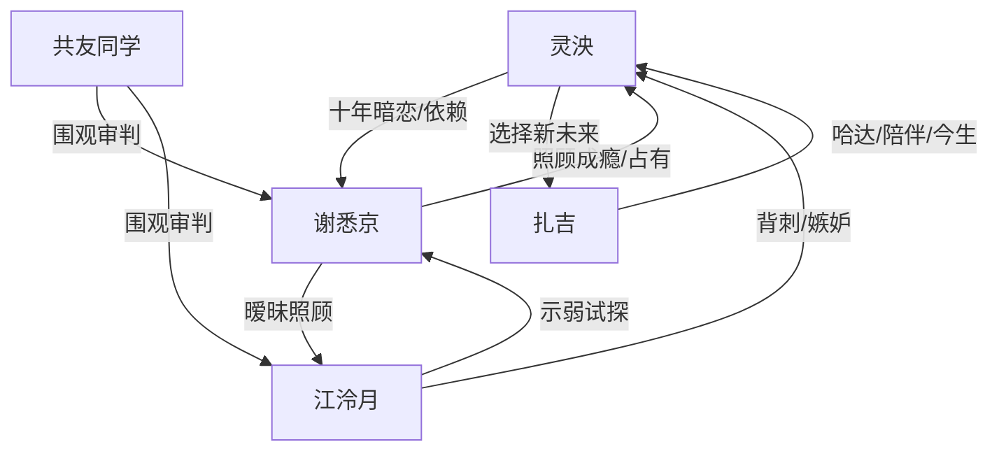

# 角色标签图谱

## 角色清单

### 灵泱 — 骄矜清醒型成长女主

- 叙事功能: 第一视角承受背叛并完成选择反杀。
- 核心标签: 十年暗恋、爱漂亮、后撤清醒
- 弧光: 依赖谢悉京的小尾巴 → 被抛弃的告白者 → 主动选择京大和新恋人
- 台词风格: 前期委屈质问，后期短句打脸。
- 关键行为: 独自登机、聚会公开追问、志愿误导、机场拒绝。
- 读者情绪关系: 前期心疼，后期爽和欣慰。

### 谢悉京 — 控制型照顾者/迟到悔恨竹马

- 叙事功能: 核心情绪债来源，制造背叛和占有欲冲突。
- 核心标签: 温柔学霸、照顾成瘾、占有欲强
- 弧光: 好哥哥姿态 → 暧昧背叛者 → 控制欲暴露 → 失去入场资格
- 台词风格: 哄劝式、解释式、后期崩溃求饶。
- 关键行为: 改签腾格里、照顾江泠月、楼梯间逼问、退学追京大。
- 读者情绪关系: 从失望到厌恶，再到看他崩塌的爽感。

### 江泠月 — 试探型绿茶闺蜜/自食其果者

- 叙事功能: 闺蜜背刺，推动三角关系暴露。
- 核心标签: 明艳话唠、嫉妒、示弱操控
- 弧光: 答应陪旅行 → 临时鸽掉 → 抢走谢悉京 → 被志愿反噬
- 台词风格: 伪善解释、尖锐羞辱、后期破防。
- 关键行为: 告密告白计划、邀谢悉京去腾格里、朋友圈刺激、聚会性羞辱。
- 读者情绪关系: 主要恨点之一，但最终被谢悉京反噬带来爽感。

### 扎吉 — 笨拙透明型补偿男主

- 叙事功能: 情感补偿和新生活象征。
- 核心标签: 藏区少年、纯粹陪伴、亮晶晶馈赠
- 弧光: 陌生送哈达者 → 倾听陪伴者 → 京大学长/男友
- 台词风格: 蹩脚普通话，真诚直球。
- 关键行为: 送哈达、带女主骑马、鼓励告白、送首饰、京大重逢。
- 读者情绪关系: 治愈、甜、替女主高兴。

### 共友/同学群 — 舆论见证者

- 叙事功能: 放大羞辱与打脸效果，提供公共审判场。
- 核心标签: 八卦、见证、助攻
- 弧光: 询问旅行异常 → 聚会围观 → 见证关系崩塌
- 台词风格: 直接、网感。
- 关键行为: 追问朋友圈、聚会真心话、替女主指责江泠月。
- 读者情绪关系: 强化“不是女主一个人觉得不对”的正义感。

## 关系网络

## 角色功能对照表（供改编参考）

| 原角色 | 极致标签 | 叙事功能 | 读者情绪功能 | 改编时必须保留的 |
|--------|---------|---------|-------------|---------------|
| 灵泱 | 骄矜清醒成长女主 | 承压与反杀主体 | 心疼→爽 | 她必须主动撤回，不靠别人替她报仇 |
| 谢悉京 | 控制型照顾者 | 情绪债主源 | 恨、看崩塌 | 温柔外壳与控制内核并存 |
| 江泠月 | 绿茶闺蜜 | 背刺与试探 | 厌恶、看反噬 | 她必须用“为你好”包装伤害 |
| 扎吉 | 笨拙补偿男主 | 治愈与未来 | 甜、安心 | 笨拙普通话、透明眼神、具体陪伴 |
| 共友 | 公共见证者 | 放大社死场 | 爽感放大 | 聚会/群聊等公开场域 |
