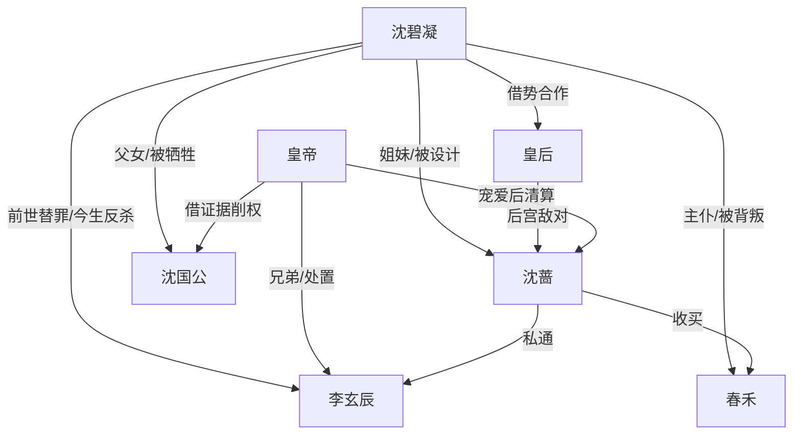

# 角色标签图谱

## 角色清单

### 沈碧凝 — 清醒重生庶女/证据型大女主
- 叙事功能: 主视角、复仇执行者、价值升维者
- 核心标签: 重生、冷静、反骨
- 弧光: 替罪牺牲品 → 当众自证者 → 女官掌权者
- 台词风格: 克制、清晰、证据导向
- 关键行为: 拒认小像、指出泪痣、借皇后验身、拿出情书账册、请旨入仕
- 读者情绪关系: 心疼转爽，最终敬佩

### 沈蔷 — 伪善贵妃/吸血长姐
- 叙事功能: 核心女反派，前世惨死根源
- 核心标签: 得宠、狠毒、操控
- 弧光: 高位贵妃 → 禁足冷宫 → 疯死雪夜
- 台词风格: 娇柔外壳下藏威胁
- 关键行为: 命令女主顶罪、设计洗去守宫砂、逼当众验身
- 读者情绪关系: 恨，期待她跌落

### 李玄辰 — 薄情亲王/伪深情偷情者
- 叙事功能: 男性压迫者、前世酷刑执行者
- 核心标签: 自私、虚伪、反咬
- 弧光: 尊贵亲王 → 当殿互咬 → 圈禁病死
- 台词风格: 深情表演、危机时甩锅
- 关键行为: 小像掉落、污蔑女主私情、危急时出卖沈蔷
- 读者情绪关系: 恶心、解恨

### 沈国公 — 弃女保荣父亲
- 叙事功能: 家族压迫具象化，第二清算对象
- 核心标签: 偏心、功利、冷血
- 弧光: 高位国公 → 当众弃女 → 抄家流放
- 台词风格: 道德审判、家族大义压人
- 关键行为: 掌掴女主、伪造私通史、请求逐出长姐保沈家
- 读者情绪关系: 恨，强化家庭伦理痛点

### 春禾 — 背主侍女/伪证工具人
- 叙事功能: 贴身背叛制造二次压迫
- 核心标签: 背叛、软弱、被拿捏
- 弧光: 十八年侍女 → 当殿作伪证 → 杖责沦落
- 台词风格: 哭诉式伪证
- 关键行为: 指认女主说谎、补刀守宫砂
- 读者情绪关系: 失望、愤怒

### 皇后 — 借势盟友/后宫权力支点
- 叙事功能: 让女主从孤立无援进入权力博弈
- 核心标签: 冷静、审时度势、制衡贵妃
- 弧光: 旁观者 → 验身裁判 → 背后扶持者
- 台词风格: 简短审视
- 关键行为: 接受验身、让太医查验药痕、扶持女主入仕
- 读者情绪关系: 安全感、期待合作

### 皇帝 — 权力裁判/颜面优先的清算者
- 叙事功能: 宫廷法则的执行者
- 核心标签: 多疑、重颜面、帝王权衡
- 弧光: 怀疑小像 → 震怒丑闻 → 借机削世家
- 台词风格: 短促威压
- 关键行为: 审问、准验身、废亲王贵妃、允女主入仕
- 读者情绪关系: 压迫与工具性爽点并存

## 关系网络

## 角色功能对照表（供改编参考）

| 原角色 | 极致标签 | 叙事功能 | 读者情绪功能 | 改编时必须保留的 |
|--------|---------|---------|-------------|---------------|
| 沈碧凝 | 清醒重生庶女 | 复仇主线 | 心疼、爽、敬佩 | 拒绝替罪+证据反杀+价值升维 |
| 沈蔷 | 伪善贵妃 | 核心女反派 | 恨 | 亲缘压迫与高位跌落 |
| 李玄辰 | 薄情亲王 | 男性施害者 | 恶心、解恨 | 前世酷刑与今生甩锅 |
| 沈国公 | 弃女父亲 | 家族压迫 | 亲情痛点 | 当众弃女、最终被揭贪腐 |
| 春禾 | 背主侍女 | 二次背叛 | 被背刺感 | 贴身证词反咬 |
| 皇后 | 权力盟友 | 破局支点 | 安全感 | 与反派利益冲突，能提供公正验身 |
