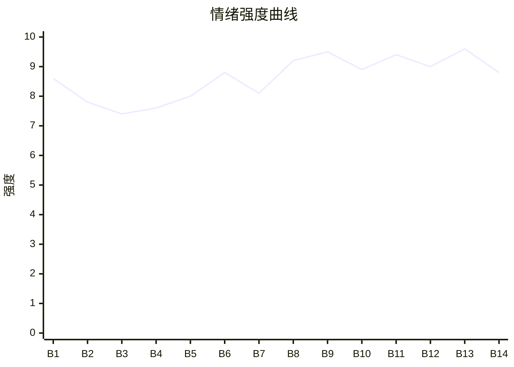

# Beat Sheet 节拍器

## 全文概况

- 总字数: 约 11800 字
- 节拍数: 14 幕
- 核心母题（Logline）: 被前世未婚妻和假少爷害死的真少爷重生后，主动脱离原生家庭，成为霍家天骄与顶尖医生，最终揭穿假少爷骗局、清算旧情并回归真正家人。
- 情绪模式: 前世极致打压 → 重生剥离 → 身份反差 → 真相反杀 → 命债偿还 → 精神断缘

## 节拍详表

### Beat 1: 重生阻断认亲 [开篇-“那陆家和我都留不得你了”]
- **字数**: 约 520 字（占比 4.4%）
- **核心事件**: 男主交代前世惨死，重生回五岁认亲日，却被同样重生的许瑜欢阻断认亲。
- **情绪标签**: 震惊、憋屈、宿命反讽
- **情绪强度**: 8.6/10
- **情绪方向**: ⚡突变
- **冲突类型**: 大转折
- **悬念钩子**: 许瑜欢为何也重生？男主这次会如何选择？
- **叙事速度**: 快
- **对话占比**: 22%
- **reversal_mechanism**: [M5, M6]
- **hook_strength**: 8.7/10
- **关键句**: “看着她充满嫌恶的表情，我知道她也重生了。”
- **原文摘录**: 前世被认回陆家后，我为了照顾体弱多病的假少爷陆洛白而选择了学医。他却装作病情恶化，污蔑我不仅救不了他，还想抢走他的一切。我的未婚妻许瑜欢信以为真，联合陆家将我扫地出门。不久后，我患上肺结核，病死在街头。再醒来时，我回到了五岁被接回陆家的那天。许瑜欢拦在亲生父母面前，指着我说：“叔叔，阿姨，别弄错了，这个人根本不是你们的亲生儿子。”看着她充满嫌恶的表情，我知道她也重生了。亲生父母失望离开后，她递给我一块糖果。“陆家有一个少爷就够了，既然你妄图抢走他的位置，那陆家和我都留不得你了。”

### Beat 2: 陆星野已死 [“我用力攥紧”-“现在活着的，是我自己”]
- **字数**: 约 420 字（占比 3.6%）
- **核心事件**: 男主消化二次抛弃，决定放弃陆家身份，完成心理死亡。
- **情绪标签**: 心痛、清醒、断舍离
- **情绪强度**: 7.8/10
- **情绪方向**: ↓下降后转稳
- **冲突类型**: 微冲突
- **悬念钩子**: 他不回陆家后会被谁接住？
- **叙事速度**: 中
- **对话占比**: 0%
- **reversal_mechanism**: [M5]
- **hook_strength**: null
- **关键句**: “我用力地擦了擦眼角，告诉自己，陆星野已经死了。”
- **原文摘录**: 我用力攥紧了那颗糖，坚硬的棱角几乎要刺破我的掌心。是啊，在前世的她看来，我就是一个恶毒的嫉妒者，一个治不好陆洛白的废物。既然前世陆洛白还是因为我而恶化了。那么重来一世，我这个心机深重的人，自然没有再被回陆家的必要。我笑了，将眼泪憋了回去。我用力地擦了擦眼角，告诉自己，陆星野已经死了。现在活着的，是我自己。

### Beat 3: 霍家收养与新命名 [“我转身走回”-“能成为一块无价的美玉”]
- **字数**: 约 980 字（占比 8.3%）
- **核心事件**: 霍老爷子在孤儿院选中男主，赐名霍星野，给他新的身份和家。
- **情绪标签**: 温暖、补偿、命运翻盘
- **情绪强度**: 7.4/10
- **情绪方向**: ↑上升
- **冲突类型**: 微冲突
- **悬念钩子**: 霍家身份将如何反打陆家？
- **叙事速度**: 中
- **对话占比**: 35%
- **reversal_mechanism**: [M2, M5]
- **hook_strength**: null
- **关键句**: “从今天起，你就叫霍星野。”
- **原文摘录**: 我转身走回了孤儿院的角落。没过多久，一辆黑色的红旗轿车停在了门口。院长领着一位头发花白老人走了进来。孤儿院里所有的孩子都沸腾了，像一群小麻雀一样叽叽喳喳地围了上去，争先恐后地表现自己。只有我，安静地待在不起眼的角落里，像一个局外人。霍老爷子注意到了我。他拨开人群，拄着拐杖，一步步朝我走来。“小娃娃，你怎么一个人待在这儿？他们不喜欢你吗？”我摇了摇头，抬起小脸，将手里那颗被我攥得有些温热的糖果递给了他。“爷爷，吃糖。”他接过那颗糖，剥开糖纸，放进嘴里。“嗯，很甜。”随后问道：“你叫什么名字？”“院长叫我星野。”“星野……你想不想跟爷爷回家？做我的孙子。”我没有丝毫犹豫。“我愿意。”他开怀大笑。“好！好！从今天起，你就叫霍星野。”他牵起我的手。“星垂平野阔，月涌大江流，星野，是个好名字。”“孩子，爷爷希望你，能成为一块无价的美玉。”

### Beat 4: 二十年成长为医学权威 [“我成了霍家的天之骄子”-“会永远地消失”]
- **字数**: 约 820 字（占比 6.9%）
- **核心事件**: 男主在霍家爱意中成长，成为最年轻的内科医生与研究者。
- **情绪标签**: 爽、安定、价值补偿
- **情绪强度**: 7.6/10
- **情绪方向**: ↑上升
- **冲突类型**: 无到微冲突
- **悬念钩子**: 陆家迟早会重新闯入。
- **叙事速度**: 快
- **对话占比**: 8%
- **reversal_mechanism**: [M2]
- **hook_strength**: null
- **关键句**: “二十年后，我成了国内最年轻，也最负盛名的内科医生和医学研究者之一。”
- **原文摘录**: 我成了霍家的天之骄子。霍老爷子将我视若珍宝，亲自教我读书写字，教我为人处世的道理。爷爷的子女们，虽然工作繁忙，但每次回来都会给我带各种新奇的礼物，真心实意地关心我。最疼我的，是我那个大我十岁的姐姐，霍明月。她第一次见到我时，酷酷的脸上就露出了温柔的笑。“我们霍家的小少爷，谁都不能碰。”在这样的爱意包围下，我几乎快要忘记了前世的伤痛。我努力地学习，从小学到高中，我的成绩永远是第一。各种竞赛的奖杯和证书，堆满了我的房间。大学时，我毫不犹豫地选择了医学。因为我知道，陆洛白的病是陆家和许瑜欢心中永远的痛。也是悬在我头顶的一把刀。二十年后，我成了国内最年轻，也最负盛名的内科医生和医学研究者之一。日子平静而充实，我以为陆家那些人，会永远地消失在我的生命里。

### Beat 5: 许瑜欢求医重逢 [“直到那天”-“转身摔门而去”]
- **字数**: 约 900 字（占比 7.6%）
- **核心事件**: 许瑜欢带着旧傲慢求医，发现专家竟是被她抛弃的男主。
- **情绪标签**: 尴尬、期待打脸、冷爽
- **情绪强度**: 8.0/10
- **情绪方向**: ↑上升
- **冲突类型**: 大转折
- **悬念钩子**: 她会不会意识到自己当年错失了什么？
- **叙事速度**: 快
- **对话占比**: 45%
- **reversal_mechanism**: [M2, M5]
- **hook_strength**: null
- **关键句**: “她怎么也想不到，她费尽心思想要寻找的医学专家，竟然会是她二十年前抛弃掉的我。”
- **原文摘录**: 直到那天，我的助理敲开我办公室的门。“霍医生，外面有一位叫许瑜欢的女士指名要见您。”“她说想请您为她的未婚夫看病，预约了我们最贵的专家号。”听到这个名字，我的心脏还是不受控制地抽动了一下。“让她进来吧。”一个气质清冷的女人走了进来。许瑜欢见到我的第一眼，就愣住了。她怎么也想不到，她费尽心思想要寻找的医学专家，竟然会是她二十年前抛弃掉的我。“你……就是霍医生？”我点头：“许小姐，请坐，请说一下你未婚夫的病情。”她审视着我：“你真的是医生？你有多大的把握能治好我未婚夫？”我说：“看来许小姐对我的专业能力不太信任。既然如此，那这次的问诊就取消吧。小李，送客。”许瑜欢脸色难看，转身摔门而去。

### Beat 6: 实验楼外身份羞辱反打 [“下班后”-“她当然认得霍氏集团的长公主”]
- **字数**: 约 1450 字（占比 12.3%）
- **核心事件**: 许瑜欢怀疑男主报复，男主装作不记得并反讽感谢；霍明月登场坐实霍家身份。
- **情绪标签**: 打脸、羞辱回旋、扬眉吐气
- **情绪强度**: 8.8/10
- **情绪方向**: ↑上升
- **冲突类型**: 大转折
- **悬念钩子**: 许瑜欢会为了陆洛白再次求他吗？
- **叙事速度**: 快
- **对话占比**: 55%
- **reversal_mechanism**: [M2, M3, M5]
- **hook_strength**: null
- **关键句**: “报复你？你配吗？”
- **原文摘录**: 下班后，许瑜欢突然出现在实验室的大楼门口。“陆星野，我警告你。不管你现在是什么身份，都别想伤害洛白。”我说：“许小姐，我姓霍，叫霍星野，请你别叫错了。而且，我不认识你，更不认识你的未婚夫。”她愣住：“你不记得我了？”我假装回忆：“哦——原来是你啊。实在不好意思，二十年前的事，太久远了，我早就忘了。毕竟，每天都有那么多重要的研究要做，哪有时间去记那些鸡毛蒜皮的小事呢？”她咬牙说我怀恨在心。我嗤笑：“报复你？你配吗？说起来，我还要感谢你呢，要不是你当年那么坚决地阻止，我又怎么有机会成为霍万山的孙子？”她讥讽我不可能进霍家。话音刚落，黑色宾利停下，霍明月下车为我披外套：“星野，怎么还不走？爷爷都等急了。”许瑜欢认得霍氏集团长公主，也知道她有一个被霍家捧在手心里的弟弟，只是没想到那个弟弟竟然会是我。

### Beat 7: 陆洛白诊室露馅 [“第二天”-“一言不发地走出了诊室”]
- **字数**: 约 1100 字（占比 9.3%）
- **核心事件**: 陆家带陆洛白复诊，陆洛白在诊室内露出恶毒真面目，男主完成检查并暗中取证。
- **情绪标签**: 厌恶、压迫回忆、反杀蓄力
- **情绪强度**: 8.1/10
- **情绪方向**: →平稳蓄压
- **冲突类型**: 微冲突
- **悬念钩子**: 男主会如何公开揭穿他？
- **叙事速度**: 中
- **对话占比**: 42%
- **reversal_mechanism**: [M3, M6]
- **hook_strength**: null
- **关键句**: “前世，他也是这样，人前一套，人后一套。”
- **原文摘录**: 第二天，许瑜欢重新申请专家问诊。下午三点，陆家一家人带着陆洛白出现。许瑜欢道歉，陆父陆母眼神复杂。我说：“病人留下来，家属请在外面等候。”门关上后，陆洛白的羸弱瞬间消失，换成嫉妒和怨毒。“陆星野，不对，我应该叫你霍星野。没想到啊，你还真是命大。”他说我攀上霍家高枝，又说：“在瑜欢心里，你永远都比不上我一根手指头！”前世他也是这样，人前一套，人后一套，打碎花瓶、撕掉文件再嫁祸给我。我给他做听诊、触诊，一丝不苟。做完检查后，我沉着脸，一言不发地走出了诊室。

### Beat 8: 无病真相公开 [“外面，陆家和许瑜欢”-“因为陆洛白，他根本就没病”]
- **字数**: 约 540 字（占比 4.6%）
- **核心事件**: 男主先宣布医院治不了，制造绝望，再抛出“根本没病”的爆点。
- **情绪标签**: 震惊、强反转、爽点前夜
- **情绪强度**: 9.2/10
- **情绪方向**: ⚡突变
- **冲突类型**: 大转折
- **悬念钩子**: 他如何证明陆洛白没病？
- **叙事速度**: 快
- **对话占比**: 50%
- **reversal_mechanism**: [M3, M6]
- **hook_strength**: null
- **关键句**: “因为陆洛白，他根本就没病！”
- **原文摘录**: 外面，陆家和许瑜欢正焦急等待。许瑜欢问：“霍医生，洛白他……怎么样？”陆母抓着我的手臂：“医生，我儿子的病，到底还有没有救啊？”我一脸不耐烦，当着所有人的面说：“你未婚夫的病，我们院所治不了！”所有人呼吸一滞。陆母腿一软，许瑜欢讥讽我：“你是不是在公报私仇！”陆洛白也出来挤出眼泪：“瑜欢，算了，我就知道我的病是治不好的，不怪霍医生……”我冷冷看着他们，抛出下半句话：“因为陆洛白，他根本就没病！”

### Beat 9: 录音与报告双证据反杀 [“空气瞬间凝固”-“欺骗了他们所有人”]
- **字数**: 约 1350 字（占比 11.4%）
- **核心事件**: 男主用专业判断、诊室录音和药物残留报告坐实陆洛白装病，陆家与许瑜欢信念崩塌。
- **情绪标签**: 痛快、公开处刑、真相崩塌
- **情绪强度**: 9.5/10
- **情绪方向**: ↑上升
- **冲突类型**: 大转折
- **悬念钩子**: 陆洛白为什么装病？前世真相是否另有隐情？
- **叙事速度**: 快
- **对话占比**: 48%
- **reversal_mechanism**: [M3, M6]
- **hook_strength**: null
- **关键句**: “现在，你们还觉得，是我在血口喷人吗？”
- **原文摘录**: 空气瞬间凝固。许瑜欢怒吼我胡说，陆父陆母要求解释，只有陆洛白脸色惨白。我说他只是肾脏功能偏弱，远不到换肾程度，严重症状都是装出来的，可能服用了能暂时引起类似尿毒症症状的药物。许瑜欢要证据。我拿出手机播放录音：“霍星野，没想到啊，你还真是命大。”“怎么？当上医生了不起啊？不还是要来给我看病？”录音里的他与此刻柔弱形象判若两人。许瑜欢的愤怒一点点龟裂。陆洛白大喊是我下套。我说：“你不是说你很乏力吗，但刚才你的声音中气很足啊。”随后把检测报告甩在许瑜欢脸上：“这是从你未婚夫血液里检测出的药物残留成分。现在，你们还觉得，是我在血口喷人吗？”许瑜欢意识到她珍视保护的人从头到尾都在欺骗她，欺骗了他们所有人。

### Beat 10: 陆洛白崩溃认罪 [“为什么？”-“将门重重地关上”]
- **字数**: 约 760 字（占比 6.4%）
- **核心事件**: 陆洛白承认装病出于恐惧与占有，男主驱逐众人。
- **情绪标签**: 厌恶、清算、断绝
- **情绪强度**: 8.9/10
- **情绪方向**: ↑上升后回落
- **冲突类型**: 大转折
- **悬念钩子**: 许瑜欢是否会提前世悔恨？
- **叙事速度**: 快
- **对话占比**: 50%
- **reversal_mechanism**: [M3, M5]
- **hook_strength**: null
- **关键句**: “我只是想让他离我们远远的！我有什么错！”
- **原文摘录**: “为什么？”许瑜欢声音干涩，“洛白，你为什么要这么做？”陆洛白被逼到绝境，歇斯底里大哭：“因为我怕！我怕你们找回亲生儿子后，就不要我了。我怕你们把所有的爱都给了别人！”他指着我和许瑜欢：“我只是想让他离我们远远的！我有什么错！”前世，为了这个莫须有的病，我被亲生父母和未婚妻厌恶，最终惨死。这一世，我连陆家的门都没踏入，他还在用这个谎言欺骗所有人。我只觉得反胃。“说完了吗？说完了，就带着你的家人，从我的眼前消失。从今往后，别再让我看到你们。”我转身进办公室，将门重重关上。

### Beat 11: 许瑜欢前世悔恨与死因真相 [“几天后的一个晚上”-“轰然倒塌”]
- **字数**: 约 1350 字（占比 11.4%）
- **核心事件**: 许瑜欢承认两人都重生并道歉，男主揭开陆洛白前世真正死因，击碎她的赎罪逻辑。
- **情绪标签**: 迟来悔恨、冷酷真相、精神处刑
- **情绪强度**: 9.4/10
- **情绪方向**: ⚡突变
- **冲突类型**: 大转折
- **悬念钩子**: 许瑜欢会如何偿还前世命债？
- **叙事速度**: 中
- **对话占比**: 55%
- **reversal_mechanism**: [M3, M5, M6]
- **hook_strength**: null
- **关键句**: “你的后悔，对我来说，一文不值。”
- **原文摘录**: 几天后的晚上，我术后走出手术室，看见许瑜欢。她说：“我是为前世的我，来跟你道歉的。”她承认知道我也是重生的，承认前世对不起我，说她从我死后没有一天不悔恨，最后只找到了我的尸骨。我笑了：“许瑜欢，你知道吗？你的后悔，对我来说，一文不值。”我告诉她：“其实，前世的陆洛白，根本不是因为病情恶化死的。他是为了和狐朋狗友追求刺激，磕了药后死的。”那时距离我被赶出陆家已过去大半年，他原本的身体早被我调理好。许瑜欢晃了一下。她一直以为陆洛白的死是她的罪孽，是她逼我离开的恶果。可现在，一切都只是笑话。她为了不值得的人，伤害了真正无辜的爱人，背负半生悔恨。她建立起来的整个世界，在这一刻，轰然倒塌。

### Beat 12: 陆家失序与慈善晚宴袭击 [“我彻底将陆家”-“浓硫酸！”]
- **字数**: 约 1250 字（占比 10.6%）
- **核心事件**: 陆家崩坏，陆洛白失去宠爱后在晚宴持硫酸袭击男主。
- **情绪标签**: 报应、危机、恶意爆发
- **情绪强度**: 9.0/10
- **情绪方向**: ↑上升到突变
- **冲突类型**: 大转折
- **悬念钩子**: 男主是否会毁容？谁会挡下？
- **叙事速度**: 快
- **对话占比**: 38%
- **reversal_mechanism**: [M5, M6]
- **hook_strength**: null
- **关键句**: “那是一个小小的玻璃瓶，里面装着深褐色的液体。是浓硫酸！”
- **原文摘录**: 我重新忙于实验室和手术台。偶尔听说陆家彻底乱套：陆父陆母收回陆洛白的银行卡和豪车，几乎将他软禁；陆洛白撕下伪装，歇斯底里。许瑜欢则把自己关在房间里。后来我代表霍家出席慈善晚宴。陆洛白穿着廉价西服混进来，眼里全是疯狂嫉妒。“都是你！你把我的一切都毁了！”他被保安架住时恶毒地说：“我得不到的，你也别想得到！”随后挣脱保安，从包里掏出一个小玻璃瓶，里面装着深褐色液体。是浓硫酸！

### Beat 13: 许瑜欢挡硫酸与手术两清 [“我的瞳孔猛地一缩”-“划清界限”]
- **字数**: 约 1500 字（占比 12.7%）
- **核心事件**: 许瑜欢替男主挡下硫酸，男主以医生身份救她，宣布恩怨两清、从此陌路。
- **情绪标签**: 震动、偿债、冷静切割
- **情绪强度**: 9.6/10
- **情绪方向**: ⚡突变后回落
- **冲突类型**: 大转折
- **悬念钩子**: 男主是否会原谅她？
- **叙事速度**: 中
- **对话占比**: 34%
- **reversal_mechanism**: [M3, M5]
- **hook_strength**: null
- **关键句**: “不是原谅，而是为了彻底地与你，与你们许家和陆家，划清界限。”
- **原文摘录**: 我下意识闭眼，却没有等来剧痛。一个身影挡在我面前，浓硫酸尽数泼在许瑜欢后背上。她死死将我护在怀里。“星野，这是我欠你的……前世，我欠你一条命。这一世，我还给你……”她失去意识。许家父母求我救她。我说：“她是我的病人，我自然会救她。但，仅此而已。”手术由我主刀。前世我为救陆洛白日夜操劳，她却在手术室外指责我居心叵测。如今躺在这里的人变成了她。我不是在救许瑜欢，我是在救一个病人。十小时后手术成功。我说：“从她为我挡下那瓶硫酸开始，前世今生，我们之间的恩怨，就两清了。从此以后，我们就是陌生人。”许瑜欢，我救了你的命。不是原谅，而是为了彻底地与你，与你们许家和陆家，划清界限。

### Beat 14: 荣耀领奖与陌路结尾 [“许瑜欢的伤养了很久”-结尾]
- **字数**: 约 1250 字（占比 10.6%）
- **核心事件**: 陆洛白获刑，男主新药成功、站上医学巅峰，与许瑜欢擦肩而过，回到真正家人身边。
- **情绪标签**: 圆满、释然、终极补偿
- **情绪强度**: 8.8/10
- **情绪方向**: ↑上升后平稳
- **冲突类型**: 大转折后的收束
- **悬念钩子**: 无，完成精神闭环。
- **叙事速度**: 中
- **对话占比**: 18%
- **reversal_mechanism**: [M3, M5]
- **hook_strength**: null
- **关键句**: “这，才是我的人生。这，才是我的家人。”
- **原文摘录**: 许瑜欢醒来后得知我留下“恩怨两清，从此陌路”，沉默很久。陆洛白因故意伤害罪被判十年，法庭上喊爸爸妈妈，可陆父陆母没有看他一眼。我的新药研发取得突破性成功，震惊国际医学界。颁奖典礼那天，我站在世界医学最高殿堂的领奖台上，看见爷爷和姐姐坐在第一排，他们脸上是骄傲和自豪。我的心里被巨大的幸福感填满。这，才是我的人生。这，才是我的家人。典礼结束后，我在人群缝隙里看见许瑜欢。她穿旧外套，背部僵硬，远远看着我。我们的目光交汇一瞬。我平静移开视线，挽着姐姐说：“姐，我们回家吧，我饿了。”我们一家人笑着闹着从她身边走过。许瑜欢，你看。没有你，我过得很好。甚至，比你想象中，好上一万倍。

## 情绪曲线可视化

## 节拍密度检测

- 平均每 843 字一个节拍
- 微冲突密度: 每约 950 字一次
- 大转折密度: 每约 1200 字一次
- 判定: 符合高频节拍器标准；中后段几乎每 1000-1500 字有一次身份、真相或危机升级。

## 反转机制清单(Reversal Mechanisms)

| 机制 ID | 机制名 | 承载 Beat | 关键段落/金句 | 等价改编提示 |
|--------|--------|-----------|--------------|-------------|
| M2 | 身份反差爆发 | Beat 3-6, Beat 14 | “她当然认得霍氏集团的长公主……那个弟弟，竟然会是我。” | 身份载体可换，但“被抛弃者成为更高阶资源拥有者”的反差层级不能降。 |
| M3 | 因果回旋反讽 | Beat 6, 9, 11, 13-14 | “你的后悔，对我来说，一文不值。” “我不是在救许瑜欢。我是在救一个病人。” | 必须保留施害逻辑反身应用：当年拿“病”和“救人”压主角，今生让他们求主角救命。 |
| M5 | 温度反转曲线 | Beat 1-2, 5-6, 11, 13-14 | “前世，我欠你一条命。这一世，我还给你……” | 温度必须从误爱/厌弃到悔恨偿命，最终主角不回温，只做冷静切割。 |
| M6 | 多层递进反转 | Beat 1, 6, 8-9, 11, 13 | 重生互知、霍家身份、无病证据、前世死因、命债两清 | 至少保留 4 层反转，层级从身份到事实到命债到价值归属递进。 |
