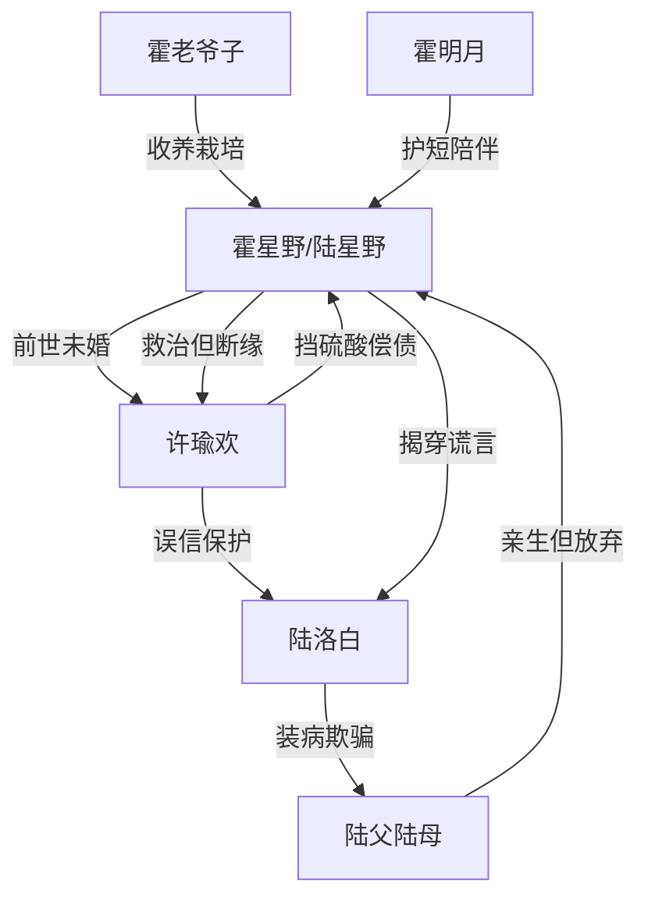

# 角色标签图谱

## 角色清单

### 霍星野/陆星野 — 清醒重生男主
- 叙事功能: 复仇轴心、道德坐标、身份反差承载者
- 核心标签: 重生者、医学天才、断缘者
- 弧光: 被抛弃的真少爷 → 霍家天骄 → 世界级医生 → 彻底断缘
- 台词风格: 短句、冷静、反问精准
- 关键行为: 放弃陆家、接受霍家、揭穿装病、救许瑜欢但不原谅
- 读者情绪关系: 心疼、代入、爽

### 许瑜欢 — 悔恨前未婚妻
- 叙事功能: 前世施害者、今生悔恨承载者、命债偿还者
- 核心标签: 误信者、重生者、迟来悔悟
- 弧光: 嫌恶阻断认亲 → 求医傲慢 → 信念崩塌 → 挡硫酸偿命 → 永失所爱
- 台词风格: 前期质疑警告，后期沙哑道歉
- 关键行为: 阻止认亲、求医、道歉、挡硫酸
- 读者情绪关系: 前期恨，后期复杂但不可回收

### 陆洛白 — 伪病假少爷
- 叙事功能: 核心反派、谎言源头、情绪债制造者
- 核心标签: 装病、绿茶男、占有型恶人
- 弧光: 被偏爱的假少爷 → 被揭穿的骗子 → 失宠疯子 → 入狱
- 台词风格: 人前柔弱，人后尖酸刻薄
- 关键行为: 装病污蔑、挑衅男主、晚宴泼硫酸
- 读者情绪关系: 憎恶、期待报应

### 陆父陆母 — 失格亲生父母
- 叙事功能: 亲情压迫背景、误判的共同责任人
- 核心标签: 偏听偏信、迟钝、自食恶果
- 弧光: 放弃亲子 → 求医局促 → 信念崩塌 → 失去养子
- 台词风格: 焦急、质问、后期沉默
- 关键行为: 前世扫地出门、今生信任陆洛白、最后不看陆洛白
- 读者情绪关系: 怨、冷眼旁观

### 霍老爷子 — 真正家人的源头
- 叙事功能: 补偿性亲情、男主新身份赋予者
- 核心标签: 伯乐、家长、庇护者
- 弧光: 孤儿院认养 → 培养男主 → 见证荣耀
- 台词风格: 温厚、有文化感
- 关键行为: 收养男主、赐名霍星野、托举其人生
- 读者情绪关系: 温暖、安心

### 霍明月 — 护短姐姐
- 叙事功能: 霍家身份具象化、亲情补偿代表
- 核心标签: 长公主、护弟、体面强势
- 弧光: 保护男主 → 公开坐实身份 → 陪他回家
- 台词风格: 温柔直接
- 关键行为: 为男主披外套、带他离开、结尾一起回家
- 读者情绪关系: 爽、羡慕、安心

### 助理小李 — 读者嘴替
- 叙事功能: 外部评价、爽点强化、八卦信息传递
- 核心标签: 忠诚、直白、吐槽
- 弧光: 维护医生权威 → 吐槽许瑜欢和陆家
- 台词风格: 口语化、情绪直接
- 关键行为: 替男主说话、传递陆家后续
- 读者情绪关系: 代替读者骂人，增强痛快感

## 关系网络

## 角色功能对照表（供改编参考）

| 原角色 | 极致标签 | 叙事功能 | 读者情绪功能 | 改编时必须保留的 |
|--------|---------|---------|-------------|---------------|
| 霍星野 | 清醒断缘男主 | 主视角与反杀执行者 | 心疼+爽 | 不求原谅、不回头 |
| 许瑜欢 | 悔恨前未婚妻 | 火葬场承载者 | 先恨后复杂 | 伤害不可被轻易洗白 |
| 陆洛白 | 装病绿茶男 | 核心反派 | 恨点制造 | 人前人后两面与主动伤害 |
| 陆父陆母 | 失格亲人 | 家庭误判背景 | 憋屈来源 | 偏信假少爷 |
| 霍家 | 补偿性家人 | 新人生托举 | 温暖补偿 | 给男主真正归属 |
