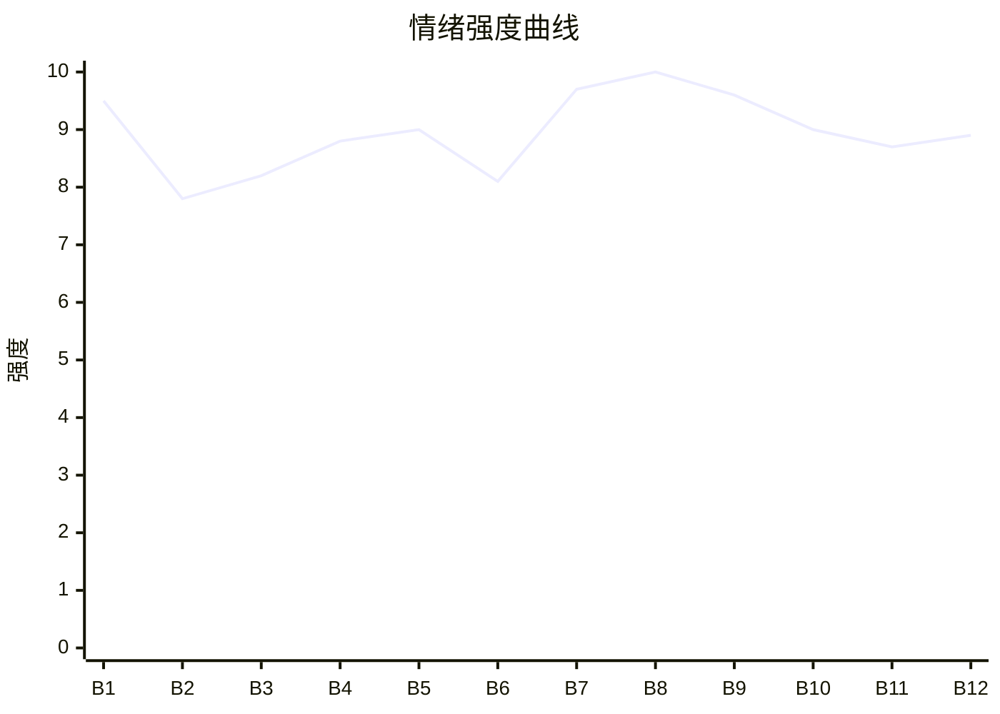

# Beat Sheet 节拍器

## 全文概况

- 总字数: 约 9150 字
- 节拍数: 12 幕
- 核心母题（Logline）: 被吸血原生家庭害死全家的重生女主，为守住丈夫女儿，识破姐姐假死骗债局，并借法律、舆论与亲情断舍离完成清算。
- 情绪模式: 前世惨死压迫 → 重生识局 → 亲情围剿 → 女儿危机 → 封棺反杀 → 法律重判 → 小家补偿

## 节拍详表

### Beat 1: 前世全家惨死与重生 [第1章开头-“又回到了姐姐下葬当天”]

- **字数**: 约 760 字（占比 8.3%）
- **核心事件**: 女主前世替假死姐姐还债十年，害得女儿被强奸致死、丈夫猝死、自己跳楼，死前发现骗局后重生。
- **情绪标签**: 震惊、痛恨、悔恨
- **情绪强度**: 9.5/10
- **情绪方向**: ⚡突变
- **冲突类型**: 大转折
- **悬念钩子**: 女主回到下葬当天，会不会识破并反杀？
- **叙事速度**: 快
- **对话占比**: 30%
- **reversal_mechanism**: [M3, M5]
- **hook_strength**: 9.2/10
- **关键句**: “临死前却看见，姐姐光鲜亮丽靠在债主杨学武怀里。”
- **原文摘录**: “姐姐欠下三百万后意外身亡。葬礼上，爸妈哭着对我说，‘咱们亏人不亏心，人死了债不能烂。’……直到女儿十三岁，我加班没来得及接她，她被强奸致死。丈夫江科得知消息心梗猝死……女儿下葬当晚，我还完了最后的三十万，在内疚中从高楼跳下。临死前却看见，姐姐光鲜亮丽靠在债主杨学武怀里。‘真没用，三百万十年才还上，害得我们夫妻现在才团圆。’……我死不瞑目。再睁眼，又回到了姐姐下葬当天……”

### Beat 2: 灵堂逼债与父母道德绑架 [第1章“依然啊”-“这债，我们还”]

- **字数**: 约 680 字（占比 7.4%）
- **核心事件**: 父母按前世剧本哭灵，杨学武带壮汉逼债，父母再次把三百万债务推向女主。
- **情绪标签**: 憋屈、警觉、厌恶
- **情绪强度**: 7.8/10
- **情绪方向**: ↑上升
- **冲突类型**: 微冲突
- **悬念钩子**: 女主是否会像前世一样认债？
- **叙事速度**: 中快
- **对话占比**: 55%
- **reversal_mechanism**: [M3]
- **hook_strength**: null
- **关键句**: “佳佳，以后咱们一起还这三百万共渡难关好么？”
- **原文摘录**: “‘依然啊，你怎么走得这么早，简直是挖了爸妈的心肝！’……杨学武大摇大摆走进客厅，把欠款单往桌上一拍。‘你们闺女临死前可欠了我三百万，现在人是死了，债怎么说？’……我爸看着欠条，眼神逐渐变得坚定。‘无论如何，我们周家亏人不亏心，人死了债不能烂！’‘这债，我们还！’他转头，苍老的视线在人群中准确找到我。‘佳佳，以后咱们一起还这三百万共渡难关好么？’”

### Beat 3: 女主发现棺材气孔并拒绝认债 [第1章“我却注意到”-章末]

- **字数**: 约 520 字（占比 5.7%）
- **核心事件**: 女主发现棺材有气孔，确认姐姐假死，当众拒绝替姐姐还债。
- **情绪标签**: 清醒、愤怒、期待
- **情绪强度**: 8.2/10
- **情绪方向**: ↑上升
- **冲突类型**: 大转折
- **悬念钩子**: 女主拒绝后，父母和杨学武会如何加码？
- **叙事速度**: 快
- **对话占比**: 35%
- **reversal_mechanism**: [M1, M3]
- **hook_strength**: null
- **关键句**: “姐姐自己欠的债，凭什么要我来还？”
- **原文摘录**: “我却注意到，杨学武的视线一直盯着棺材。我蹲下身假装系鞋带……红木棺材在侧面开了几个气孔，隐约能看见里面微动的布料。果然！周依然根本没死，这场葬礼从一开始就是他们夫妻俩做的局！……今生，我一字一顿大声宣布。‘姐姐自己欠的债，凭什么要我来还？’”

### Beat 4: 父母围攻与七十万被盗转 [第2章开头-“那七十万分明是我卡里的所有存款”]

- **字数**: 约 930 字（占比 10.2%）
- **核心事件**: 父母和亲戚用孝道围剿女主，母亲偷绑女主银行卡转走七十万。
- **情绪标签**: 窒息、愤怒、背叛
- **情绪强度**: 8.8/10
- **情绪方向**: ↑上升
- **冲突类型**: 微冲突
- **悬念钩子**: 女主会不会当场揭开装死真相？
- **叙事速度**: 中
- **对话占比**: 50%
- **reversal_mechanism**: [M3, M5]
- **hook_strength**: null
- **关键句**: “那七十万分明是我卡里的所有存款！”
- **原文摘录**: “我妈从我爸怀里起身，指着我破口大骂。‘你个不孝女！’……亲戚们看不下去了。‘佳佳，你爸妈给你花了那么多钱，能帮就帮一把吧。’……事实是周依然考了两年还是只有两百分，我却考了985。……我妈一巴掌扇上来。然后哭着掏出手机，当场给杨学武转了七十万！……与此同时，我手机‘叮’的一声，显示余额为零。脑子‘嗡’一下炸了。”

### Beat 5: 佛珠暴露父母共犯身份 [第2章后半-章末]

- **字数**: 约 470 字（占比 5.1%）
- **核心事件**: 女主从父亲手腕佛珠认出父母早知真相，决定不立即揭穿，而是让他们身败名裂。
- **情绪标签**: 惊雷、恨意、冷静
- **情绪强度**: 9.0/10
- **情绪方向**: ⚡突变
- **冲突类型**: 大转折
- **悬念钩子**: 女主将如何让全家身败名裂？
- **叙事速度**: 快
- **对话占比**: 20%
- **reversal_mechanism**: [M6, M5]
- **hook_strength**: null
- **关键句**: “爸妈从头到尾都知道真相。”
- **原文摘录**: “我却听到棺材里传来几不可闻的轻笑。周依然也在嘲笑吧……视线却忽然定格在我爸的手腕上。那里有个菩提串，碧绿的佛珠，上门刻了周依然名字的缩写。跟杨学武手上的一模一样。前世他亲口承认过，自己送了老丈人一条！‘轰——’像惊雷劈开浓雾，所有事都通了。爸妈从头到尾都知道真相。他们故意演戏，想榨干我的每一分血！”

### Beat 6: 女主报警并试探死亡证明 [第3章]

- **字数**: 约 650 字（占比 7.1%）
- **核心事件**: 女主压下情绪报警，用死亡证明和上香习俗试探父母，准备掀棺。
- **情绪标签**: 压抑、谋划、紧张
- **情绪强度**: 8.1/10
- **情绪方向**: ↑上升
- **冲突类型**: 微冲突
- **悬念钩子**: 女主能否成功掀棺？
- **叙事速度**: 中快
- **对话占比**: 45%
- **reversal_mechanism**: [M1]
- **hook_strength**: null
- **关键句**: “现在——我就给我的好姐姐上香！”
- **原文摘录**: “恨意冲到极致，理智却前所未有冷静下来。周家三口伪善势力，想要我的钱还要博个好名声。直接捅破太便宜他们了，我要他们身败名裂！……我在手机上按下三个数字。抬头看了眼棺材，突然轻声问。‘我姐当初到底是怎么死的？哪家医院，死亡证明有吗？’……‘按照老家说法，同胞姐妹要往未亡人嘴里插一炷香……现在——我就给我的好姐姐上香！’”

### Beat 7: 女儿被挟持与丈夫同重生 [第4章开头-警察进门]

- **字数**: 约 1100 字（占比 12.0%）
- **核心事件**: 父母阻拦掀棺，杨学武挟持囡囡逼女主签债务合同，女主发现江科也重生，警察赶到。
- **情绪标签**: 恐惧、爆裂、绝境
- **情绪强度**: 9.7/10
- **情绪方向**: ↑上升
- **冲突类型**: 大转折
- **悬念钩子**: 警察进门后，女主会如何反击？
- **叙事速度**: 极快
- **对话占比**: 55%
- **reversal_mechanism**: [M5, M6]
- **hook_strength**: null
- **关键句**: “他也回来了！”
- **原文摘录**: “说着，我立刻转身，抬手就要掀棺！‘不要！’我妈尖叫一声……几个大汉推推搡搡，把刚才离开的江科逼回灵堂。在他怀里，囡囡穿着公主裙嚎啕大哭。……杨学武从怀里掏出刀子，转身直接横在囡囡面前。‘妈妈——！’刀锋往里一压，一条血线瞬间涌出。……又？哪来的又？……他也回来了！……‘砰’得一声，客厅大门被人踹开。几个警察环视现场，声音冷沉。‘举起手来，全都给我住手！’”

### Beat 8: 速干水泥封棺，付费卡点 [第4章末]

- **字数**: 约 280 字（占比 3.1%）
- **核心事件**: 女主趁警方控制现场，将速干水泥倒上棺材，喊出“封棺下葬”。
- **情绪标签**: 爽感、疯狂、期待
- **情绪强度**: 10/10
- **情绪方向**: ⚡突变
- **冲突类型**: 大转折
- **悬念钩子**: 棺材里的周依然会不会被迫出声？
- **叙事速度**: 极快
- **对话占比**: 25%
- **reversal_mechanism**: [M1, M3]
- **hook_strength**: null
- **关键句**: “我来送姐姐最后一程！封棺——下葬！”
- **原文摘录**: “趁此机会，我冲到门口，把早就准备好的速干水泥抱在怀里。‘你干什么！’我爸眼珠子快瞪出来。我拼命把水泥‘哗啦’一声全倒在棺材上，笑中带泪，放声大吼。‘我来送姐姐最后一程！’‘封棺——下葬！’【此处为付费节点】”

### Beat 9: 假死真相公开处刑 [第5章]

- **字数**: 约 1080 字（占比 11.8%）
- **核心事件**: 棺材气孔被封，周依然敲棺求救，假死骗局在亲戚和警察面前彻底曝光。
- **情绪标签**: 痛快、震惊、公开羞辱
- **情绪强度**: 9.6/10
- **情绪方向**: ↓释放
- **冲突类型**: 大转折
- **悬念钩子**: 警局里他们会如何狡辩？
- **叙事速度**: 中快
- **对话占比**: 45%
- **reversal_mechanism**: [M1, M3, M6]
- **hook_strength**: null
- **关键句**: “封了你女儿就出不来了是不是？”
- **原文摘录**: “水泥倾泻而下，很快覆盖整个棺材……我听见里面传来一小声惊叫。周依然慌了！……‘封了会怎么样？’笑声骤消，我指着他厉喝。‘封了你女儿就出不来了是不是，因为从头到尾，这场葬礼就是她躲债骗钱的骗局！’……很快，里面传来微小的敲击声。……到最后，整个灵堂都能听见她的尖叫。‘放我出去——’‘爸，妈，学武！救我，救命！’……周依然迫不及待坐起来。她还穿着丧袍，但脸色红润满头大汗，哪有一点死亡的迹象。”

### Beat 10: 警局认罪与拒绝和解 [第6章]

- **字数**: 约 1450 字（占比 15.8%）
- **核心事件**: 江科解释前世真相，警局审讯中周依然承认赌债骗局，警察告知重刑可能，女主明确不和解。
- **情绪标签**: 真相、冷静、清算
- **情绪强度**: 9.0/10
- **情绪方向**: →高位平稳
- **冲突类型**: 大转折
- **悬念钩子**: 面对父母求饶，女主是否会心软？
- **叙事速度**: 中
- **对话占比**: 50%
- **reversal_mechanism**: [M3, M5, M6]
- **hook_strength**: null
- **关键句**: “不和解。”
- **原文摘录**: “去警局的路上我才知道，江科并不是单纯被囡囡出事的消息气死。事实上囡囡被送到医院后还有一口气……‘她还不知道吧，学武哥跟周依然欠了八十万，这是演了一出大戏拿周佳佳抵债呢！’……到了警局。……周依然哇得哭出声。‘但只有八十万。是学武说，不如把这钱装成三百万推给我妹……我爸妈也同意了……’……警察转向我。‘周佳佳，这件事涉及到你个人权益。你是否愿意和解？’……我握紧了江科的手……对着警察一字一顿。‘不和解。’‘而且，我要以最大可能，争取给他们最重判刑。’”

### Beat 11: 亲情审判与彻底断亲 [第7章]

- **字数**: 约 980 字（占比 10.7%）
- **核心事件**: 姐姐和父亲继续用亲情绑架，女主逐条拆穿旧恩，江科替她完成因果回旋式断亲。
- **情绪标签**: 决绝、释然、报应
- **情绪强度**: 8.7/10
- **情绪方向**: ↓释放
- **冲突类型**: 微冲突
- **悬念钩子**: 法律之外，社会层面是否也会清算周家？
- **叙事速度**: 中
- **对话占比**: 60%
- **reversal_mechanism**: [M3, M5]
- **hook_strength**: null
- **关键句**: “既然你从来没把她当过女儿，又凭什么要求佳佳还把你当妈？”
- **原文摘录**: “周依然披头散发，张着嘴嚎叫像个疯子。‘凭什么！我不就是开个玩笑吗，又没真把你怎么着！’……我缓缓逼近，一字一顿。‘一个玩笑，你让我背上三百万的债。一个玩笑，你让人拿刀架在我女儿脖子上。周依然，这叫什么玩笑？用人命开的玩笑吗？！’……江科先坚定得掰开了王春兰的手指。‘你在帮周依然做局骗佳佳的时候，就已经做出选择了。既然你从来没把她当过女儿，又凭什么要求佳佳还把你当妈？这一切，不过是因果循环报应不爽。’”

### Beat 12: 舆论处刑、庭审重判与小家团圆 [第8章]

- **字数**: 约 2280 字（占比 24.9%）
- **核心事件**: 女主守护女儿，网上公开证据反制父母横幅造谣，庭审中全员获刑，最终与丈夫女儿迎来新生活。
- **情绪标签**: 补偿、痛快、温暖
- **情绪强度**: 8.9/10
- **情绪方向**: ↓释放后回暖
- **冲突类型**: 大转折
- **悬念钩子**: 无，完成闭环。
- **叙事速度**: 中快
- **对话占比**: 45%
- **reversal_mechanism**: [M3, M5, M6]
- **hook_strength**: null
- **关键句**: “现在处理完了。妈妈可以陪囡囡一起玩了。”
- **原文摘录**: “从警局出来，我和江科直奔市中心医院。……这是我十月怀胎生下的女儿……‘这次，我一定会护住她。’……一周后我下班走出单位大门，看见周国刚王春兰在公司门口扯了条横幅。‘不孝女周佳佳，为钱把亲生父母送进监狱，天理难容！’……我没慌。当天就把事情的前因后果、证据链以及警方盖章的案情通报一字不差全部贴在网上。……法官一锤定音。‘被告人周依然……判处有期徒刑十二年……杨学武……十八年……周国刚王春兰……六年……’……我一脸平静得看着他们。‘我说过的，你们没把我当过女儿，我也不会再把你们当爹妈。’……外面阳光正好。囡囡穿着一条碎花小裙子……‘现在处理完了。妈妈可以陪囡囡一起玩了。’……温暖的日光下，一家三口并肩走在路上。影子交叠在一起，很长很长。”

## 情绪曲线可视化

## 节拍密度检测

- 平均每 760 字一个节拍
- 微冲突密度: 每约 1300 字一次
- 大转折密度: 每约 1000 字一次
- 判定: 符合高频节拍器标准

## 反转机制清单(Reversal Mechanisms)

从 prompts/patterns/reversal-mechanisms.md 的 8 大机制中命中以下机制:

| 机制 ID | 机制名 | 承载 Beat | 关键段落/金句 | 等价改编提示 |
|--------|--------|-----------|--------------|-------------|
| M1 | 死环反杀 | Beat 3, 6, 8, 9 | “封了你女儿就出不来了是不是” | 固化载体可换，死环结构不换；对方若承认阻拦封棺就是承认人活着，若不承认就只能看骗局自爆。 |
| M3 | 因果回旋反讽 | Beat 1, 8, 9, 11, 12 | “我来送姐姐最后一程！” | 必须保留施害者规则反身应用：他们用“人死债不烂”逼女主，女主用“既然死了就封棺下葬”回敬。 |
| M5 | 温度反转曲线 | Beat 1, 4, 5, 10, 11, 12 | “既然你从来没把她当过女儿，又凭什么要求佳佳还把你当妈？” | 必须保留父母曾有温情、后来偏心归零、末尾求饶悔恨的三段温度。 |
| M6 | 多层递进反转 | Beat 5, 7, 9, 10, 12 | “他也回来了！”“周依然本尊，现在就躺在棺材里” | 反转层数不能少：真相、同盟、公开处刑、法律/舆论清算需阶梯递进。 |
