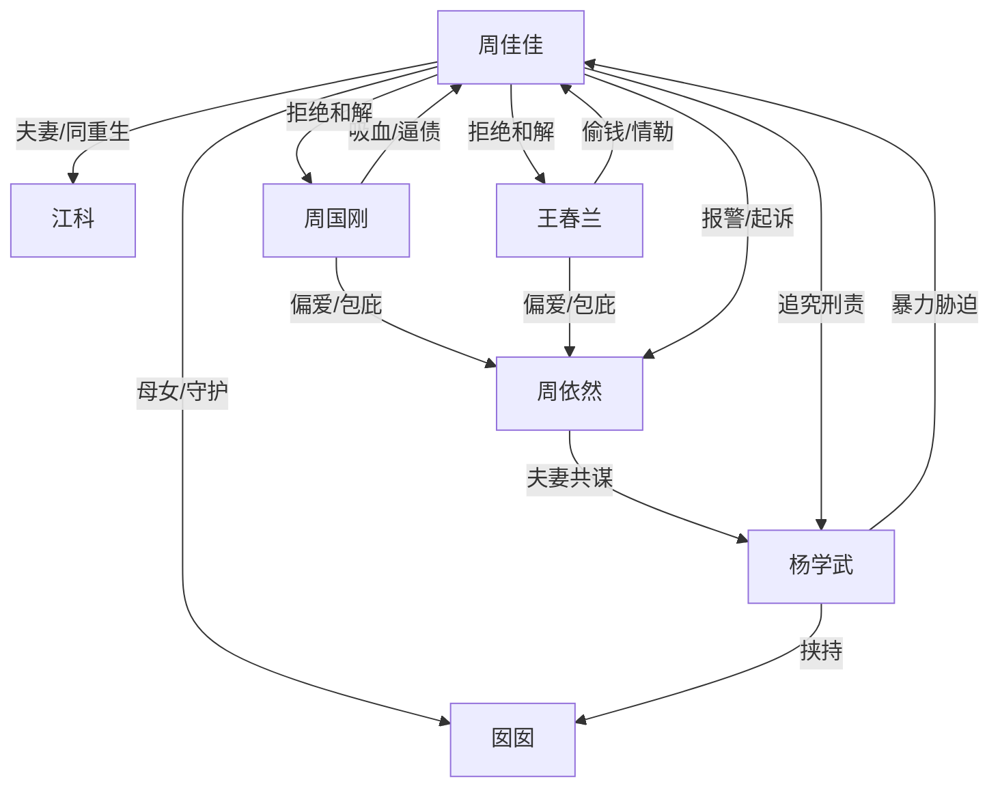

# 角色标签图谱

## 角色清单

### 周佳佳 — 清醒重生复仇女主

- 叙事功能: 第一人称主角，承载前世惨剧、重生识局、反杀清算。
- 核心标签: 重生、清醒、护小家
- 弧光: 愚孝牺牲者 → 识局复仇者 → 断亲守护者
- 台词风格: 短句、反问、一字一顿。
- 关键行为: 报警、拒债、封棺、拒绝和解、公开证据。
- 读者情绪关系: 心疼、代入、爽。

### 周依然 — 装死吸血姐姐

- 叙事功能: 核心施害者，假死骗债骗局的中心。
- 核心标签: 贪婪、伪善、甩锅
- 弧光: 被偏爱的“死人” → 被封棺揭穿 → 被判十二年
- 台词风格: 狡辩、撒泼、甩锅。
- 关键行为: 装死、骗债、配合丈夫威胁女主。
- 读者情绪关系: 恨、鄙夷、期待报应。

### 杨学武 — 匪气姐夫/暴力债主

- 叙事功能: 外部暴力压迫源，负责把家庭骗局升级为刑事危机。
- 核心标签: 高利贷、持刀、恶棍
- 弧光: 带人逼债 → 挟持幼女 → 获刑十八年
- 台词风格: 粗暴、威胁、命令。
- 关键行为: 拍欠款单、带壮汉、持刀威胁囡囡。
- 读者情绪关系: 恨、恐惧、期待重判。

### 周国刚 — 伪善父亲/共犯家长

- 叙事功能: 道德绑架执行者，用“亏人不亏心”包装吸血。
- 核心标签: 偏心、虚伪、共犯
- 弧光: 正义父亲人设 → 共犯暴露 → 下跪求饶
- 台词风格: 父权命令、亲情绑架。
- 关键行为: 逼女主认债、压跪签字、庭审求情。
- 读者情绪关系: 恨、恶心、期待脸面崩塌。

### 王春兰 — 偏心母亲/哭闹共犯

- 叙事功能: 情绪勒索者，用哭、跪、母女情分逼女主让步。
- 核心标签: 偏心、偷钱、卖惨
- 弧光: 哭灵煽动者 → 偷转七十万 → 退群社死 → 磕头求饶
- 台词风格: 哭喊、咒骂、求饶。
- 关键行为: 偷绑女主卡、转走七十万、拉横幅污蔑。
- 读者情绪关系: 恨、窒息、痛快。

### 江科 — 同重生丈夫/守护小家盟友

- 叙事功能: 证明前世惨剧、保护女儿、帮助女主完成断亲。
- 核心标签: 深情、清醒、护妻女
- 弧光: 前世绝望丈夫 → 今生保护者 → 情绪支柱
- 台词风格: 克制、坚定、逻辑清晰。
- 关键行为: 保护囡囡、抢回孩子、掰开王春兰的手。
- 读者情绪关系: 心疼、安心、补偿感。

### 囡囡 — 情绪软肋/必须守住的小家

- 叙事功能: 前世最大情绪债，今生保护目标。
- 核心标签: 幼女、受害者、补偿对象
- 弧光: 前世惨死 → 今生获救 → 结尾奔向母亲
- 台词风格: 稚嫩、直接。
- 关键行为: 被挟持、获救、结尾要去游乐园。
- 读者情绪关系: 心疼、恐惧、暖意。

## 关系网络

## 角色功能对照表（供改编参考）

| 原角色 | 极致标签 | 叙事功能 | 读者情绪功能 | 改编时必须保留的 |
|--------|---------|---------|-------------|---------------|
| 周佳佳 | 清醒重生女主 | 识局反杀 | 爽、心疼 | 前世惨债、今生冷静设局 |
| 周依然 | 装死吸血姐姐 | 骗局核心 | 恨、期待报应 | 假死/伪装弱者/最终自爆 |
| 杨学武 | 暴力债主姐夫 | 升级危机 | 恨、恐惧 | 持刀或等价暴力胁迫 |
| 父母 | 伪善共犯 | 道德绑架 | 窒息、愤怒 | 偏心且知情，不是被骗 |
| 江科 | 同重生盟友 | 守护与补偿 | 安心、心疼 | 保护孩子、替女主断亲 |
| 囡囡 | 小家软肋 | 情绪债锚点 | 心疼、补偿 | 前世受害，今生必须获救 |
