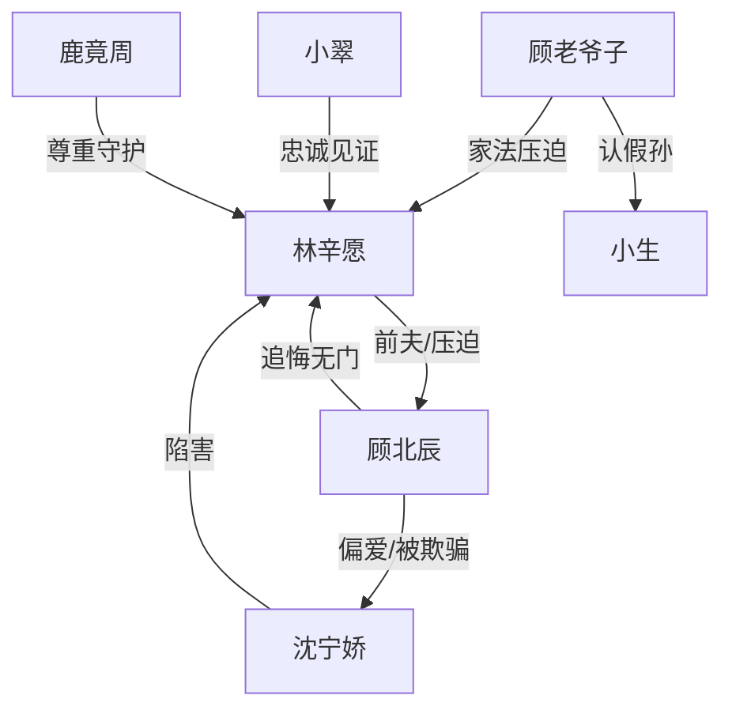

# 角色标签图谱

## 角色清单

### 林辛愿 — 重生清醒大女主
- 叙事功能: 情绪债承受者、逃离者、最终补偿对象
- 核心标签: 重生、冷静、决绝
- 弧光: 被婚姻困住的顾太太 → 合法离婚的自由女性 → 被尊重的新妻子
- 台词风格: 克制短句，后期判决式拒绝
- 关键行为: 不闹、签离婚报告、南下深城、拒绝复合、拒收财产
- 读者情绪关系: 心疼、憋屈、替她爽

### 顾北辰 — 偏执负心追悔男
- 叙事功能: 最大压迫源与后期悔恨容器
- 核心标签: 自负、偏心、迟悔
- 弧光: 施害者 → 失去者 → 以死偿债者
- 台词风格: 前期命令审判，后期哀求忏悔
- 关键行为: 带回沈宁娇、惩罚林辛愿、拒绝离婚、追到深城、挡刀
- 读者情绪关系: 前期恨，后期看他悔疯但不希望被原谅

### 沈宁娇 — 恶毒绿茶寡嫂
- 叙事功能: 陷害发动机、男主堕落诱因
- 核心标签: 装弱、狠毒、贪婪
- 弧光: 柔弱遗孀 → 伪装败露 → 疯癫乞丐
- 台词风格: 前期茶言茶语，后期破罐破摔
- 关键行为: 逼孩子入族谱、自伤陷害、放火、车上栽赃、持刀刺杀
- 读者情绪关系: 强恨点，提供清算爽点

### 顾老爷子 — 封建父权压迫者
- 叙事功能: 家族伦理压迫的制度化代表
- 核心标签: 重男轻女、威权、双标
- 弧光: 掌权审判者 → 被假孙真相击垮
- 台词风格: 命令式、家法式
- 关键行为: 砸茶盏、罚跪、认嫡孙、祠堂惩罚
- 读者情绪关系: 厌恶、期待报应

### 小翠 — 良心见证人
- 叙事功能: 真相证人，替读者控诉
- 核心标签: 忠诚、直率、见证
- 弧光: 护主保姆 → 离开顾家 → 真相揭发者
- 台词风格: 直接控诉，情绪饱满
- 关键行为: 帮林辛愿搬走、告诉顾北辰真相
- 读者情绪关系: 出气口、正义嘴替

### 鹿竟周 — 温柔补偿型男主
- 叙事功能: 女主新生的情感与社会补偿
- 核心标签: 稳定、尊重、守护
- 弧光: 朋友/伙伴 → 守护者 → 丈夫
- 台词风格: 温和克制
- 关键行为: 深城帮衬、护住林辛愿、给予尊重婚姻
- 读者情绪关系: 安全感、补偿感

## 关系网络

## 角色功能对照表（供改编参考）

| 原角色 | 极致标签 | 叙事功能 | 读者情绪功能 | 改编时必须保留的 |
|--------|---------|---------|-------------|---------------|
| 林辛愿 | 重生清醒大女主 | 忍痛逃离 | 心疼+爽 | 不原谅、不复合 |
| 顾北辰 | 迟悔负心男 | 施害与追悔 | 恨+看报应 | 前期偏心必须足够重 |
| 沈宁娇 | 恶毒绿茶 | 连环陷害 | 强恨点 | 至少三次主动陷害 |
| 顾老爷子 | 父权压迫者 | 制度暴力 | 厌恶 | 重男轻女与家法 |
| 小翠 | 正义嘴替 | 揭真相 | 出气 | 控诉段不可删 |
| 鹿竟周 | 补偿型伴侣 | 新生证明 | 安全感 | 尊重女主边界 |
