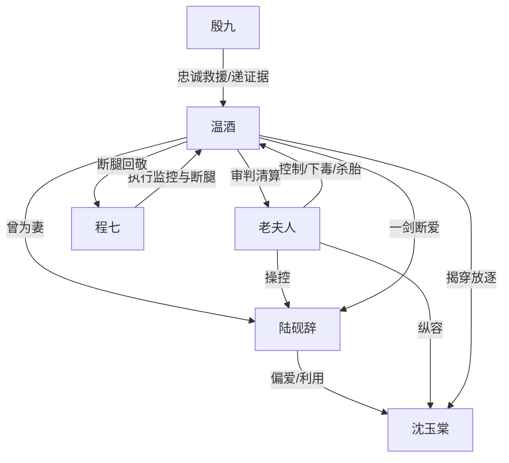

# 角色标签图谱

## 角色清单

### 温酒 — 清醒复仇型阎罗殿女主

- 叙事功能: 被压迫者、反击发动机、最终审判者。
- 核心标签: 阎罗殿殿主 / 大燕温氏嫡长女 / 为爱放下刀又拿回刀的人
- 弧光: 为婚姻收刀 → 被囚禁折辱 → 召回旧部 → 审判侯府 → 拿回自己
- 台词风格: 短句、反问、审判式复述旧话
- 关键行为: 捏碎佛珠、释放信引、审问老夫人、揭身份、放过人命但毁掉侯府权力
- 读者情绪关系: 前半心疼，后半爽，结尾尊敬

### 老夫人 — 佛面蛇心的控制型恶婆母

- 叙事功能: 最大压迫源，制造身体、身份、子嗣三重剥夺。
- 核心标签: 慈悲外壳 / 权力控制 / 血统洁癖
- 弧光: 稳坐高位操控全局 → 被阎罗殿反渗透 → 爵位与权力尽失
- 台词风格: 慢、稳、居高临下，常以规矩和仁义包装恶行
- 关键行为: 赐暗卫、赐毒佛珠、杀胎、断腿、送瘦马巷
- 读者情绪关系: 强恨点，结尾被原话回敬带来核心爽感

### 陆砚辞 — 冷血失爱的权贵夫君

- 叙事功能: 情感债核心，提供温度反转与迟来悔意。
- 核心标签: 冷漠夫君 / 道德双标 / 迟来悔
- 弧光: 不看温酒 → 默许伤害 → 身份揭开后恐惧 → 被一剑断爱
- 台词风格: 平、冷、少字，崩溃后才有迟疑
- 关键行为: 默许断腿与送人、递自白状、迟来伸手、承认羊肉汤旧事
- 读者情绪关系: 前半恨，后半看他悔而不得

### 沈玉棠 — 假白莲谋位者

- 叙事功能: 情敌压迫层与反转靶子。
- 核心标签: 假病弱 / 假身份 / 利益型表演者
- 弧光: 装柔弱 → 撕脸炫耀 → 被揭青楼出身和谋产书信 → 被放逐
- 台词风格: 前期绵软，撕脸后直白得意，崩溃后尖利
- 关键行为: 建议娶温酒做人质、冒充沈家女、怀孕谋产
- 读者情绪关系: 恨与鄙夷，后期带少量荒唐感

### 殷九 — 忠诚副手与翻盘执行者

- 叙事功能: 女主旧权力具象化，负责证据、清场与身份递进。
- 核心标签: 少年副手 / 忠犬式执行 / 情报掌控
- 弧光: 隐忍三年布局 → 信引召回 → 逐层递证 → 扶女主出门
- 台词风格: 平静、账册式、精准报证据
- 关键行为: 带三百二十一人入侯府、递刀、念信、送枢密院信
- 读者情绪关系: 安全感、痛快感、补偿感

### 程七 — 具体施暴执行者

- 叙事功能: 把老夫人的命令转成身体创伤。
- 核心标签: 温和刽子手 / 暗卫头领 / 欺弱怕强
- 弧光: 稳定施暴 → 脸色变白 → 跪地求命 → 被断腿
- 台词风格: 假温和、轻慢、推卸责任
- 关键行为: 换响箭、解释蚀骨散、打断温酒双腿、记录癸水
- 读者情绪关系: 具体恨点，断腿回敬形成小爽点

## 关系网络

## 角色功能对照表（供改编参考）

| 原角色 | 极致标签 | 叙事功能 | 读者情绪功能 | 改编时必须保留的 |
|--------|---------|---------|-------------|---------------|
| 温酒 | 清醒复仇女主 | 被剥夺后反击 | 心疼转爽 | 放下核心能力又拿回核心能力 |
| 老夫人 | 佛面蛇心婆母 | 主压迫源 | 恨点 | 用仁义/规矩包装残害 |
| 陆砚辞 | 冷血夫君 | 情感债 | 恨与迟来悔 | 曾有可被女主误读的微弱温情 |
| 沈玉棠 | 假白莲 | 关系羞辱 | 打脸爽 | 前期装柔弱，后期身份翻车 |
| 殷九 | 忠诚副手 | 反击执行 | 安全感 | 递刀、递证据、递旧势力 |
| 程七 | 施暴爪牙 | 具体债务 | 小清算爽 | 断腿债必须等价偿还 |
