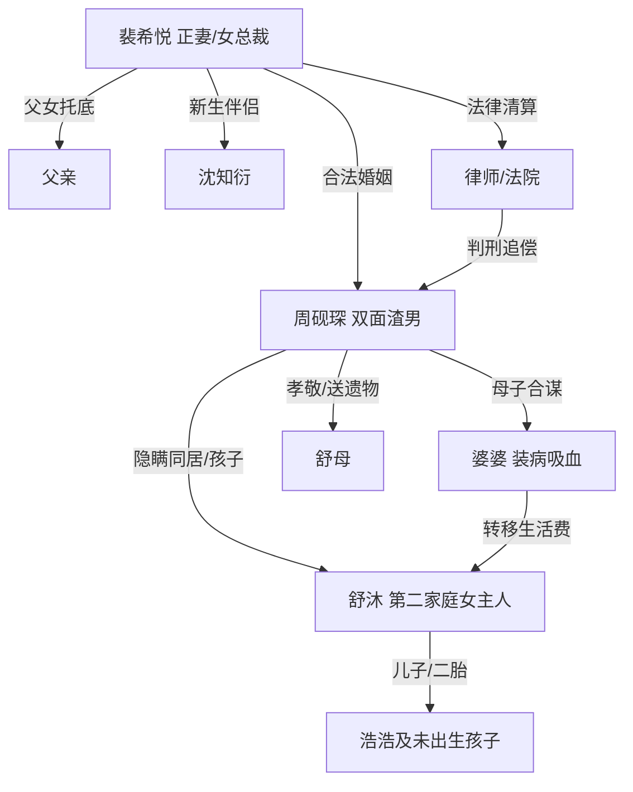

# 角色标签图谱

## 角色清单

### 裴希悦 — 清醒女总裁/被吸血正妻
- 叙事功能: 受害者、取证者、审判者、人生重建者
- 核心标签: 清醒、克制、有资源
- 弧光: 盲目信任 → 发现骗局 → 隐忍取证 → 公开清算 → 重新幸福
- 台词风格: 短句、冷硬、证据先行
- 关键行为: 小号取证、赶赴葬礼、压住冲动、灵堂公开证据、起诉
- 读者情绪关系: 前半心疼，高潮爽，后半替她松口气

### 周砚琛 — 软饭双面渣男
- 叙事功能: 核心施害者、情绪债制造机、最终悔恨载体
- 核心标签: 骗婚、吸血、双面
- 弧光: 好丈夫假象 → 双家庭曝光 → 当众崩塌 → 入狱 → 悔断肝肠
- 台词风格: 前期哄骗命令，败露后甩锅求饶
- 关键行为: 装无业、骗医药费、养第二家庭、转赠遗物、否认正妻、恐吓女主
- 读者情绪关系: 恨、鄙夷、期待报应

### 舒沐 — 被蒙骗的第二家庭女主人
- 叙事功能: 第二个家的可视化载体，反衬周砚琛双面人生
- 核心标签: 被宠假象、怀孕、受骗小三
- 弧光: 幸福正妻自认 → 发现自己是小三 → 被周砚琛反咬 → 离城
- 台词风格: 温柔、依赖、后期崩溃
- 关键行为: 接待女主、讲述周砚琛好丈夫人设、质问周砚琛
- 读者情绪关系: 初期被迁怒，后期有限同情

### 婆婆 — 装病吸血恶婆婆
- 叙事功能: 家族合谋证据，财产转移中转站
- 核心标签: 装病、贪婪、护短
- 弧光: 病弱假象 → 健步如飞 → 败露撒泼 → 失去经济来源
- 台词风格: 撒泼、倒打一耙
- 关键行为: 收女主 2.2 万、养舒沐母子、装病骗钱、辱骂女主
- 读者情绪关系: 厌恶，期待断供和报应

### 舒母 — 无知受益者/遗物刺痛点
- 叙事功能: 承载母亲遗物羞辱，把出轨升级为亲情亵渎
- 核心标签: 受益、无知、反讽
- 弧光: 夸赞好女婿 → 得知真相后被牵连
- 台词风格: 感激、朴素
- 关键行为: 戴女主母亲耳环，夸周砚琛会疼人
- 读者情绪关系: 复杂；她的无知让女主更痛

### 父亲 — 亲情托底者
- 叙事功能: 情绪修复、道德背书、女主重生支点
- 核心标签: 后盾、清醒、护女
- 弧光: 曾反对婚事 → 接纳女儿回头 → 陪她打掉孩子 → 祝福新婚
- 台词风格: 简短坚定
- 关键行为: 不责备女主，支持她切断婚姻和孩子牵连
- 读者情绪关系: 心疼、安心

### 沈知衍 — 补偿型真诚伴侣
- 叙事功能: 结尾补偿，证明女主值得被好好对待
- 核心标签: 稳重、尊重、分寸感
- 弧光: 世交介绍 → 慢慢靠近 → 求婚 → 幸福婚姻
- 台词风格: 温和承诺
- 关键行为: 尊重女主过去，陪伴支持
- 读者情绪关系: 安慰、补偿满足

## 关系网络

## 角色功能对照表（供改编参考）

| 原角色 | 极致标签 | 叙事功能 | 读者情绪功能 | 改编时必须保留的 |
|--------|---------|---------|-------------|---------------|
| 裴希悦 | 清醒女总裁 | 受害-取证-审判 | 心疼转爽 | 克制取证、公开清算、拒绝回头 |
| 周砚琛 | 软饭双面男 | 施害核心 | 恨点与报应靶 | 双面人设、骗钱、崩塌求饶 |
| 舒沐 | 被蒙骗小三 | 第二家庭具象化 | 刺痛与反衬 | 自认正妻、怀孕/孩子、幸福假象 |
| 婆婆 | 装病恶婆婆 | 合谋吸血 | 厌恶 | 装病骗钱、败露撒泼 |
| 舒母 | 无知受益者 | 遗物羞辱载体 | 加深心痛 | 戴/使用女主亲人遗物 |
| 父亲 | 后盾 | 修复与托底 | 安心 | 不责备、坚定支持女主切割 |
| 沈知衍 | 真诚伴侣 | 后置补偿 | 圆满 | 尊重、安稳、见证女主新生 |
