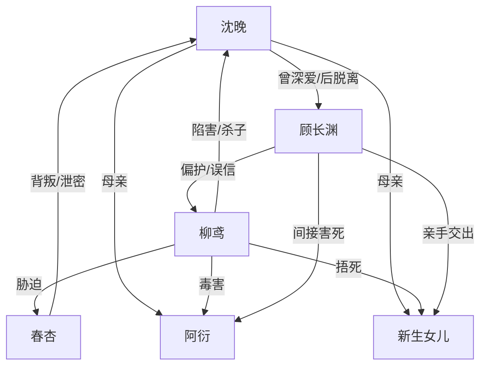

# 角色标签图谱

## 角色清单

### 沈晚 — 清醒脱离型虐文女主
- 叙事功能: 承受极致背叛，累计情绪债，最终用“离开”完成最大惩罚。
- 核心标签: 隐忍、母性、决绝
- 弧光: 等他回来 → 不再等 → 脱离世界 → 放下爱恨
- 台词风格: 短句、冷句、崩溃时直接撕裂。
- 关键行为: 保小、控诉柳鸢、选择即刻脱离、开启下一个世界。
- 读者情绪关系: 心疼、替她恨、最后替她解脱。

### 顾长渊 — 迟来追悔型负心夫君
- 叙事功能: 反复误选柳鸢，制造最大压迫；后半承接追悔爽点。
- 核心标签: 偏心、软弱、悔疯
- 弧光: 自以为两全 → 一次次抛妻弃子 → 真相反噬 → 杀表妹殉死
- 台词风格: 前半辩解与命令，后半破碎忏悔。
- 关键行为: 难产时离开、掌掴沈晚、错过最后救命机会、掐死柳鸢、服毒。
- 读者情绪关系: 前半恨，后半看他痛苦偿债。

### 柳鸢 — 恶毒绿茶表妹
- 叙事功能: 施害者、挑衅者、真相引爆器。
- 核心标签: 装弱、恶毒、占有欲
- 弧光: 装病夺人 → 怀孕挑衅 → 杀子真相暴露 → 被男主亲手杀死
- 台词风格: 当众柔弱，私下残忍。
- 关键行为: 装心疾、怀孕上门、捂死女婴、毒死阿衍、设计血崩和堕胎药。
- 读者情绪关系: 极致恨点，清算必须明确。

### 春杏 — 背恩叛主婢女
- 叙事功能: 栽赃工具与后期真相证人。
- 核心标签: 背叛、软弱、被胁迫
- 弧光: 被沈晚救下 → 端堕胎药陷害 → 门内忏悔暴露真相
- 台词风格: 怯弱、发抖、被柳鸢压制。
- 关键行为: 端药陷害、参与望风、与柳鸢对话泄密。
- 读者情绪关系: 恨其背恩，也提供真相出口。

### 阿衍/女儿 — 无辜血亲债
- 叙事功能: 情绪债核心抵押物。
- 核心标签: 无辜、早夭、母性痛点
- 弧光: 一个已死，一个出生即被害。
- 台词风格: 无。
- 关键行为: 以死亡持续审判顾长渊。
- 读者情绪关系: 心疼与愤怒的根源。

## 关系网络

## 角色功能对照表（供改编参考）

| 原角色 | 极致标签 | 叙事功能 | 读者情绪功能 | 改编时必须保留的 |
|--------|---------|---------|-------------|---------------|
| 沈晚 | 清醒脱离女主 | 承债与离开 | 心疼、解脱 | 不原谅、不回头 |
| 顾长渊 | 迟来追悔夫君 | 误选与偿债 | 恨转爽 | 至少三次选错 |
| 柳鸢 | 恶毒绿茶表妹 | 施害与挑衅 | 恨点 | 当众装弱、私下炫耀 |
| 春杏 | 背恩婢女 | 栽赃与泄密 | 二级恨点 | 被救过却背叛 |
| 两个孩子 | 无辜血债 | 情绪债锚点 | 母性痛 | 必须有具体死法与责任链 |
