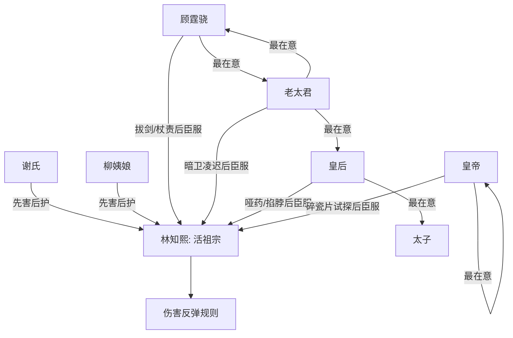

# 角色标签图谱

## 角色清单

### 林知熙 — 咸鱼无敌活祖宗
- 叙事功能: 规则中心、被动反杀发动机、喜剧吐槽视角。
- 核心标签: 咸鱼、怕疼、被动无敌。
- 弧光: 不受待见小妾 → 全府全宫供奉的祖宗。
- 台词风格: 懒洋洋、口语吐槽、吃货导向。
- 关键行为: 不主动害人，只承受伤害并让规则反弹。
- 读者情绪关系: 爽、好笑、轻微心疼。

### 顾霆骁 — 冷面头铁国公
- 叙事功能: 第一层男性权力压迫者，完成从不信邪到供祖宗的转折。
- 核心标签: 重礼法、头铁、护母。
- 弧光: 拔剑要杀 → 跪地涂药 → 烤串捏肩。
- 台词风格: 命令式、暴怒式，臣服后卑微。
- 关键行为: 割伤、饿罚、杖责林知熙，引发老太君反弹。
- 读者情绪关系: 前期想看他被打脸，后期变成喜剧工具人。

### 谢氏 — 清醒主母
- 叙事功能: 最早理解规则的保护者，负责解释和预警。
- 核心标签: 端庄、识时务、护子。
- 弧光: 罚跪加害者 → 跪求国公 → 供奉祖宗。
- 台词风格: 急切劝阻、理性解释。
- 关键行为: 抱腿阻止、揭示规则、照顾林知熙。
- 读者情绪关系: 从后宅敌人转为可靠队友。

### 柳姨娘 — 护崽癫狂姨娘
- 叙事功能: 与主母形成反差同盟，强化“后宅团结只为保她命”。
- 核心标签: 受宠、护子、敢疯。
- 弧光: 下毒试探 → 跪求保护 → 为儿扑杀老太君。
- 台词风格: 夸张、哭喊、狠话直接。
- 关键行为: 下毒引发规则验证，后期给主角做饭照料。
- 读者情绪关系: 喜剧感强，护崽时带爽。

### 老太君 — 宅斗冠军老糊涂
- 叙事功能: 第二轮升级压迫者，引入暗卫和皇后线。
- 核心标签: 权威、固执、亲情至上。
- 弧光: 指挥暗卫凌迟 → 害惨儿孙女儿 → 跪喊活菩萨。
- 台词风格: 老派威压、失控求饶。
- 关键行为: 下令锁骨钩，造成全家级反弹。
- 读者情绪关系: 恨其糊涂，爽其崩塌。

### 皇后顾云儿 — 权力误判者
- 叙事功能: 将冲突从国公府推向皇权核心。
- 核心标签: 天下之母、护太子、疑心巫蛊。
- 弧光: 赐哑药害人 → 太子受害 → 下跪认祖宗。
- 台词风格: 怨毒、决断、臣服后急切。
- 关键行为: 灌哑药、掐脖验证。
- 读者情绪关系: 期待她被太子反噬打脸。

### 皇帝 — 自恋多疑权力顶点
- 叙事功能: 终极权力压迫者，验证规则对皇权同样有效。
- 核心标签: 多疑、九五至尊、最爱自己。
- 弧光: 怀疑顾家谋逆 → 碎瓷片试探 → 满地打滚认祖宗。
- 台词风格: 帝王威压，崩塌后卑微讨好。
- 关键行为: 命人按林知熙跪碎瓷片。
- 读者情绪关系: 终极打脸爽点。

## 关系网络

## 角色功能对照表（供改编参考）

| 原角色 | 极致标签 | 叙事功能 | 读者情绪功能 | 改编时必须保留的 |
|--------|---------|---------|-------------|---------------|
| 林知熙 | 咸鱼无敌活祖宗 | 规则中心 | 爽、好笑、代偿 | 被动无敌、不主动害人、怕疼贪吃 |
| 顾霆骁 | 头铁国公 | 第一层权力打脸 | 等他跪 | 从不信到臣服的崩塌 |
| 谢氏 | 清醒主母 | 规则解释者 | 安全感 | 抱腿劝阻和“会死人”预警 |
| 柳姨娘 | 护崽姨娘 | 喜剧同盟 | 好笑、痛快 | 护子癫狂和做饭供奉 |
| 老太君 | 老派权威 | 家族级升级 | 看她悔 | 暗卫重伤与亲情反噬 |
| 皇后 | 宫廷权力 | 皇权升级 | 太子反噬爽 | 哑药害太子 |
| 皇帝 | 权力顶点 | 终极验证 | 最大打脸 | 最在意自己，亲自受百倍痛 |
