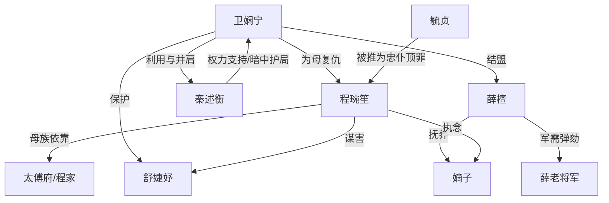

# 角色标签图谱

## 角色清单

### 卫娴宁 — 清醒复仇大女主
- 叙事功能: 主线复仇执行者，低位入局者，后期权力重构者。
- 核心标签: 隐忍、设局、守边界
- 弧光: 掌事姑姑遗孤 → 御茶房宫女 → 才人/嫔/昭仪/德妃 → 皇后
- 台词风格: 克制守礼，先低头，再递刀。
- 关键行为: 入宫改名、茶房设局、香墨相冲、火场护折、药匣反杀、账册借刀、热水抓鬼、夺嫡子抚养权、平反毓贞。
- 读者情绪关系: 心疼她的起点，期待她反杀，认可她不伤稚子的边界。

### 程琬笙 — 伪善高台皇后
- 叙事功能: 核心压迫者，女主复仇靶心，道德反讽承载者。
- 核心标签: 温柔杀人、权力傲慢、母性反噬
- 弧光: 端庄皇后 → 被夺宫权 → 失子疯癫 → 废后冷宫死亡
- 台词风格: 仁善外壳下的冷酷命令，擅长“为你好”式定罪。
- 关键行为: 推毓贞顶罪、栽赃卫娴宁、利用贤妃、买通吴婆子、试图保住嫡子。
- 读者情绪关系: 主要恨点；她越端庄，读者越期待她失态。

### 毓贞 — 无名忠仆/被夺姓名的母亲
- 叙事功能: 情绪债源头，主题核心，女主复仇正当性来源。
- 核心标签: 忠诚、受害、无名
- 弧光: 皇后信任的掌事姑姑 → 替罪惨死 → 平反追封有名
- 台词风格: 原文几乎缺席，正因缺席形成“被抹掉的人”。
- 关键行为: 为皇后试药、旧日帮扶孙太监/木匠/药铺掌柜，为女主留下人脉善因。
- 读者情绪关系: 心疼与愤怒的根源。

### 秦述衡 — 冷静识人的帝王
- 叙事功能: 权力杠杆，女主上升通道，后期并肩者。
- 核心标签: 多疑、识才、尊重复仇
- 弧光: 高处帝王 → 试探女主 → 暗中护局 → 立女主为后
- 台词风格: 简短压迫，常以问句试探。
- 关键行为: 留意卫娴宁、验香墨、纳入后宫、给暗卫、允许她亲手报仇、立后分权。
- 读者情绪关系: 提供安全感和权力爽，但不抢女主复仇主导权。

### 薛檀 — 护崽将门贤妃
- 叙事功能: 女主盟友，军需线入口，嫡子抚养人。
- 核心标签: 直烈、护童、重义
- 弧光: 防备女主 → 被共同利益拉拢 → 共掌六宫 → 成为小皇子母妃
- 台词风格: 直白硬朗，少弯绕。
- 关键行为: 带药匣入殿、递信薛老将军、护舒婕妤生产、抚养嫡子。
- 读者情绪关系: 可靠盟友，缓和女主狠辣带来的道德压力。

### 舒婕妤 — 被保护的孕妇/弱者坐标
- 叙事功能: 皇后杀局目标，女主道德边界证明。
- 核心标签: 温软、无辜、母体
- 弧光: 被皇后利用的孕妃 → 被女主保护 → 顺利生下公主
- 台词风格: 柔弱、恐惧、信任女主。
- 关键行为: 接安胎药、被构陷胎动、配合假腹痛。
- 读者情绪关系: 让读者确认皇后该死，也确认女主不是无差别复仇。

## 关系网络

## 角色功能对照表（供改编参考）

| 原角色 | 极致标签 | 叙事功能 | 读者情绪功能 | 改编时必须保留的 |
|--------|---------|---------|-------------|---------------|
| 卫娴宁 | 清醒复仇大女主 | 设局、反杀、价值翻身 | 心疼、期待、爽 | 低位入局、亲手复仇、不伤无辜 |
| 程琬笙 | 伪善高台皇后 | 压迫源、反讽靶心 | 恨、等她崩 | “温柔杀人”的伪善外壳 |
| 毓贞 | 无名忠仆母亲 | 情绪债源头 | 心疼、愤怒 | 被夺姓名，最终正名 |
| 秦述衡 | 冷静帝王 | 权力杠杆 | 安全感、认可 | 不替女主抢复仇主导权 |
| 薛檀 | 将门护崽贤妃 | 盟友、借刀线 | 信任、补偿 | 保护孩子与军权资源 |
| 舒婕妤 | 无辜孕妇 | 道德参照物 | 心疼、紧张 | 证明反派伤及无辜 |
