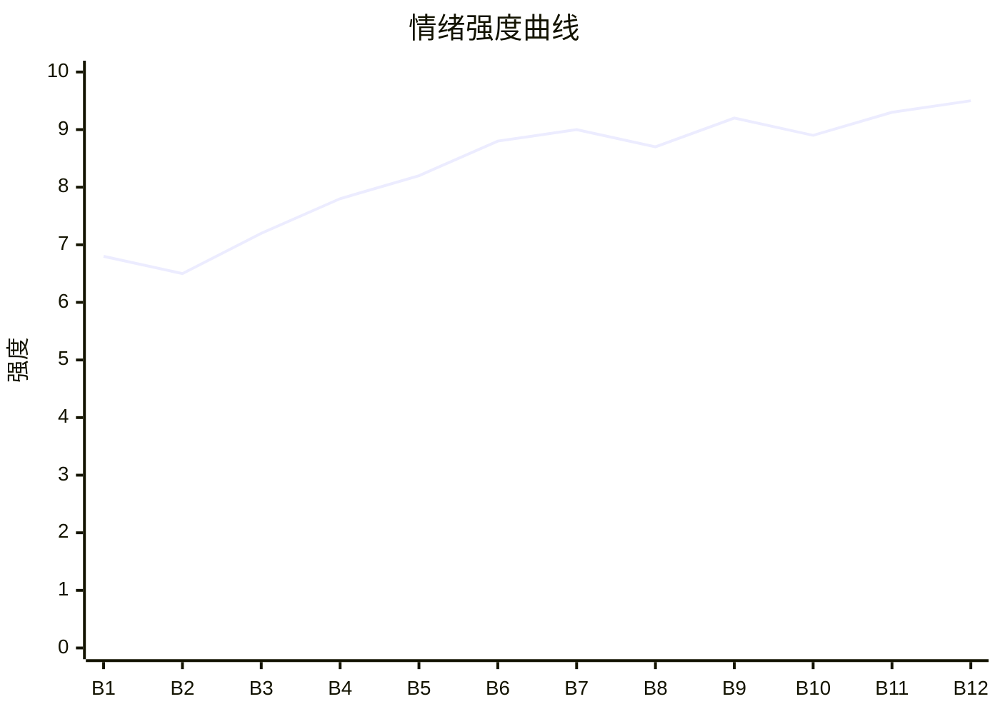

# Beat Sheet 节拍器

## 全文概况

- 总字数: 约 11600 字
- 节拍数: 12 幕
- 核心母题（Logline）: 豪门联姻丈夫发现妻子纵容年轻学弟越界后，不争不闹，直接切割婚姻与利益，最终让迟钝妻子追悔失去。
- 情绪模式: 冷静发现 → 反复压迫 → 底线断裂 → 离婚清算 → 真相反噬 → 清醒退场

## 节拍详表

### Beat 1: 七周年铃声异变 [开篇-1 前段]

- **字数**: 约 800 字（占比 7%）
- **核心事件**: 周聿修在结婚七周年发现虞念铃声变成兔子歌，并拿到沈长泽资料。
- **情绪标签**: 冷笑、预感、轻蔑
- **情绪强度**: 6.8/10
- **情绪方向**: ⚡突变
- **冲突类型**: 大转折
- **悬念钩子**: 沈长泽到底越界到什么程度？
- **叙事速度**: 快
- **对话占比**: 25%
- **reversal_mechanism**: [M5]
- **hook_strength**: 8.0/10
- **关键句**: “所以脏了，丢掉就好。”
- **原文摘录**: “结婚七周年宴会。我发现一贯娇矜的女人，把万年不变的手机铃声换成了兔子歌……更可惜，虞念也不明白，当初我选她联姻，仅仅是因为她干净。所以脏了，丢掉就好。”

### Beat 2: 餐桌试探与半年前伏笔 [1 中段]

- **字数**: 约 900 字（占比 8%）
- **核心事件**: 虞念解释沈长泽只是学术交流，周聿修由“半年前”联想到她的全部变化。
- **情绪标签**: 怀疑、克制、冷淡
- **情绪强度**: 6.5/10
- **情绪方向**: ↑上升
- **冲突类型**: 微冲突
- **悬念钩子**: 她的变化是否都因沈长泽而起？
- **叙事速度**: 中
- **对话占比**: 45%
- **reversal_mechanism**: [M5]
- **hook_strength**: null
- **关键句**: “只要不闹到明面上来影响虞周两家的商业版图就行。”
- **原文摘录**: “沈长泽，是我在港大的同系师弟……半年前。桌下晃动的腿停住。我不由得想起她身上出现变化的开始，就是半年前。”

### Beat 3: 老宅初次正面挑衅 [1 末]

- **字数**: 约 950 字（占比 8%）
- **核心事件**: 沈长泽主动到老宅喊姐夫，借学术问题登堂入室，被周聿修当场戳穿。
- **情绪标签**: 冒犯、打脸、暗爽
- **情绪强度**: 7.2/10
- **情绪方向**: ↑上升
- **冲突类型**: 大转折
- **悬念钩子**: 虞念会护谁？
- **叙事速度**: 快
- **对话占比**: 55%
- **reversal_mechanism**: [M3]
- **hook_strength**: null
- **关键句**: “空手来别人家，是想凭空想象吗？”
- **原文摘录**: “姐夫好。沈长泽走过来……我没记错的话，你是化工专业硕士是吧？既然是化工专业，实验数据基于仪器分析的道理不需要我教你，空手来别人家，是想凭空想象吗？”

### Beat 4: 寿宴失分与虞念偏护 [2]

- **字数**: 约 1150 字（占比 10%）
- **核心事件**: 沈长泽在寿宴上插嘴生孩子议题，被虞家老爷子训斥，虞念却替他解释。
- **情绪标签**: 羞辱、憋屈、厌烦
- **情绪强度**: 7.8/10
- **情绪方向**: ↑上升
- **冲突类型**: 大转折
- **悬念钩子**: 周聿修是否会选择离婚？
- **叙事速度**: 中
- **对话占比**: 60%
- **reversal_mechanism**: [M3, M5]
- **hook_strength**: null
- **关键句**: “我的联姻对象，不是非你不可。”
- **原文摘录**: “师姐正是闯荡的年纪，才不会生孩子……长泽没有恶意，他刚上研究生不懂人情世故。以后我会好好管教。”

### Beat 5: 纪念日弃约与入宅越界 [3 前段]

- **字数**: 约 1100 字（占比 9%）
- **核心事件**: 虞念因沈长泽实验室事故离开纪念日晚餐，又把他带回家养伤。
- **情绪标签**: 被抛下、越界、冷怒
- **情绪强度**: 8.2/10
- **情绪方向**: ↑上升
- **冲突类型**: 大转折
- **悬念钩子**: 正主被迫面对小三入宅后如何处理？
- **叙事速度**: 快
- **对话占比**: 50%
- **reversal_mechanism**: [M5]
- **hook_strength**: null
- **关键句**: “没钱去酒店？那我赏你。”
- **原文摘录**: “我吹着江上微凉的风，身边是冷掉的牛排和熄灭的蜡烛……我在楼上静静看着，握着栏杆的手，慢慢攥紧……将银行卡扔在他脸上。”

### Beat 6: 兔子铃声二次爆炸，底线宣判 [3 末]

- **字数**: 约 900 字（占比 8%）
- **核心事件**: 周聿修拨通虞念手机，兔子歌响起；沈长泽再来电话，虞念仍选择离开。
- **情绪标签**: 心冷、判决、失望
- **情绪强度**: 8.8/10
- **情绪方向**: ⚡突变
- **冲突类型**: 大转折
- **悬念钩子**: 她出了门，婚姻是否彻底结束？
- **叙事速度**: 快
- **对话占比**: 65%
- **reversal_mechanism**: [M3, M5]
- **hook_strength**: null
- **关键句**: “出了这个门，我们就结束。”
- **原文摘录**: “一阵小兔子的欢快音乐在寂静的大厅炸响……虞念。我冷声叫住她，出了这个门，我们就结束……说罢，一阵风吹过。再无她的身影。”

### Beat 7: 医院误判与离婚启动 [4]

- **字数**: 约 1350 字（占比 12%）
- **核心事件**: 虞念因沈长泽被打误会周聿修，周聿修彻底关门，命令法务准备离婚和商业清算。
- **情绪标签**: 断裂、愤怒、爽点预热
- **情绪强度**: 9.0/10
- **情绪方向**: ↑上升
- **冲突类型**: 大转折
- **悬念钩子**: 离婚协议和商业切割会造成多大震动？
- **叙事速度**: 快
- **对话占比**: 55%
- **reversal_mechanism**: [M5, M6]
- **hook_strength**: null
- **关键句**: “出具离婚协议，立刻！”
- **原文摘录**: “除了你，又有谁视他为眼中钉！……既然认定我，那就随你怎么想，你和他，都给我滚……出具离婚协议，立刻！还有，以最快的速度分割清算和虞氏集团的商业往来。”

### Beat 8: 离婚协议砸向老宅 [5-6 前段]

- **字数**: 约 1500 字（占比 13%）
- **核心事件**: 离婚协议送到老宅，虞念首次真正慌乱，商业后果显形。
- **情绪标签**: 反噬、慌乱、追悔开端
- **情绪强度**: 8.7/10
- **情绪方向**: ↓下降后反弹
- **冲突类型**: 大转折
- **悬念钩子**: 虞念能不能挽回？
- **叙事速度**: 中
- **对话占比**: 50%
- **reversal_mechanism**: [M5, M6]
- **hook_strength**: null
- **关键句**: “回旋的余地在哪里！”
- **原文摘录**: “聿修那小子把离婚协议都寄到老宅了……财产分割得如此清楚，和周氏的项目全面停工……你告诉我，回旋的余地在哪里！”

### Beat 9: 越界定义权反杀 [6 中段]

- **字数**: 约 1000 字（占比 9%）
- **核心事件**: 周聿修向虞念明确“不是上床才叫过界”，给出婚姻结束的逻辑。
- **情绪标签**: 清醒、打脸、规则重写
- **情绪强度**: 9.2/10
- **情绪方向**: ↑上升
- **冲突类型**: 大转折
- **悬念钩子**: 虞念是否会发现沈长泽真面目？
- **叙事速度**: 中
- **对话占比**: 70%
- **reversal_mechanism**: [M3, M5]
- **hook_strength**: null
- **关键句**: “不是只有上了床才叫过界。”
- **原文摘录**: “好，那我来告诉你，不是只有上了床才叫过界……你知道，却还是纵容着他。所以到了现在这个地步，纠缠就没意思了，赶紧签字吧。”

### Beat 10: 自导自演真相暴露 [6 末-7 前段]

- **字数**: 约 1150 字（占比 10%）
- **核心事件**: 虞念听见沈长泽承认自导自演，终于醒悟并将其开除驱逐。
- **情绪标签**: 反噬、羞耻、报应
- **情绪强度**: 8.9/10
- **情绪方向**: ↑上升
- **冲突类型**: 大转折
- **悬念钩子**: 真相已出，周聿修是否会回头？
- **叙事速度**: 快
- **对话占比**: 65%
- **reversal_mechanism**: [M3, M6]
- **hook_strength**: null
- **关键句**: “不自导自演一场戏，怎么能推动他们离婚呢？”
- **原文摘录**: “没关系啊，这点疼是值得的，不自导自演一场戏，怎么能推动他们离婚呢？……虞念猛地推开门……沈长泽，你会为自己的所作所为，付出代价。”

### Beat 11: 卑微求和被拒 [7 末]

- **字数**: 约 950 字（占比 8%）
- **核心事件**: 虞念承认越界并求复合，周聿修明确拒绝。
- **情绪标签**: 爽、冷酷、追悔
- **情绪强度**: 9.3/10
- **情绪方向**: ↑上升
- **冲突类型**: 大转折
- **悬念钩子**: 虞念不签字会如何升级？
- **叙事速度**: 快
- **对话占比**: 70%
- **reversal_mechanism**: [M3, M5]
- **hook_strength**: null
- **关键句**: “但我可以没有你啊。”
- **原文摘录**: “我们，能不能不离婚？……有意义，聿修我们在一起七年，我的生活中都是你的身影。所以我不能没有你。但我可以没有你啊。”

### Beat 12: 绑架终局与清醒退场 [8]

- **字数**: 约 1350 字（占比 12%）
- **核心事件**: 沈长泽绑架周聿修，被周聿修戳破豪门规则后崩溃；虞念签字，周聿修回京。
- **情绪标签**: 降维、终局、释然
- **情绪强度**: 9.5/10
- **情绪方向**: ⚡突变后平稳
- **冲突类型**: 终局大转折
- **悬念钩子**: 无，完成闭环。
- **叙事速度**: 快
- **对话占比**: 60%
- **reversal_mechanism**: [M3, M6]
- **hook_strength**: null
- **关键句**: “我周聿修的人生，从来精彩，有你没你，都是一样的。”
- **原文摘录**: “你错了，就算我和她离婚，就算你们相爱，你也不可能走进虞家的大门……她身体僵了僵，良久才从嗓子里挤出，好，我签……我周聿修的人生，从来精彩，有你没你，都是一样的。”

## 情绪曲线可视化

## 节拍密度检测

- 平均每 967 字一个节拍
- 微冲突密度: 每 900 字一次
- 大转折密度: 每 1100 字一次
- 判定: 符合高频节拍器标准，但前半婚姻拉扯略长，靠对话维持张力。

## 反转机制清单(Reversal Mechanisms)

| 机制 ID | 机制名 | 承载 Beat | 关键段落/金句 | 等价改编提示 |
|--------|--------|-----------|--------------|-------------|
| M3 | 因果回旋反讽 | Beat 4, 6, 9, 11, 12 | “不是只有上了床才叫过界。”、“但我可以没有你啊。” | 必须保留施害者规则被主角原样反打：她说“丈夫只会是你”，他用“离婚才是真边界”回应。 |
| M5 | 温度反转曲线 | Beat 1-12 | “我的丈夫，只会是你。”到“我可以没有你啊。” | 必须有曾经稳定婚姻温度、越界归零、追悔负值三段，不可直接写成无爱离婚。 |
| M6 | 多层递进反转 | Beat 7-12 | 离婚协议、商业清算、自导自演暴露、绑架崩塌 | 层数不能少：个人关系、商业权力、真相揭露、终局退场逐级升维。 |
