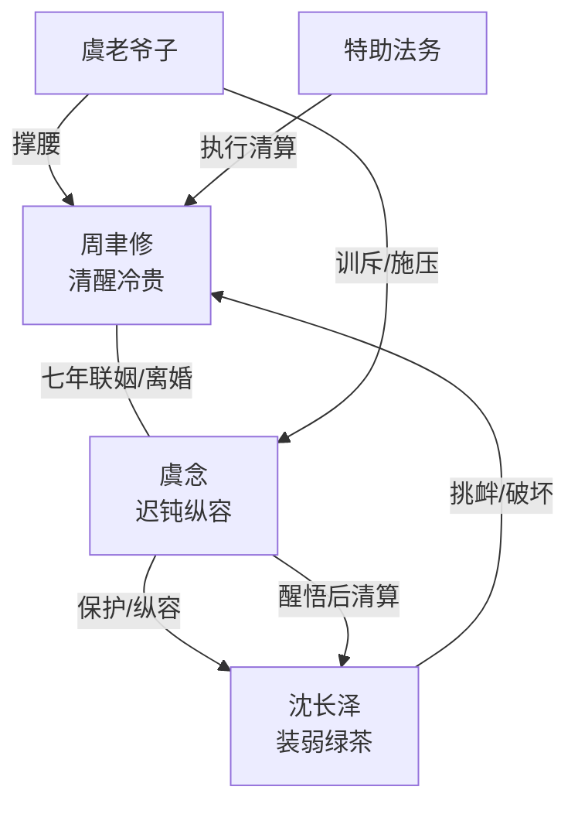

# 角色标签图谱

## 角色清单

### 周聿修 — 清醒冷贵豪门丈夫

- 叙事功能: 主视角、受害者、规则重写者、最终退场者。
- 核心标签: 清醒、骄傲、底线感强。
- 弧光: 旁观忍让 → 底线断裂 → 离婚清算 → 回京重启。
- 台词风格: 短句、反问、冷判决。
- 关键行为: 调查沈长泽、寿宴压制、启动离婚、商业切割、拒绝复合。
- 读者情绪关系: 心疼其被忽视，爽于其不回头。

### 虞念 — 迟钝纵容的豪门女总裁

- 叙事功能: 施压方、追悔方、火葬场主体。
- 核心标签: 自负、迟钝、后知后觉。
- 弧光: 纵容越界 → 误判丈夫 → 收到离婚协议 → 撞破真相 → 卑微求和。
- 台词风格: 解释型、安抚型，后期沙哑求和。
- 关键行为: 保护沈长泽、误会周聿修、砸掉兔子铃声、驱逐沈长泽、签字离婚。
- 读者情绪关系: 前期气，后期看她追悔得到补偿。

### 沈长泽 — 装弱绿茶男大学生

- 叙事功能: 婚姻入侵者、情绪债制造机、终局反噬对象。
- 核心标签: 年轻、装可怜、贪婪。
- 弧光: 借学弟身份越界 → 挑衅正主 → 自导自演 → 被驱逐 → 绑架崩溃。
- 台词风格: “师姐”高频，示弱、委屈、暗中得意。
- 关键行为: 寿宴插嘴、入宅养伤、自导自演被打、绑架周聿修。
- 读者情绪关系: 强恨点，承担小三报应爽点。

### 虞老爷子 — 豪门秩序维护者

- 叙事功能: 外部权威、道德和家族规则的见证者。
- 核心标签: 护短、威严、清醒。
- 弧光: 寿宴训斥沈长泽 → 安抚周聿修 → 逼问虞念。
- 台词风格: 直白、怒斥、权威。
- 关键行为: 拒绝沈长泽插手家事、警告虞念哄回周聿修。
- 读者情绪关系: 提供“有人站在主角这边”的补偿。

### 特助/法务团队 — 执行工具人

- 叙事功能: 展示周聿修的权力和效率。
- 核心标签: 高效、忠诚、信息源。
- 弧光: 调查资料 → 报告动态 → 推动离婚流程。
- 台词风格: 职业、简短。
- 关键行为: 查沈长泽、送协议、报告驱逐和风险。
- 读者情绪关系: 强化主角不是只会吵架，而是有资源清算。

## 关系网络

## 角色功能对照表（供改编参考）

| 原角色 | 极致标签 | 叙事功能 | 读者情绪功能 | 改编时必须保留的 |
|--------|---------|---------|-------------|---------------|
| 周聿修 | 清醒冷贵正主 | 被越界者、清算者 | 心疼、爽 | 不争宠，直接切割 |
| 虞念 | 迟钝追妻方 | 纵容者、追悔者 | 气、看火葬场 | 后知后觉，不是纯恶 |
| 沈长泽 | 装弱绿茶入侵者 | 情绪债制造机 | 恨、期待报应 | 用弱者姿态逼正主失态 |
| 虞老爷子 | 家族权威 | 外部支持 | 补偿、安全感 | 明确站队主角 |
| 特助法务 | 权力执行器 | 清算工具 | 爽、效率 | 体现主角资源和行动力 |
