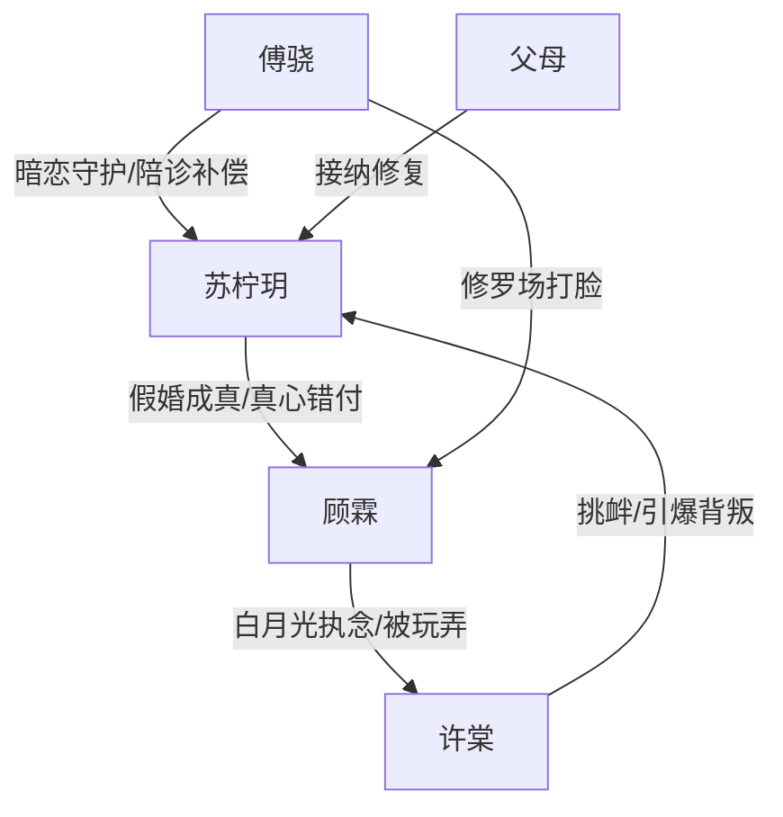

# 角色标签图谱

## 角色清单

### 苏柠玥 — 真心错付后清醒离场的女主
- 叙事功能: 承受背叛、完成断舍离、承载读者代入。
- 核心标签: 暗恋成真、怀孕受伤、清醒离场
- 弧光: 卑微期待 → 被背叛触底 → 删除拉黑 → 拒绝复合 → 重建安全感
- 台词风格: 前期试探含蓄，后期直接冷静。
- 关键行为: 扔孕检报告、聚会承认“假的”、流产、搬走、餐厅拒绝顾霖。
- 读者情绪关系: 心疼、代入、替她解气。

### 顾霖 — 迟钝自私的白月光执念型渣男
- 叙事功能: 制造情绪债与追悔火葬场。
- 核心标签: 温柔假象、白月光执念、失去后追悔
- 弧光: 体贴恋人 → 关系回避者 → 出轨者 → 追悔者 → 被放弃者
- 台词风格: 含糊、逃避、事后补救。
- 关键行为: 领证爽约、摘戒指接许棠、聚会否认关系、酒店越轨、求复合。
- 读者情绪关系: 前期让人恨，后期提供报应爽。

### 许棠 — 占有型白月光/绿茶触发器
- 叙事功能: 引爆顾霖真实排序，推动女主清醒。
- 核心标签: 被追捧惯了、占有舔狗、无情玩弄
- 弧光: 回国搅局 → 私发照片挑衅 → 揭示“狗”定位
- 台词风格: 甜、漫不经心、羞辱感强。
- 关键行为: 发白玫瑰朋友圈、聚会起哄、酒店照片、电话羞辱顾霖。
- 读者情绪关系: 恨点触发器，也给顾霖报应。

### 傅骁 — 嘴硬守护型男二/补偿型新男主
- 叙事功能: 托举女主价值，提供情绪补偿和轻喜缓冲。
- 核心标签: 死对头、暗恋多年、嘴欠但护短
- 弧光: 看热闹拆台 → 陪诊签字 → 公开护人 → 告白等待
- 台词风格: 欠、直、带轻喜，关键处认真。
- 关键行为: 陪诊、告密顾霖、病房护人、餐厅反击“前任羞辱”。
- 读者情绪关系: 爽、暖、替女主争气。

### 苏柠玥父母 — 无条件接住的家庭补偿
- 叙事功能: 修复女主羞耻感，完成安全感回归。
- 核心标签: 愧疚、包容、保护
- 弧光: 催婚压力源 → 情感避风港
- 台词风格: 温和、自责。
- 关键行为: 得知真相后抱住女主，没有责骂。
- 读者情绪关系: 安慰、释放。

## 关系网络

## 角色功能对照表（供改编参考）

| 原角色 | 极致标签 | 叙事功能 | 读者情绪功能 | 改编时必须保留的 |
|--------|---------|---------|-------------|---------------|
| 苏柠玥 | 真心错付女主 | 代入与清醒离场 | 心疼、解气 | 暗恋投入、怀孕创伤、主动切断 |
| 顾霖 | 白月光执念渣男 | 情绪债制造者 | 恨与追悔爽 | 前期体贴、后期回避、失去后崩 |
| 许棠 | 占有型白月光 | 外部诱因 | 愤怒、反讽 | 私发证据、把男主当狗 |
| 傅骁 | 嘴硬守护者 | 补偿与新可能 | 暖、爽、轻喜 | 陪诊、公开护人、不嫌弃创伤 |
| 父母 | 安全感锚点 | 终局修复 | 安慰 | 不责骂，反而接住 |
