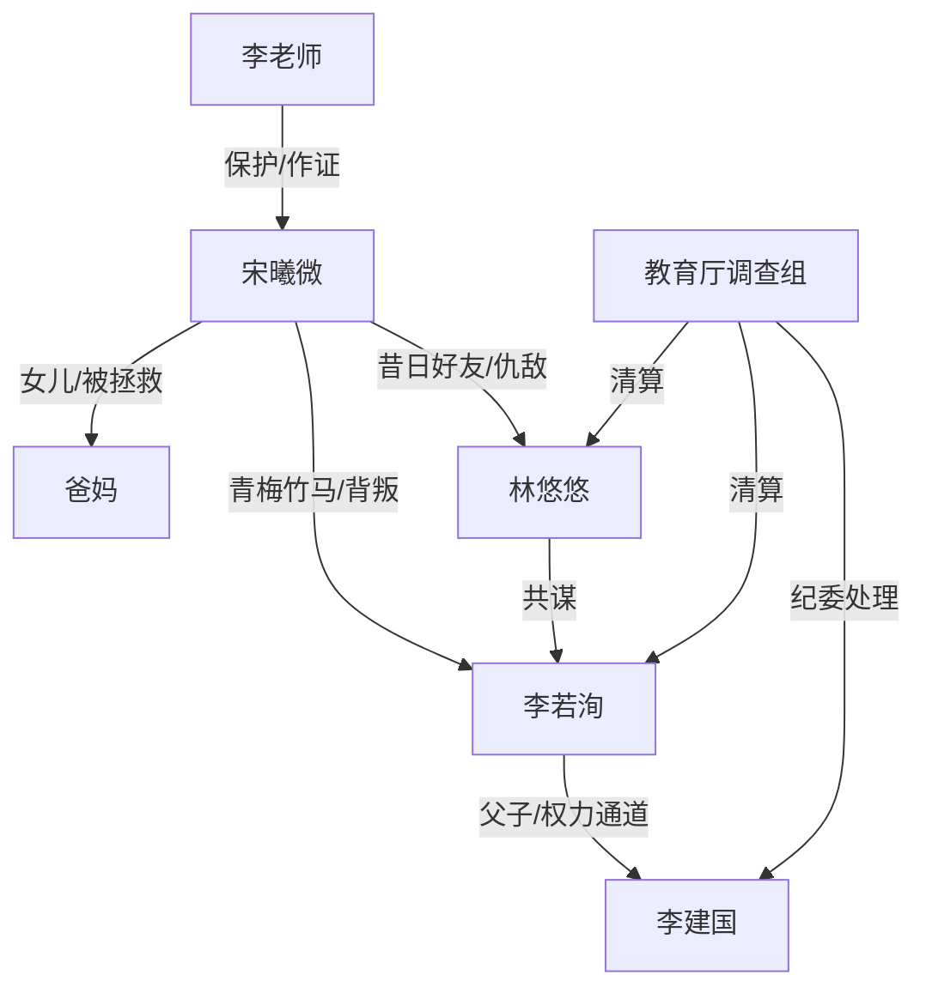

# 角色标签图谱

## 角色清单

### 宋曦微 — 清醒重生反杀大女主
- 叙事功能: 主视角、设局者、情绪债承受者与清算者。
- 核心标签: 高智商、冷静、背负灭门记忆
- 弧光: 被顶替毁灭 → 主动牺牲高考 → 证据反杀 → 活着向前
- 台词风格: 短句、反问、冷静逼供
- 关键行为: 交白卷、报名强者班、诱使林悠悠举报、点破非法查档。
- 读者情绪关系: 心疼、代入、爽。

### 林悠悠 — 偷人生绿茶诬告者
- 叙事功能: 核心反派，上一世夺取女主人生，这一世推动旧剧本自爆。
- 核心标签: 伪善、贪婪、恶毒
- 弧光: 伪装好友 → 直播举报 → 逻辑崩塌 → 被处分网暴
- 台词风格: 装哭、装无辜、话术含糊
- 关键行为: 发加油短信、伪造举报材料、冒名查系统、直播举报。
- 读者情绪关系: 恨、等她翻车。

### 李若洵 — 背刺竹马/帮凶
- 叙事功能: 亲密关系背叛者，连接林悠悠与教育厅权力通道。
- 核心标签: 伪证、嫉妒、懦弱
- 弧光: 站队反派 → 拿伪证压女主 → 父亲被牵出 → 道歉无效
- 台词风格: 质问、强撑、音调失控
- 关键行为: 作证女主身份、提供照片证书、转发成绩信息。
- 读者情绪关系: 厌恶、鄙视、爽点陪葬。

### 李老师 — 保护型证据执行者
- 叙事功能: 女主的现实支点，负责公开官方成绩和强者班材料。
- 核心标签: 负责、护短、理性
- 弧光: 误以为女主糟践前途 → 理解并配合 → 当众反击反派
- 台词风格: 严厉、平静、证据化
- 关键行为: 带女主进办公室、展示20分成绩、出示强者班材料。
- 读者情绪关系: 信任、安心。

### 爸妈 — 被拯救的家庭锚点
- 叙事功能: 情绪债的最大承载物，也是结尾补偿的核心。
- 核心标签: 爱女、无辜、生活感
- 弧光: 上一世惨死 → 这一世活着等女主回家
- 台词风格: 朴素、关切
- 关键行为: 上一世求学校、承受网暴；这一世接女主、做饭。
- 读者情绪关系: 心疼、希望他们活下来。

### 李建国/教育厅关系 — 权力滥用载体
- 叙事功能: 让伪造顶替具备现实可信度，也承担制度清算。
- 核心标签: 滥权、后台、证据源
- 弧光: 暗处操控 → 登录记录暴露 → 停职移交纪委
- 台词风格: 无直接台词，靠记录呈现。
- 关键行为: 用内部账号查档，泄露考生信息。
- 读者情绪关系: 愤怒、要求严惩。

## 关系网络

## 角色功能对照表（供改编参考）

| 原角色 | 极致标签 | 叙事功能 | 读者情绪功能 | 改编时必须保留的 |
|--------|---------|---------|-------------|---------------|
| 宋曦微 | 清醒重生大女主 | 设局反杀 | 心疼+爽 | 主动牺牲表面利益，换取死环证据 |
| 林悠悠 | 偷人生绿茶 | 核心施害者 | 恨 | 伪善好友身份和主动举报动作 |
| 李若洵 | 背刺竹马 | 亲密背叛+证据通道 | 厌恶 | 作伪证、牵出权力后台 |
| 李老师 | 护短老师 | 证据公布者 | 安心 | 平静抛出关键官方数据 |
| 爸妈 | 无辜家人 | 情绪债载体 | 心疼 | 上一世惨烈代价与这一世存活补偿 |
