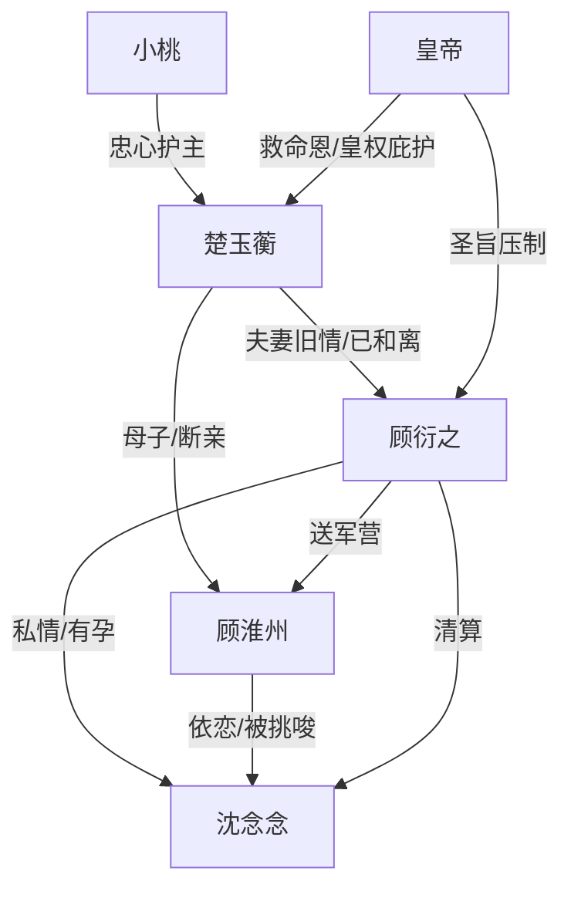

# 角色标签图谱

## 角色清单

### 楚玉蘅 — 清醒断情女医
- 叙事功能: 第一视角主角，承受羞辱并完成离府、和离、身份重建。
- 核心标签: 克制、清醒、医者自由身
- 弧光: 被逼回府的侯夫人 → 圣旨和离的救驾恩人 → 济世神医
- 台词风格: 短句、平静、极少控诉
- 关键行为: 写信入宫求旨；拒见顾衍之；最终开医馆独立生活。
- 读者情绪关系: 心疼、代入、爽。

### 顾衍之 — 疯批追妻火葬场侯爷
- 叙事功能: 主要施压者，也是后半段悔恨偿债载体。
- 核心标签: 自私、控制欲、迟来悔恨
- 弧光: 以权逼妻回府 → 犬笼羞辱女主 → 跪宫门追遍天涯
- 台词风格: 命令、质问、崩溃式哀求
- 关键行为: 以父母威胁；护沈氏；逼女主进犬笼；后期清算沈氏并追妻。
- 读者情绪关系: 恨、痛快、看其崩塌。

### 沈念念 — 伪柔弱寡嫂
- 叙事功能: 第三者压迫源，推动男主与儿子背叛女主。
- 核心标签: 白莲、算计、借孕上位
- 弧光: 寺中藏孕 → 入府争位 → 被落胎送庵
- 台词风格: 柔弱自责、以退为进
- 关键行为: 借腹中孩子求名分；送训练过的猎犬；逼女主入笼。
- 读者情绪关系: 恨、期待报应。

### 顾淮州 — 白眼狼亲子
- 叙事功能: 加重女主心碎与断亲合理性。
- 核心标签: 被挑唆、冷血、迟悟
- 弧光: 抱沈氏叫念姨 → 放狗害母 → 军营醒悟 → 求母不成
- 台词风格: 稚气残忍，后期发抖认错
- 关键行为: 放开猎犬；骂母亲害人精；最后带桂花糕求原谅。
- 读者情绪关系: 心寒、复杂、有限同情。

### 小桃 — 忠仆牺牲者
- 叙事功能: 女主身边唯一真心，制造不可逆情绪债。
- 核心标签: 忠烈、护主、牺牲
- 弧光: 为女主不平 → 推开猎犬 → 撞柱自戕
- 台词风格: 直接、哭喊、护主
- 关键行为: 用银簪伤狗救女主；宁死不愿女主受辱。
- 读者情绪关系: 心疼、愤怒、要求清算。

### 皇帝 — 皇权后盾型贵人
- 叙事功能: 兑现伏笔，提供合法清算与身份抬升。
- 核心标签: 温和、护短、权威
- 弧光: 被救贵人 → 赐和离 → 封济世神医
- 台词风格: 平稳、有分量
- 关键行为: 准和离；派禁军护女主；赐金令医榜。
- 读者情绪关系: 爽、安心、补偿。

## 关系网络

## 角色功能对照表（供改编参考）

| 原角色 | 极致标签 | 叙事功能 | 读者情绪功能 | 改编时必须保留的 |
|--------|---------|---------|-------------|---------------|
| 楚玉蘅 | 清醒断情女医 | 承债与断债主轴 | 心疼、爽 | 冷静退场，不复合 |
| 顾衍之 | 疯批侯爷 | 压迫者与偿债者 | 恨、看崩塌 | 前期足够狠，后期足够惨 |
| 沈念念 | 白莲寡嫂 | 第三者与挑拨者 | 恨 | 以柔弱姿态施害 |
| 顾淮州 | 白眼狼儿子 | 亲情背刺 | 心寒 | 必须亲口伤母，后期迟悟 |
| 小桃 | 忠仆 | 不可逆牺牲 | 心疼、愤怒 | 牺牲要成为清算理由 |
| 皇帝 | 权威贵人 | 身份反转载体 | 爽、补偿 | 合法高权力背书 |
