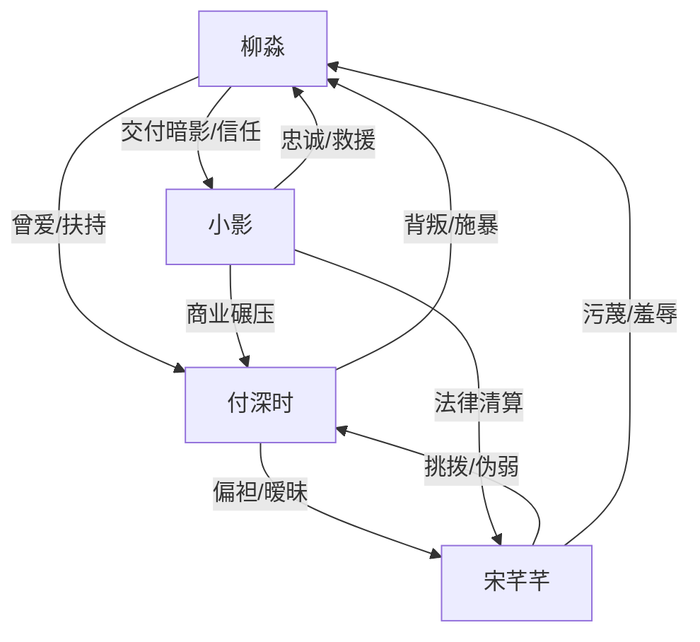

# 角色标签图谱

## 角色清单

### 柳淼 — 隐退大佬/清醒复仇女主
- 叙事功能: 被压迫者、隐藏资源源头、价值重建者。
- 核心标签: 隐忍、强大、清醒。
- 弧光: 为爱放弃暗影 → 被背叛触底 → 回到光里重建秩序。
- 台词风格: 短句、冷静、少解释。
- 关键行为: 拒绝下跪、吐血反击、切割付深时、关闭暗影。
- 读者情绪关系: 前半心疼，后半爽与敬佩。

### 付深时 — 软饭硬吃的亲密关系施暴者
- 叙事功能: 主压迫者、温度反转对象、清算靶心。
- 核心标签: 自负、残忍、懦弱。
- 弧光: 自认商业天才 → 直播凌虐妻子 → 得知真相跪地求生。
- 台词风格: 居高临下、羞辱式、求饶时急碎。
- 关键行为: 下药、直播、放狗、高压水枪、威胁公开视频、跪求谅解。
- 读者情绪关系: 强恨点，后期提供跪地爽点。

### 宋芊芊 — 绿茶贫困生/伪弱者
- 叙事功能: 挑拨者、道德绑架载体、互咬对象。
- 核心标签: 装善良、阴毒、贪婪。
- 弧光: 装可怜受害者 → 怂恿施暴 → 失势后反咬付深时。
- 台词风格: “姐姐”“命贱”“别为难”式绿茶话术。
- 关键行为: 污蔑搭车事件、怂恿水枪和扒衣、勒住付深时。
- 读者情绪关系: 强厌恶，适合被反噬。

### 小影 — 忠犬旧部/正光掌门人
- 叙事功能: 救援者、身份揭露者、女主补偿关系。
- 核心标签: 忠诚、克制、执行力。
- 弧光: 暗影继承人 → 正光掌门 → 女主新秩序合作者。
- 台词风格: 少话、冷硬、关键句有重量。
- 关键行为: 直升机救援、披衣、揭露真相、接管付氏。
- 读者情绪关系: 安全感与补偿感。

## 关系网络

## 角色功能对照表（供改编参考）

| 原角色 | 极致标签 | 叙事功能 | 读者情绪功能 | 改编时必须保留的 |
|--------|---------|---------|-------------|---------------|
| 柳淼 | 隐退大佬妻子 | 被压迫后反杀 | 心疼→爽→敬佩 | 为爱隐退、隐藏资源、最终重建 |
| 付深时 | 软饭硬吃丈夫 | 主施害者 | 恨、鄙夷 | 亲密背叛、傲慢、失势跪求 |
| 宋芊芊 | 绿茶贫困生 | 挑拨和放大压迫 | 厌恶 | 伪弱者话术、怂恿升级、后期互咬 |
| 小影 | 忠犬掌权者 | 救援和揭露 | 安全感 | 关键时刻降临、揭身份、执行清算 |
