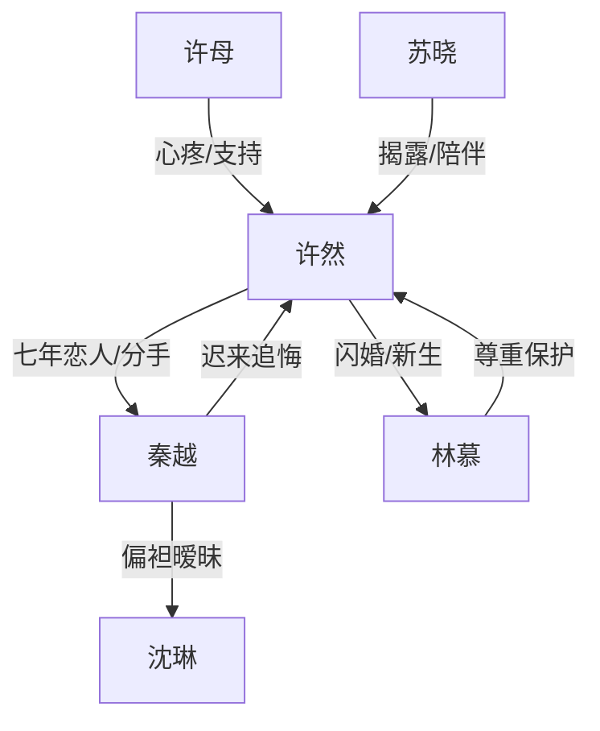

# 角色标签图谱

## 角色清单

### 许然 — 清醒止损大女主

- 叙事功能: 情绪承受者、关系切割者、新生活选择者
- 核心标签: 清醒、克制、重视母亲
- 弧光: 七年等待者 → 主动分手者 → 被好好珍惜的妻子
- 台词风格: 平静短句，关键处直接截断对方
- 关键行为: 提分手、相亲、次日领证、拒绝前任回头
- 读者情绪关系: 心疼、代入、爽

### 秦越 — 迟来深情前任

- 叙事功能: 压迫源、反面价值观、追悔火葬场承担者
- 核心标签: 自私、拖延、理所当然
- 弧光: 稳操胜券 → 愤怒否认 → 追悔失控 → 永久错过
- 台词风格: 安抚式画饼、责备式控制、后期低姿态道歉
- 关键行为: 饭局离席、生日撒谎、拒绝承认分手、要求许然离婚
- 读者情绪关系: 恨、厌、想看他失去

### 林慕 — 稳定温柔新丈夫

- 叙事功能: 补偿型男主、确定性未来、对照秦越
- 核心标签: 尊重、稳定、温柔
- 弧光: 相亲对象 → 合法丈夫 → 公开保护者 → 幸福兑现者
- 台词风格: 认真、边界清晰、少承诺多行动
- 关键行为: 确认许然非赌气、领证、做饭、公开维护“我太太”
- 读者情绪关系: 安心、甜、补偿

### 许母 — 道德坐标与心疼锚点

- 叙事功能: 触发女主清醒、承载亲情债
- 核心标签: 隐忍、护女、体面
- 弧光: 失望旁观 → 支持女儿 → 见证幸福
- 台词风格: 少而重，朴素直接
- 关键行为: 饭局沉默、短信提醒、支持分手与相亲
- 读者情绪关系: 心疼、认同、保护欲

### 沈琳 — 隐性第三者/引爆工具

- 叙事功能: 秦越偏心的证明，压垮旧关系的证据
- 核心标签: 年轻助理、暧昧受益者、误判者
- 弧光: 被照顾者 → 被秦越否认 → 辞职退场
- 台词风格: 通过朋友圈间接出现
- 关键行为: 饭局电话、生日西餐截图
- 读者情绪关系: 厌烦、辅助恨秦越

### 苏晓 — 女主外部嘴替

- 叙事功能: 信息提供者、读者情绪代言人
- 核心标签: 仗义、直爽、清醒
- 弧光: 支持分手 → 揭露谎言 → 见证幸福
- 台词风格: 网感强、情绪外放
- 关键行为: 发截图、陪相亲、传递秦越近况
- 读者情绪关系: 爽、解气

## 关系网络

## 角色功能对照表（供改编参考）

| 原角色 | 极致标签 | 叙事功能 | 读者情绪功能 | 改编时必须保留的 |
|--------|---------|---------|-------------|---------------|
| 许然 | 清醒止损女主 | 主动切割旧关系 | 心疼转爽 | 不是赌气，是长期失望后的清醒 |
| 秦越 | 迟来深情前任 | 制造情绪债并承担追悔 | 恨与打脸 | 长期拖延、理所当然、失去后才懂 |
| 林慕 | 稳定补偿男主 | 兑现确定未来 | 安心与甜 | 尊重边界、行动胜过承诺 |
| 许母 | 护女母亲 | 道德坐标 | 心疼与认同 | 一句“别看轻自己”式点醒 |
| 沈琳 | 暧昧助理 | 引爆证据 | 厌恶 | 证明前任把女主排在别人之后 |
| 苏晓 | 闺蜜嘴替 | 信息与情绪放大 | 解气 | 提供证据并支持女主 |
