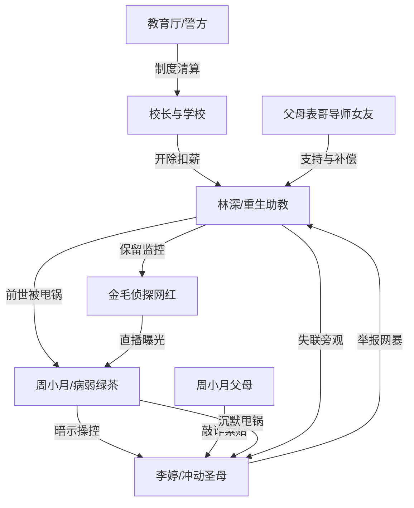

# 角色标签图谱

## 角色清单

### 林深 — 清醒重生复仇者
- 叙事功能: 第一人称主角、前世受害者、今生证据持有人和因果旁观者。
- 核心标签: 重生、冷静、懂撤退
- 弧光: 热心软和的助教 → 被十年折磨磨冷 → 重生后主动脱身并完成反杀 → 回归爱情与人生
- 台词风格: 短句、嘲讽、直给，如“你真让人恶心！”
- 关键行为: 拒绝买冰箱；诱导被开除；出国失联；保留监控；匿名引来网红；直播交证据。
- 读者情绪关系: 心疼、代入、爽、少量道德不安。

### 周小月 — 病弱绿茶捕食者
- 叙事功能: 核心施害者，利用病弱形象和沉默操控他人替她冲锋。
- 核心标签: 瓷娃娃、绿茶、毒娃娃
- 弧光: 楚楚可怜的病弱学生 → 暴露偏执占有欲 → 拔插头自导自演 → 全网审判 → 死亡
- 台词风格: 轻、弱、含混，关键处甩锅。
- 关键行为: 不澄清病情；暗示需要冰箱；拔掉插头；沉默坐实李婷；直播卖惨；甩锅父母和室友。
- 读者情绪关系: 恨、恶心、期待报应。

### 李婷 — 冲动圣母大宫女
- 叙事功能: 前世帮凶，今生替主角承接责任坑，完成因果回旋。
- 核心标签: 鲁莽、网暴惯犯、替罪羊
- 弧光: 站出来替周小月出头 → 举报林深 → 买冰箱入坑 → 被周家反咬 → 网暴逼死
- 台词风格: 火爆、命令式、威胁式。
- 关键行为: 投诉林深；买冰箱；作证甩锅失败；直播跳楼。
- 读者情绪关系: 前期恨，后期复杂但不完全同情。

### 另外两个女生 — 应声虫帮凶
- 叙事功能: 群体恶的扩音器，证明施害不是孤立个体。
- 核心标签: 从众、怯懦、帮凶
- 弧光: 跟随举报 → 出事后逃避 → 被舆论和周小月甩锅逼疯/死亡
- 台词风格: 存在感低，更多通过行为体现。
- 关键行为: 参与举报和作证；后期请假逃离；其中一人杀人后同归于尽。
- 读者情绪关系: 厌恶、报应感。

### 校长/学校管理层 — 草台权力机器
- 叙事功能: 制度性压迫来源，把个体责任转嫁给弱势员工。
- 核心标签: 傲慢、贪婪、腐烂
- 弧光: 借道德名义开除林深 → 推卸周小月事件 → 被调查组清算 → 校长入狱、学校被收购
- 台词风格: 居高临下、审判式。
- 关键行为: 询问性取向；无故开除；扣工资；检查时称监控坏了；后期甩锅。
- 读者情绪关系: 恨、期待制度清算。

### 金毛侦探网红 — 爽点放大器
- 叙事功能: 把私下证据转化成百万直播公共审判。
- 核心标签: 网红、侦探、流量推手
- 弧光: 为李婷追真相 → 找到林深 → 接收证据 → 引爆全网
- 台词风格: 直播化、煽动性、会卡节奏。
- 关键行为: 万里寻人；直播采访；播放监控；质问周小月。
- 读者情绪关系: 期待、代替读者发问。

### 表哥/父母/女朋友/导师 — 主角价值锚点
- 叙事功能: 证明林深不是孤立复仇机器，他有本该被保护的人生。
- 核心标签: 家庭支持、爱情补偿、师门资源
- 弧光: 前世被牵连或错过 → 今生及时支持 → 帮主角远离火坑
- 台词风格: 亲近、实际、保护性。
- 关键行为: 表哥送荔枝和钱；父母支持出国；女朋友安慰；导师后期推动学校调查。
- 读者情绪关系: 心疼、补偿、温暖。

## 关系网络

## 角色功能对照表（供改编参考）

| 原角色 | 极致标签 | 叙事功能 | 读者情绪功能 | 改编时必须保留的 |
|--------|---------|---------|-------------|---------------|
| 林深 | 清醒重生复仇者 | 撤离责任链、持有证据 | 代入、爽、心疼 | 前世惨债、今生冷静、不能主动害人 |
| 周小月 | 病弱绿茶捕食者 | 核心陷阱制造者 | 恨、恶心 | 病弱保护色+沉默甩锅+自导自演 |
| 李婷 | 冲动圣母帮凶 | 替主角入坑 | 因果反噬爽点 | 前期作恶、后期被同规则吞噬 |
| 学校 | 草台权力机器 | 制度压迫 | 期待清算 | 傲慢开除、扣工资、后期被调查 |
| 金毛网红 | 直播审判工具 | 放大真相 | 引爆爽点 | 公开场域、百万观看、替读者质问 |
| 家人/爱人 | 人生补偿锚 | 证明主角值得被爱 | 温暖、补偿 | 前世损失与今生重新获得 |
