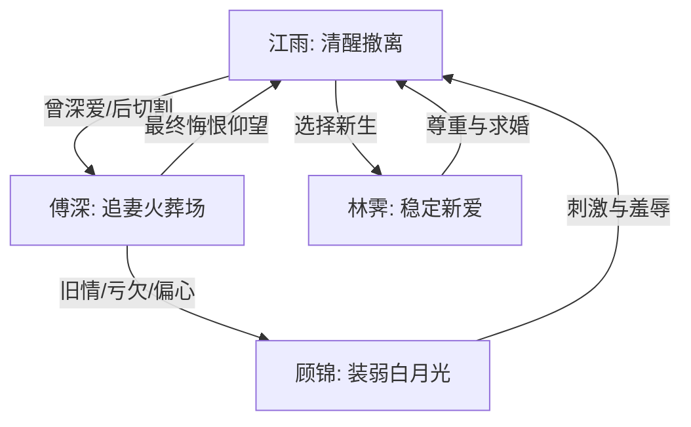

# 角色标签图谱

## 角色清单

### 江雨 — 清醒撤离型虐文大女主
- 叙事功能: 受害者、审判者、情绪视角锚点。
- 核心标签: 温柔旧爱、冷静心死、事业新生。
- 弧光: 婚前期待 → 背叛确认 → 流产触底 → 主动撤离 → 新生胜利。
- 台词风格: 轻声、温和、短句，越平静杀伤越强。
- 关键行为: 丢掉生煎、独自签字手术、拔针摊牌、搬家、ICU 告别、三年后接受新求婚。
- 读者情绪关系: 心疼、替她憋屈、最终获得补偿性爽感。

### 傅深 — 自负失守型追妻火葬场男主
- 叙事功能: 施害者、温度反转对象、悔恨容器。
- 核心标签: 霸总、旧情未清、自我欺骗。
- 弧光: 高位宠溺 → 偏心顾锦 → 失去孩子与爱人 → 跪求崩塌 → 终身悔恨。
- 台词风格: 前期命令式和辩解式，后期破碎哀求。
- 关键行为: 五千万赎宅、试婚纱离开、护顾锦、撞倒江雨、雨夜再弃、ICU 求见。
- 读者情绪关系: 前期恨，后期看他痛苦获得清算快感。

### 顾锦 — 装弱攀附型白月光
- 叙事功能: 偏爱试纸、导火索、对照反派。
- 核心标签: 破产名媛、装可怜、攀附者。
- 弧光: 落魄回国 → 借抑郁症索取照顾 → 宣示顾宅和傅深 → 被停卡赶出江城。
- 台词风格: 娇柔、示弱、暗含炫耀。
- 关键行为: 接傅深电话炫耀、在顾宅躲傅深身后、朋友圈发十指紧扣、酒吧宣示正宫。
- 读者情绪关系: 厌恶，但最终火力集中在傅深。

### 林霁 — 新生活补偿型稳定爱人
- 叙事功能: 结尾补偿、价值对照、真爱证明。
- 核心标签: 温柔、尊重、明亮。
- 弧光: 三年后登场 → 求婚成功。
- 台词风格: 体贴自然，不抢戏。
- 关键行为: 晚宴上替江雨整理头发，公开求婚。
- 读者情绪关系: 放心、补偿、替女主圆满。

## 关系网络

## 角色功能对照表（供改编参考）

| 原角色 | 极致标签 | 叙事功能 | 读者情绪功能 | 改编时必须保留的 |
|--------|---------|---------|-------------|---------------|
| 江雨 | 清醒撤离型大女主 | 视角、受害、审判 | 心疼到爽 | 平静撤离，不雌竞，不崩溃 |
| 傅深 | 自负失守火葬场男主 | 施害与悔恨 | 恨与清算 | 旧日深情证据 + 后期跪求崩塌 |
| 顾锦 | 装弱白月光 | 试探男主偏心 | 厌恶 | 示弱话术和炫耀证据 |
| 林霁 | 补偿型新爱 | 结尾圆满 | 安心 | 不必复杂，但必须尊重女主 |
