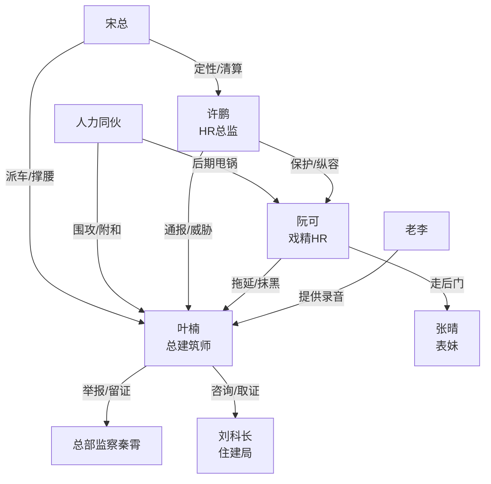

# 角色标签图谱

## 角色清单

### 叶楠 — 清醒克制型职场大女主

- 叙事功能: 受害者、留证者、反杀执行者。
- 核心标签: 总建筑师、冷静、证据意识强。
- 弧光: 被污名化的举报人 → 被事实证明的关键功臣。
- 台词风格: 短句、追问、要书面证据。
- 关键行为: 举报总部监察办；联系住建局；收集录音和监控；坚持最后时限申报。
- 读者情绪关系: 心疼、代入、爽。

### 阮可 — 戏精绿茶型 HR 反派

- 叙事功能: 直接施害者，制造压迫和恨点。
- 核心标签: 哭戏、走后门、伪善。
- 弧光: 被众人保护的小姑娘 → 被证据锤死的违规员工。
- 台词风格: 委屈、装弱、流程话术。
- 关键行为: 压材料 25 天；索要无效材料；住建局抹黑；学术造假举报；给表妹铺路。
- 读者情绪关系: 恨、厌恶、等待报应。

### 许鹏 — 护短滥权型 HR 总监

- 叙事功能: 权力压迫升级器，代表制度被滥用。
- 核心标签: 官腔、护犊子、甩锅。
- 弧光: 高高在上的流程裁判 → 被宋总压住的失格管理者。
- 台词风格: 官方、威胁、偷换概念。
- 关键行为: 要叶楠道歉撤诉；群通报污名化；暂停续期；甩锅阮可。
- 读者情绪关系: 恨、鄙夷、爽点承压对象。

### 秦霄 — 冷面监察审判官

- 叙事功能: 第三方权威，承接证据链并启动清算。
- 核心标签: 稳、准、冷。
- 弧光: 入场调查者 → 事实审判者。
- 台词风格: 短问、追问、要求正面回答。
- 关键行为: 逐项核实、播放录音、逼问许鹏。
- 读者情绪关系: 安全感、爽。

### 宋总 — 最终定性者

- 叙事功能: 最高权力背书，完成组织层面的价值回正。
- 核心标签: 权威、务实、护公司规则。
- 弧光: 后台决策者 → 现场定性者。
- 台词风格: 简短有压迫感。
- 关键行为: 推门压许鹏；派车抢救申报；全员大会定调流程整改。
- 读者情绪关系: 释放、被撑腰感。

### 老李 — 关键证人

- 叙事功能: 提供录音，推动反杀证据链闭合。
- 核心标签: 人精、正义、旁观者转证人。
- 弧光: 听到秘密的人 → 主动递刀的人。
- 台词风格: 压低声音、直接说明。
- 关键行为: 告知人力小会内容并提供录音。
- 读者情绪关系: 松一口气、期待反击。

### 王姐/人力同伙 — 舆论帮凶

- 叙事功能: 放大阮可哭戏，后期反咬形成讽刺。
- 核心标签: 护短、跟风、甩锅。
- 弧光: 围攻叶楠 → 反咬阮可 → 被处分。
- 台词风格: 站队式、复制粘贴式。
- 关键行为: 指责叶楠、群里附和、后期甩锅。
- 读者情绪关系: 厌烦、报应感。

### 张晴 — 隐身获益者

- 叙事功能: 阮可行动动机的利益源头。
- 核心标签: 表妹、见习建筑师、隐身受益。
- 弧光: 被推上位的候选人 → 考核不合格离开。
- 台词风格: 几乎无台词，靠叙述定性。
- 关键行为: 背后可能怂恿，成为替换叶楠的目标人选。
- 读者情绪关系: 怀疑、轻蔑。

## 关系网络

## 角色功能对照表（供改编参考）

| 原角色 | 极致标签 | 叙事功能 | 读者情绪功能 | 改编时必须保留的 |
|--------|---------|---------|-------------|---------------|
| 叶楠 | 清醒大女主 | 受害者兼反杀者 | 代入、心疼、爽 | 克制留证，不情绪化骂街 |
| 阮可 | 戏精绿茶 HR | 直接施害者 | 恨点制造 | 哭戏造势、走后门动机 |
| 许鹏 | 护短滥权上级 | 压迫升级 | 更大恨点 | 用流程压人、公开污名 |
| 秦霄 | 冷面审判官 | 第三方权威 | 爽点释放 | 一问一答式审问 |
| 宋总 | 高层裁决者 | 最终定性 | 安全感 | 一句话压住反派 |
| 老李 | 递证据的旁观者 | 证据补强 | 反击期待 | 关键录音或记录 |
| 人力同伙 | 跟风帮凶 | 舆论压力 | 群体报应 | 前期围攻，后期甩锅 |
