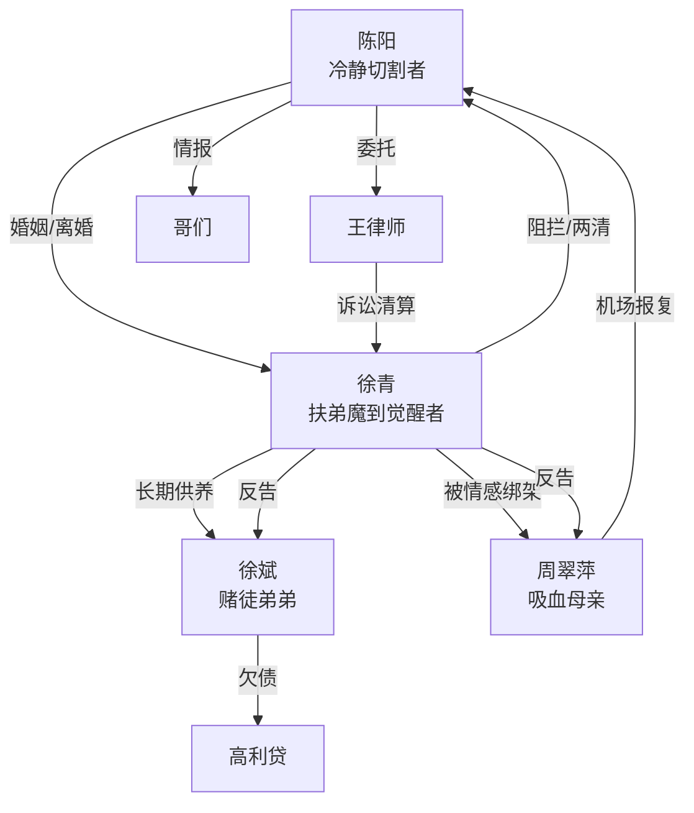

# 角色标签图谱

## 角色清单

### 陈阳 — 冷静切割型复仇男主

- 叙事功能: 第一视角叙述者、经济反击执行者、法律清算发起者。
- 核心标签: 隐忍三年、理性算计、边界感强。
- 弧光: 被妻子剥夺发言权 → 经济切割 → 法律胜诉 → 接受两清后的空白。
- 台词风格: 短句、反问、冷定义。
- 关键行为: 签外派合同、清空共同账户、保留证据、申请离婚和财产保全。
- 读者情绪关系: 前半心疼，反击时爽，结尾对其冷酷有复杂感。

### 徐青 — 扶弟魔妻子/觉醒复仇者

- 叙事功能: 前半压迫者，后半觉醒者，完成二级反转。
- 核心标签: 高薪扶弟、婚姻失责、原生家庭受害者。
- 弧光: 盛气凌人 → 经济崩溃 → 认清娘家 → 净身出户并反告亲人 → 两清离场。
- 台词风格: 前期轻蔑命令，后期冷静决绝。
- 关键行为: 把工资全贴娘家、求陈阳卖房、向律师同意离婚、法庭起诉母亲和弟弟、机场挡母亲。
- 读者情绪关系: 前半恨，后半复杂心疼和认可。

### 徐斌 — 赌徒吸血弟弟

- 叙事功能: 家庭经济黑洞，制造外部高利贷危机。
- 核心标签: 啃姐、赌博、无担当。
- 弧光: 张口要钱 → 高利贷爆雷 → 被带走 → 被另案处理。
- 台词风格: 油滑、理直气壮、装可怜。
- 关键行为: 索要三十万、谎称投资、欠下高利贷。
- 读者情绪关系: 强恨点，承担主要报应期待。

### 周翠萍 — 吸血母亲/疯癫报复者

- 叙事功能: 亲情绑架源头，终局暴力风险。
- 核心标签: 重男轻女、道德绑架、失控疯母。
- 弧光: 索取女儿 → 拒绝救女儿 → 庭审崩溃 → 机场报复。
- 台词风格: 泼辣、咒骂、亲情绑架。
- 关键行为: 逼徐青供弟、法庭撒泼、机场袭击陈阳。
- 读者情绪关系: 最大伦理恨点。

### 王律师 — 法律清算工具人

- 叙事功能: 将私人复仇转化为合法清算。
- 核心标签: 专业、冷静、推进器。
- 弧光: 收证据 → 起诉离婚 → 财产保全 → 并案审理。
- 台词风格: 专业、中性。
- 关键行为: 提醒时机、发起诉讼、推动并案。
- 读者情绪关系: 安全感和爽感工具。

### 哥们/共同好友 — 信息转播者

- 叙事功能: 让远在巴黎的男主仍能掌握国内崩塌现场。
- 核心标签: 旁观、转述、劝和/提醒。
- 弧光: 转告徐青崩溃 → 直播卖包和律师函 → 提醒机场风险。
- 台词风格: 口语化。
- 关键行为: 转达 78 个电话、卖包实况、疯母航班信息。
- 读者情绪关系: 提供吃瓜视角和外部验证。

## 关系网络

## 角色功能对照表（供改编参考）

| 原角色 | 极致标签 | 叙事功能 | 读者情绪功能 | 改编时必须保留的 |
|--------|---------|---------|-------------|---------------|
| 陈阳 | 冷静复仇者 | 反击主轴 | 先心疼后爽 | 三年供养、冷静切割、合法证据 |
| 徐青 | 扶弟魔觉醒者 | 反派转复杂角色 | 先恨后复杂 | “没资格管”种因与后期觉醒 |
| 徐斌 | 赌徒弟弟 | 外部债务爆雷 | 强恨点 | 啃姐、撒谎、债务反噬 |
| 周翠萍 | 吸血疯母 | 亲情绑架源头 | 道德厌恶 | 重男轻女、逼女儿、终局失控 |
| 王律师 | 法律刀 | 合法清算 | 爽感保障 | 证据链、财产保全、诉讼 |
| 哥们 | 情报眼 | 远程转播 | 追读辅助 | 旁观实况和机场预警 |
