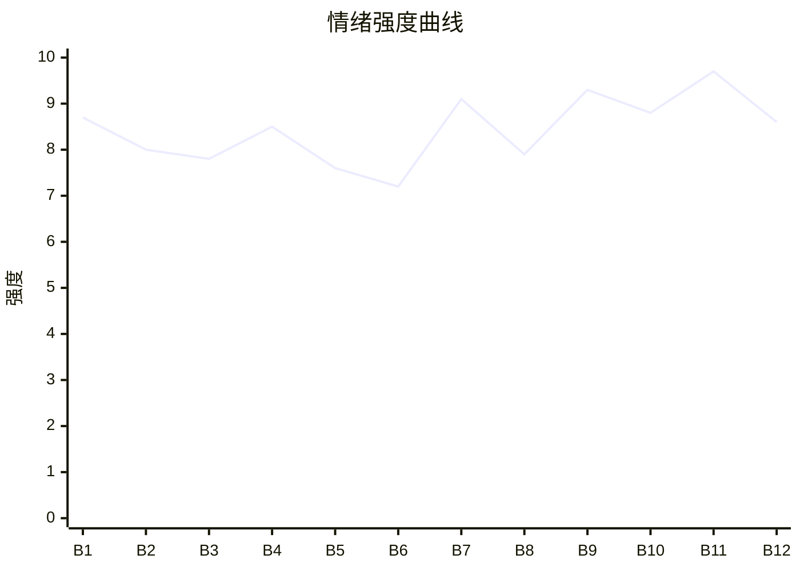

# Beat Sheet 节拍器

## 全文概况

- 总字数: 约 12300 字
- 节拍数: 12 幕
- 核心母题（Logline）: 高考 700 分的沈雨被全家逼妹妹冒名顶替上清大，她暗中接受港大录取，让谎言在公开场合反噬，最终断亲并夺回人生。
- 情绪模式: 极致打压 → 冷静藏牌 → 公开翻车 → 反身清算 → 断亲新生

## 节拍详表

### Beat 1: 700 分被妹妹冒名 [开篇-港大电话前]
- **字数**: 约 950 字（占比 7.7%）
- **核心事件**: 清大招生办上门，全家当场把 200 分的沈念推出去冒充 700 分的沈雨。
- **情绪标签**: 震惊、屈辱、背叛
- **情绪强度**: 8.7/10
- **情绪方向**: ⚡突变
- **冲突类型**: 大转折
- **悬念钩子**: 沈雨打给港大，同意提前调档。
- **叙事速度**: 快
- **对话占比**: 45%
- **reversal_mechanism**: [M2, M3]
- **hook_strength**: 8.6/10（极端度 2.7，信息密度 2.6，悬念 1.7，节奏 1.6）
- **关键句**: “至于你，就代替妹妹上野鸡民办大专。”
- **原文摘录**: 高考成绩出来，我考了700，双胞胎妹妹考了200。清大招生办当晚便出现在家里。哥哥攥住我的手，把妹妹推了出去：“这里，她就是沈雨。”招生办老师离开后，哥哥命令我：“沈雨，从今天开始，念念就是你，她会代替你去上清大。”爸爸说：“就凭你妈怀你们的时候，你抢了你妹妹所有营养。”我拿起手机给港大招生办打了电话：“老师，我同意你们提前调走我的档案。”

### Beat 2: 家族群公开造谣禁言 [港大承诺-回忆前]
- **字数**: 约 900 字（占比 7.3%）
- **核心事件**: 哥哥在百人家族群宣布沈念考 700 分，并禁言沈雨，把她塑造成 200 分废物。
- **情绪标签**: 憋屈、羞辱、孤立
- **情绪强度**: 8.0/10
- **情绪方向**: ↓下降
- **冲突类型**: 微冲突
- **悬念钩子**: 沈雨被长期污名化的原因展开。
- **叙事速度**: 中
- **对话占比**: 35%
- **reversal_mechanism**: [M3]
- **hook_strength**: null
- **关键句**: “你已被‘哥哥’管理员禁言。”
- **原文摘录**: 港大承诺全额奖学金、学费全免、专业任选，还赠送公寓和工作解决。随后哥哥在一百号人的家族群里宣布：“恭喜我的宝贝妹妹念念今年考了700分，即将在9月入学清大！”有人问沈雨考得怎么样，页面弹出提示：“你已被‘哥哥’管理员禁言。”哥哥说：“沈雨？就考了200分，上个野鸡大专都勉强，废物一个。”

### Beat 3: 铁盒奖状与童年欠债 [家族群后-楼下争取前]
- **字数**: 约 1100 字（占比 8.9%）
- **核心事件**: 沈雨打开铁盒，回忆奖状被撕、哥哥变心、自己从小被要求偿还妹妹体弱的“债”。
- **情绪标签**: 心疼、压抑、失落
- **情绪强度**: 7.8/10
- **情绪方向**: ↓下降
- **冲突类型**: 微冲突
- **悬念钩子**: 她决定最后争取一次。
- **叙事速度**: 慢
- **对话占比**: 15%
- **reversal_mechanism**: [M5]
- **hook_strength**: null
- **关键句**: “这句话，我从小听到大。”
- **原文摘录**: 我拿出一个铁盒，里面都是我偷偷捡起来的、已经被撕毁的奖状。眼泪晕染开了“沈雨”两个字。小时候哥哥也会偷偷给我买糖：“我们雨雨也很棒。”直到 8 岁那年，沈念身体急转直下，从那以后，家里唯一爱我的哥哥也去了沈念那边。“这是你欠她的！”这句话，我从小听到大。

### Beat 4: 当面争取被掌掴，志愿被接管 [楼下争取-填志愿后]
- **字数**: 约 1500 字（占比 12.2%）
- **核心事件**: 沈雨争取自己的成绩，被父亲打，哥哥接管账号替她填清大。
- **情绪标签**: 愤怒、恐惧、冷却
- **情绪强度**: 8.5/10
- **情绪方向**: ⚡突变后转稳
- **冲突类型**: 大转折
- **悬念钩子**: 他们以为掌控志愿，读者知道档案已被港大调走。
- **叙事速度**: 快
- **对话占比**: 50%
- **reversal_mechanism**: [M2, M3]
- **hook_strength**: null
- **关键句**: “反正我的档案已经被港大调走了，他们填什么都是无用功。”
- **原文摘录**: 我说：“那是我的成绩，我不想把它让给沈念！”清脆耳光打断了我。哥哥说：“说什么话，那是沈雨欠你的。”随后他拿出电脑：“准考证拿过来，我来填志愿，密码也告诉我。”我没反抗。反正我的档案已经被港大调走了，他们填什么都是无用功。沈念选汉语言，我嗤笑：是怕选理工科第一天就露馅吧。

### Beat 5: 菠萝肉与升学宴 [志愿后-清大电话]
- **字数**: 约 1150 字（占比 9.3%）
- **核心事件**: 妈妈用沈雨严重过敏的菠萝肉“奖励”她，次日又办升学宴给沈念造势，沈雨被迫沉默。
- **情绪标签**: 心寒、讽刺、隐忍
- **情绪强度**: 7.6/10
- **情绪方向**: →平稳压迫
- **冲突类型**: 微冲突
- **悬念钩子**: 沈雨正式收到港大录取，清大老师来电确认她放弃。
- **叙事速度**: 中
- **对话占比**: 30%
- **reversal_mechanism**: [M5]
- **hook_strength**: null
- **关键句**: “谢谢你连我菠萝严重过敏都不记得了。”
- **原文摘录**: 妈妈说今晚给我做菠萝肉奖励我。我笑着说谢谢，心里想：谢谢你连我菠萝严重过敏都不记得了。次日他们举办升学宴，庆祝沈念考上清大。爸爸说：“我这小女儿从小体弱多病，结果是我们家最争气的一个！”手机里，港大招生办短信：“你的档案已入驻港大，请问你选什么专业？”我回复：“人工智能工程。”

### Beat 6: 通知书被沈念藏起 [半个月后-沈念进房]
- **字数**: 约 850 字（占比 6.9%）
- **核心事件**: 两份录取通知书到家，沈念怕露馅，撒娇阻止拆封，全家纵容。
- **情绪标签**: 紧张、讽刺、期待翻车
- **情绪强度**: 7.2/10
- **情绪方向**: ↑上升
- **冲突类型**: 微冲突
- **悬念钩子**: 港大通知书被藏入行李箱，成为后续翻车道具。
- **叙事速度**: 快
- **对话占比**: 40%
- **reversal_mechanism**: [M2, M6]
- **hook_strength**: null
- **关键句**: “那上面写着姐姐的名字，我不开心不想看！”
- **原文摘录**: 邮差说：“沈家两份录取通知书都到了！”妈妈打算拆开，沈念却一把抽走两份录取通知书扔进行李箱角落：“那上面写着姐姐的名字，我不开心不想看！”哥哥宠溺道：“好，不看就不看，到时候清大直接报道就行了。”我说：“你们说的都对。”

### Beat 7: 精神支柱被烧成灰 [沈念抢铁盒-开学前]
- **字数**: 约 1450 字（占比 11.8%）
- **核心事件**: 沈念抢铁盒要烧奖状，反咬沈雨打她，哥哥亲手烧掉沈雨十几年的精神支柱。
- **情绪标签**: 崩溃、恨意、决绝
- **情绪强度**: 9.1/10
- **情绪方向**: ⚡突变
- **冲突类型**: 大转折
- **悬念钩子**: 沈雨决定不再坦白，让他们多带人去清大翻车。
- **叙事速度**: 快
- **对话占比**: 45%
- **reversal_mechanism**: [M3, M5]
- **hook_strength**: null
- **关键句**: “去吧。多带点人，多炫耀炫耀。”
- **原文摘录**: 沈念发现铁盒，拿着打火机说不能留下这些东西。我抢回来，她栽倒在地。哥哥冲上来给我一耳光：“沈雨！你竟然敢打她？！”妈妈说我是不是等着揭发妹妹。哥哥夺过奖状，一把火烧了它们。我坐在地上看着灰，把它们一点点捧回铁盒，手都烫红了也不停。本想开学坦白，现在看来：去吧，多带点人，多炫耀炫耀。

### Beat 8: 开学前分配与最后警告 [生活费分配-机场]
- **字数**: 约 1250 字（占比 10.2%）
- **核心事件**: 家人给沈雨 700 生活费，给沈念 7000，还带亲戚浩荡送清大；沈雨提醒自己没被清大录取但无人相信。
- **情绪标签**: 冷静、脱离、期待
- **情绪强度**: 7.9/10
- **情绪方向**: ↑上升
- **冲突类型**: 微冲突
- **悬念钩子**: 两路人马分开，清大翻车倒计时。
- **叙事速度**: 中
- **对话占比**: 40%
- **reversal_mechanism**: [M2, M6]
- **hook_strength**: null
- **关键句**: “说了不信就不能怪我了。”
- **原文摘录**: 妈妈说我在本地大专，一个月 700；沈念去北京，一个月 5000，哥哥再给 2000。开学前，沈念十个行李箱，我一个小书包。哥哥警告我自己去学校报到。我说：“其实，我没有被清大录取。”他怒道：“志愿是我亲自填的，差点被你骗了！”他们扬长而去。我接到港大老师电话，背着装铁盒的书包去了机场。

### Beat 9: 清大迎新处当众查无此人 [清大报到-电话对峙]
- **字数**: 约 1600 字（占比 13.0%）
- **核心事件**: 沈念在清大报到查无此人，拆开通知书发现是港大录取通知书，公开社死。
- **情绪标签**: 爽、尴尬、报应
- **情绪强度**: 9.3/10
- **情绪方向**: ↑上升
- **冲突类型**: 大转折
- **悬念钩子**: 全家得知沈雨在港大，决定继续去抢。
- **叙事速度**: 快
- **对话占比**: 55%
- **reversal_mechanism**: [M2, M6]
- **hook_strength**: null
- **关键句**: “同学，这是港大的录取通知书，你来我们清大干什么？”
- **原文摘录**: 沈念在清大文学院迎新处说：“汉语言文学，沈雨。”老师查后说：“整个清大新生，都没有叫沈雨的。”沈念拆开没拆封的快递，老师看了一眼：“同学，这是港大的录取通知书，你来我们清大干什么？”哥哥给我打电话怒吼。我说：“密码都在你手里，我怎么改？况且我早就说过了，我没考清大，是你自己不信。”

### Beat 10: 港大舞台发言与二次抢夺 [港大入学-礼堂外]
- **字数**: 约 1350 字（占比 11.0%）
- **核心事件**: 沈雨成为港大新生代表公开发言，家人追到港大要求沈念继续替代她。
- **情绪标签**: 高光、荒诞、怒火
- **情绪强度**: 8.8/10
- **情绪方向**: ↑上升
- **冲突类型**: 大转折
- **悬念钩子**: 父亲在人群中动手，沈雨借势公开揭穿。
- **叙事速度**: 快
- **对话占比**: 45%
- **reversal_mechanism**: [M2, M6]
- **hook_strength**: null
- **关键句**: “从明天开始，念念就代替你留在这里。”
- **原文摘录**: 港大老师给我十万奖励，邀请我做新生代表。我上台发言：“今天我们不讲学习，也不讲学校展望，我们讲讲童年。”台下掌声热烈。家人站在最后，哥哥愣住：“那是沈雨？”晚会后他对我说：“我们已经给你买了回蓉城的机票，从明天开始，念念就代替你留在这里。”我说：“她有什么资格替代我？”

### Beat 11: 人群前挨打反杀，断亲成立 [父亲打人-港大驱逐]
- **字数**: 约 1450 字（占比 11.8%）
- **核心事件**: 沈雨故意在人多处挨父亲一巴掌，跪地揭露“妹妹代替我上学”，引发同学和老师审判，全家被保安赶出港大。
- **情绪标签**: 极爽、释放、被保护
- **情绪强度**: 9.7/10
- **情绪方向**: ⚡高潮
- **冲突类型**: 大转折
- **悬念钩子**: 她拉黑全家，关系进入不可逆断裂。
- **叙事速度**: 快
- **对话占比**: 60%
- **reversal_mechanism**: [M3, M6]
- **hook_strength**: null
- **关键句**: “哥，我说过，我的人生，谁也抢不走。”
- **原文摘录**: 爸爸扬手打来，我没有躲，就要在人最多的时候挨下这一巴掌。我跪在地上拉着他的裤脚：“爸爸我求你，不要让妹妹代替我上学！”周围炸开：“竟然让双胞胎妹妹代替沈雨上学！”老师赶来：“真以为随便一个阿猫阿狗就能替代高考700分的沈雨的人生吗？”我说：“我们断亲，从今以后，也休想抢走我的人生！”四人被保安赶出港大并拉入黑名单。

### Beat 12: 亲戚审判与四年后新生 [拉黑后-结尾]
- **字数**: 约 1150 字（占比 9.3%）
- **核心事件**: 亲戚上门讽刺沈念，全家迟来意识到偏心残忍；四年后沈雨毕业，拥有工作、房车和阳光房。
- **情绪标签**: 余爽、迟来悔恨、治愈
- **情绪强度**: 8.6/10
- **情绪方向**: ↓缓落
- **冲突类型**: 清算余波
- **悬念钩子**: 无，闭环收束。
- **叙事速度**: 中
- **对话占比**: 45%
- **reversal_mechanism**: [M3, M5]
- **hook_strength**: null
- **关键句**: “房间，我用了阳光最好的那一间。”
- **原文摘录**: 我删除拉黑所有联系方式。沈家门口，亲戚讽刺沈念：“原来考200分的废物，不是沈雨啊！”舅舅质问：“沈雨到底欠什么了？”哥哥进入我的小房间，看见洗得发白的衣服，妈妈哭着说：“原来小雨这些年，都住得这么阴暗潮湿。”四年后，我从港大毕业，获得年薪百万工作，买了自己的房子和车子。房间，我用了阳光最好的那一间。也没再和他们联系过。真的断了亲。

## 情绪曲线可视化

## 节拍密度检测

- 平均每 1025 字一个节拍
- 微冲突密度: 每约 1400 字一次
- 大转折密度: 每约 2050 字一次
- 判定: 符合高频节拍器标准，尤其后半每 1000-1500 字都有公开翻车或清算

## 反转机制清单(Reversal Mechanisms)

| 机制 ID | 机制名 | 承载 Beat | 关键段落/金句 | 等价改编提示 |
|--------|--------|-----------|--------------|-------------|
| M2 | 身份反差爆发 | Beat 1, 4, 9-11 | “那是沈雨？”“随便一个阿猫阿狗就能替代高考700分的沈雨的人生吗？” | 身份载体可换，但前期必须让主角被误认为低价值，后期用公开身份/能力反差砸脸 |
| M3 | 因果回旋反讽 | Beat 2, 7, 11-12 | “这是你欠念念的” → “我的人生，谁也抢不走” | 必须保留施害者名言，并在结尾用同一套规则回敬 |
| M5 | 温度反转曲线 | Beat 3, 5, 7, 12 | “我们雨雨也很棒” → “心思歹毒” → “被拉黑了” | 曾经温柔必须具体存在，后期悔恨必须建立在不可逆失去上 |
| M6 | 多层递进反转 | Beat 6, 8, 9, 10, 11 | 通知书藏起、清大查无此人、港大发言、公开挨打反杀 | 反转层数不能少，且每层量级递增：道具 → 学校系统 → 公众舞台 → 社会审判 |
