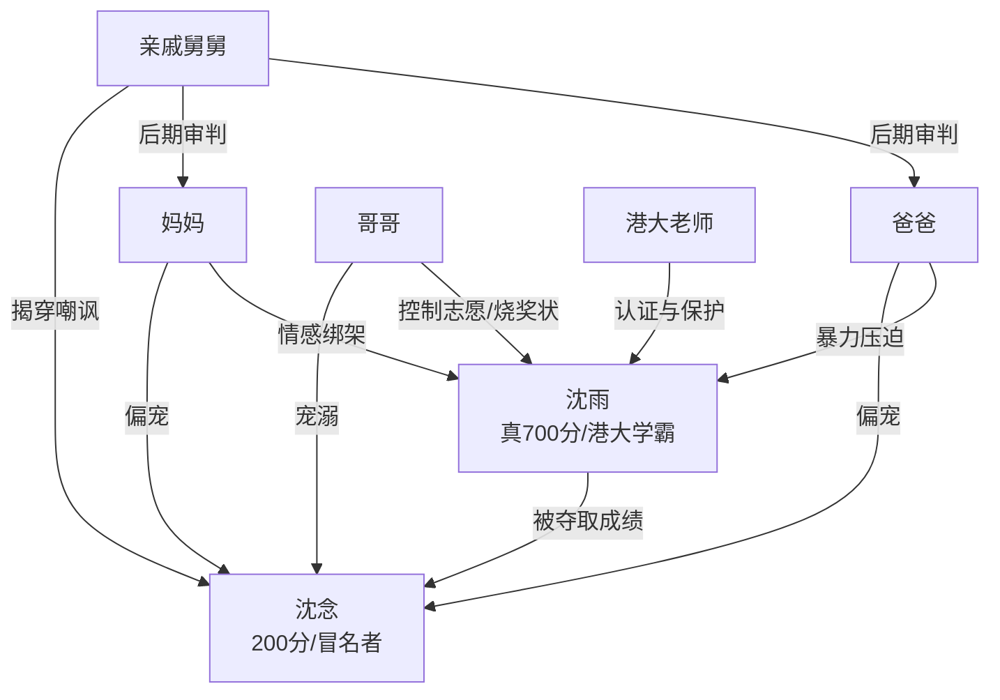

# 角色标签图谱

## 角色清单

### 沈雨 — 清醒断亲型大女主
- 叙事功能: 受害者、藏牌者、最终清算者。
- 核心标签: 700 分真学霸、长期被亏欠、冷静反杀。
- 弧光: 渴望亲情 → 最后争取 → 冷静脱身 → 公开断亲 → 自我新生。
- 台词风格: 前期短促忍让，后期冷硬砸脸。
- 关键行为: 同意港大调档、沉默等待清大翻车、港大公开揭穿、拉黑断亲。
- 读者情绪关系: 心疼、代入、爽。

### 沈念 — 被宠坏的冒名顶替者
- 叙事功能: 绿茶妹妹、夺取者、谎言受益人。
- 核心标签: 200 分、体弱滤镜、装委屈。
- 弧光: 被全家捧上神坛 → 清大社死 → 港大受辱 → 被哥哥厌弃。
- 台词风格: 撒娇、哭诉、威胁。
- 关键行为: 冒充沈雨、藏通知书、烧奖状未遂、要求继续顶替港大。
- 读者情绪关系: 恨、厌、看她翻车的爽。

### 哥哥 — 宠妹偏执型施害者
- 叙事功能: 主要压迫执行人、旧温情反差源、后悔承担者。
- 核心标签: 控制欲、偏心、迟来后悔。
- 弧光: 童年护雨 → 转向沈念 → 打压沈雨 → 港大失败 → 被拉黑后悔。
- 台词风格: 命令式、审判式、伪温柔。
- 关键行为: 推出沈念冒名、禁言沈雨、接管志愿、烧奖状、追到港大抢人。
- 读者情绪关系: 恨，后期提供迟来悔恨的余爽。

### 爸爸 — 暴力父权型偏心者
- 叙事功能: 家庭暴力和荒谬规则的权威来源。
- 核心标签: 拍桌、打耳光、威胁断亲。
- 弧光: 强硬压迫 → 港大被公开审判 → 沉默抽烟。
- 台词风格: 怒吼、威胁、道德绑架。
- 关键行为: 用胎中营养论定罪沈雨，当众打沈雨。
- 读者情绪关系: 恨，公开挨打反杀的关键工具人。

### 妈妈 — 情感绑架型偏心者
- 叙事功能: 提供生活细节层面的偏心证据。
- 核心标签: 忘记过敏、分配不公、迟来哭悔。
- 弧光: 纵容沈念 → 给沈雨 700 生活费 → 发现小房间后崩溃。
- 台词风格: 假温柔、软性绑架。
- 关键行为: 翻准考证、偏心生活费、哭问“小雨不要妈妈了吗”。
- 读者情绪关系: 心寒、愤怒、看她后悔的爽。

### 港大老师 — 外部公正保护者
- 叙事功能: 第三方认证沈雨价值，替读者发声。
- 核心标签: 仗义、公正、护短。
- 弧光: 招收沈雨 → 给奖励 → 公开保护 → 赶走家人。
- 台词风格: 直接、带职业权威。
- 关键行为: 提前发十万奖励、邀请发言、怒斥替代荒谬。
- 读者情绪关系: 安心、补偿。

### 亲戚/舅舅 — 迟来的社会审判
- 叙事功能: 把家族群的造谣反向清算。
- 核心标签: 围观者、审判者、道德纠偏。
- 弧光: 起初捧沈念 → 得知真相后嘲讽沈家。
- 台词风格: 阴阳怪气或正面质问。
- 关键行为: 堵门讽刺、舅舅质问“沈雨欠什么”。
- 读者情绪关系: 余爽。

## 关系网络

## 角色功能对照表（供改编参考）

| 原角色 | 极致标签 | 叙事功能 | 读者情绪功能 | 改编时必须保留的 |
|--------|---------|---------|-------------|---------------|
| 沈雨 | 清醒断亲大女主 | 被夺人生后反杀 | 心疼转爽 | 主角真实高价值、前期忍、后期公开断亲 |
| 沈念 | 绿茶冒名妹妹 | 夺取者 | 恨与看翻车 | 低能力高享受、装委屈、公开社死 |
| 哥哥 | 偏心控制狂 | 压迫执行者 | 恨与迟来后悔 | 曾经温柔、现在最狠、后期被拉黑 |
| 爸爸 | 暴力父权 | 肉体打压 | 激怒读者 | 当众动手，成为反杀证据 |
| 妈妈 | 情感绑架母亲 | 细节偏心 | 心寒 | 忘记过敏/生活费差距/小房间悔恨 |
| 港大老师 | 外部公正者 | 权威认证 | 补偿 | 必须有第三方公开保护主角 |
