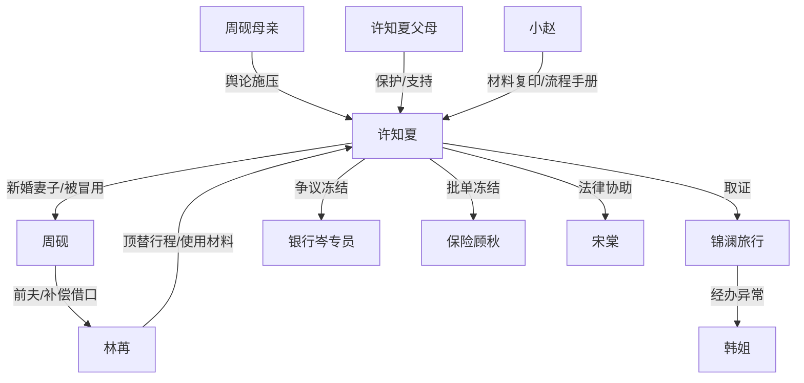

# 角色标签图谱

## 角色清单

### 许知夏 — 冷静证据型大女主
- 叙事功能: 主角、被冒用授权者、证据链组织者。
- 核心标签: 清醒、专业、克制
- 弧光: 新婚被退票的新娘 → 用流程夺回授权和人生边界的人
- 台词风格: 短句追问、流程名词、冷反讽
- 关键行为: 冻结附属卡、封存航段、索取退团确认、保险争议冻结、银行止付、酒店/物业/影像保全、离婚切割
- 读者情绪关系: 心疼她被背叛，爽于她不内耗、用证据反杀

### 周砚 — 软控制型渣夫/授权侵占者
- 叙事功能: 主反派；把“夫妻关系”当成挪用授权的遮羞布。
- 核心标签: 控制、算计、伪温柔
- 弧光: 机场压制女主 → 复核会上被流程锁死 → 离婚时仍试图保公司周转
- 台词风格: 先压低声音安抚，后转为指责、情绪勒索、谈钱
- 关键行为: 婚礼当天拿走手机、变更号码、确认退团和更名、改保险受益人、舆论抢跑、影响客户
- 读者情绪关系: 恨；尤其恨他用“我们是夫妻”遮盖冒用

### 林苒 — 白月光前妻/共谋型受益者
- 叙事功能: 替代女主位置的人，也是签名样张和材料交叉的重要参与者。
- 核心标签: 伪弱、贪占、切责
- 弧光: 机场从容登场 → 公开视频引导舆论 → 露口承认签名来源 → 被周砚丢下
- 台词风格: 柔软、委屈、把索取包装成“欠我的”
- 关键行为: 顶替蜜月团、使用丝带和箱子、拍签到册签名、填写配偶关系、公开视频
- 读者情绪关系: 恨与鄙夷；她的“可怜”不能抵消共谋

### 周砚母亲 — 家族舆论施压者
- 叙事功能: 把私人侵害包装成“家丑”“体面”“大度”的传统压力源。
- 核心标签: 护短、甩锅、情绪勒索
- 弧光: 群里污名女主 → 银行闹场 → 删除视频无果
- 台词风格: 哭诉、指责、道德压迫
- 关键行为: 发机场照片、私聊劝大度、银行试图动手、尝试删除物业视频
- 读者情绪关系: 恨；增强“全家一起压迫”的债务

### 许知夏父母 — 稳定支撑者
- 叙事功能: 给女主情感底盘和行动方法，不抢主线。
- 核心标签: 清醒、护女、务实
- 弧光: 从接电话震惊 → 提供录音笔、群里发声、守住女主
- 台词风格: 短、实、护边界
- 关键行为: 提醒录音、亲戚群回击、不给周砚开门
- 读者情绪关系: 温暖、补偿；抵消亲家压迫

### 小赵 — 被女主善意救过的关键证人
- 叙事功能: 善因回收，提供本人材料与流程手册入口。
- 核心标签: 良知、谨慎、报恩
- 弧光: 旅行社小员工 → 帮女主取到复印件 → 工作被保住
- 台词风格: 低声、克制、怕牵连
- 关键行为: 给材料复印件、提醒原件不能动、提供培训手册
- 读者情绪关系: 可信任、温暖

### 顾秋/岑专员/宋棠 — 制度盟友
- 叙事功能: 把女主的情绪转成正式路径。
- 核心标签: 专业、稳定、边界
- 弧光: 流程参与者 → 关键节点佐证者
- 台词风格: 精确、职业、无废话
- 关键行为: 保险批单冻结、银行争议止付、法律路径规划
- 读者情绪关系: 安心、爽点放大器

## 关系网络

## 角色功能对照表（供改编参考）

| 原角色 | 极致标签 | 叙事功能 | 读者情绪功能 | 改编时必须保留的 |
|--------|---------|---------|-------------|---------------|
| 许知夏 | 冷静证据型大女主 | 主角/授权被侵害者 | 心疼、爽、尊重 | 专业能力与克制行动 |
| 周砚 | 软控制型渣夫 | 主反派 | 恨、恶心 | 用亲密关系包装侵占 |
| 林苒 | 共谋白月光 | 替代者/受益者 | 恨、反感 | 伪弱+实际获利 |
| 周母 | 家族施压者 | 舆论打压 | 憋屈、愤怒 | “体面/一家人”话术 |
| 父母 | 稳定支撑者 | 情感补偿 | 暖、安心 | 不劝和、不劝体面 |
| 小赵 | 善因证人 | 证据突破口 | 温暖、信任 | 女主曾经帮过她 |
| 专业人士 | 制度盟友 | 让反杀可信 | 安心、爽 | 流程语言必须真实 |
