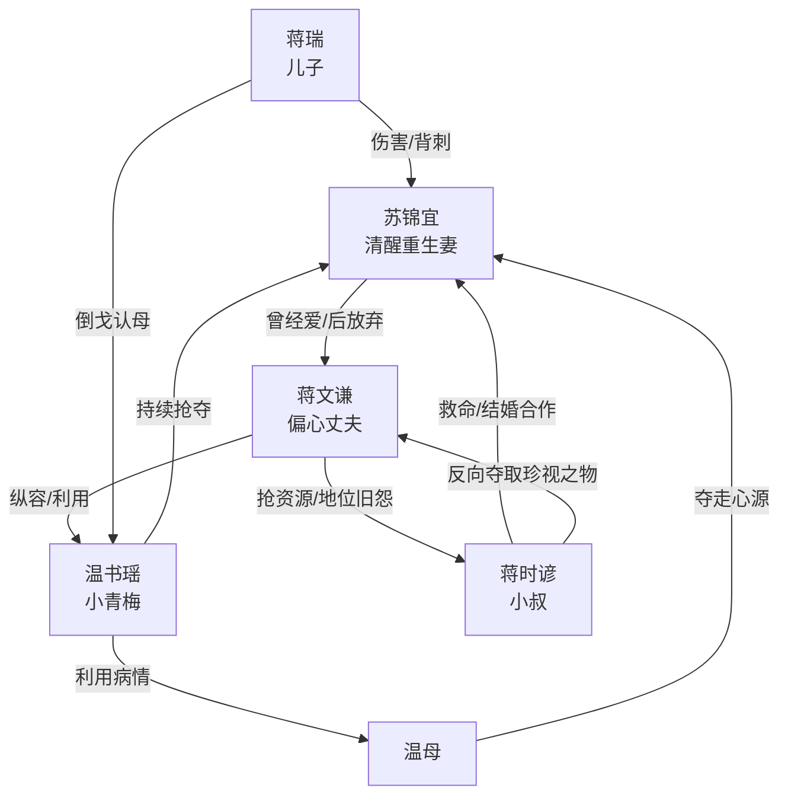

# 角色标签图谱

## 角色清单

### 苏锦宜 — 清醒重生复仇妻
- 叙事功能: 第一人称主角，承载压迫、标价规则、生命危机与最终新生。
- 核心标签: 重生、冷静、被夺取者
- 弧光: 争爱哭闹的妻子 → 明码标价攒救命钱 → 被夺心源濒死 → 主动选择新生
- 台词风格: 短句、冷静、带反讽，关键时刻直接审判
- 关键行为: 标价副驾/计划书/儿子/婚礼；签离婚；手术求生；嫁蒋时谚
- 读者情绪关系: 心疼、代入、爽

### 蒋文谦 — 偏心迟悔丈夫
- 叙事功能: 主压迫者与后半追悔视角承载者。
- 核心标签: 自负、误判、迟来悔恨
- 弧光: 纵容小青梅抢妻子东西 → 误判妻子装病 → 抢走心源 → 发现真相崩塌跪求
- 台词风格: 前期指责训斥，后期语无伦次、道歉乞求
- 关键行为: 转账羞辱、让婚礼、签错离婚协议、调走心源、查监控
- 读者情绪关系: 恨、等他崩溃、拒绝同情

### 温书瑶 — 绿茶夺取型小青梅
- 叙事功能: 外部夺取者，触发丈夫偏心和女主情绪债。
- 核心标签: 绿茶、虚荣、抢夺
- 弧光: 抢副驾/项目/婚纱/遗物/心源 → 被蒋文谦识破 → 家族破产
- 台词风格: 道歉式陷害、柔弱式甩锅
- 关键行为: 拿礼物冒充母亲角色，穿婚纱，戴镯子和戒指，诱导心源转移
- 读者情绪关系: 厌恶、盼报应

### 蒋瑞 — 倒戈儿子
- 叙事功能: 强化家庭伦理痛感，让女主失去“上一世最放不下”的对象。
- 核心标签: 被教坏、残忍、幼稚偏心
- 弧光: 抱温书瑶叫妈妈 → 骂女主坏女人 → 砸碎姥姥遗物 → 后期哭着找妈妈
- 台词风格: 童稚但残忍，复制大人的价值观
- 关键行为: 拒绝女主接走，撞倒女主，砸玉镯
- 读者情绪关系: 心寒、复杂、不可轻易原谅

### 蒋时谚 — 救命小叔/反夺取盟友
- 叙事功能: 后半反杀资源与女主新生承载者。
- 核心标签: 强势、绅士、复仇盟友
- 弧光: 紧急联系人救命 → 隐藏女主行踪 → 提出真结婚合作 → 提供公开反杀场域
- 台词风格: 从容、玩味、边界清晰
- 关键行为: 救治女主、处理监控、安排婚礼、给女主合法身份
- 读者情绪关系: 安全感、补偿爽

### 温母 — 心源夺取工具人
- 叙事功能: 将“抢东西”升级为“抢命”的载体。
- 核心标签: 病重、被利用、生命资源错配
- 弧光: 临终婚礼理由 → 心源抢夺对象
- 台词风格: 无直接高光
- 关键行为: 被温书瑶用于夺走心源
- 读者情绪关系: 辅助厌恶温书瑶与蒋文谦

## 关系网络

## 角色功能对照表（供改编参考）

| 原角色 | 极致标签 | 叙事功能 | 读者情绪功能 | 改编时必须保留的 |
|--------|---------|---------|-------------|---------------|
| 苏锦宜 | 清醒重生复仇妻 | 受害者与规则制定者 | 心疼与爽 | 标价规则、救命钱动机、最终不回头 |
| 蒋文谦 | 偏心迟悔丈夫 | 主压迫者/追悔容器 | 恨与看崩塌 | 前期误判要狠，后期悔恨要具体 |
| 温书瑶 | 绿茶夺取者 | 情绪债制造机 | 厌恶 | 抢夺要连续，从小物件升级到命 |
| 蒋瑞 | 倒戈儿子 | 伦理痛感放大器 | 心寒 | 孩子必须造成不可逆伤害 |
| 蒋时谚 | 救命小叔 | 反杀资源/新生象征 | 补偿爽 | 救命、隐藏行踪、公开婚礼反杀 |
