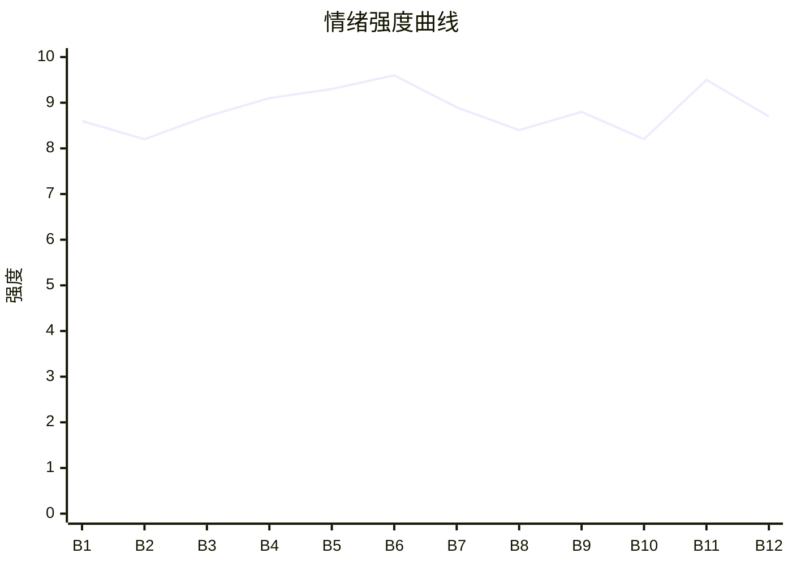

# Beat Sheet 节拍器

## 全文概况

- 总字数: 约 14200 字
- 节拍数: 12 幕
- 核心母题（Logline）: 被妻子枉法偏袒白月光判败的技术传承人，为夺回尊严与专利清白，借死敌律师与预埋证据链反杀窃贼和枉法妻，最终重回行业巅峰。
- 情绪模式: 极致打压 → 触底断情 → 暗线布网 → 证据反杀 → 悔恨无门 → 主角封神

## 节拍详表

### Beat 1: 开局败诉与撕书转投 [P1-P11]
- **字数**: 约 360 字（占比 2.5%）
- **核心事件**: 主审法官江晚棠偏袒白月光，男主当众撕毁上诉书，转签她的死敌。
- **情绪标签**: 震惊、憋屈、反击期待
- **情绪强度**: 8.6/10
- **情绪方向**: ⚡突变
- **冲突类型**: 大转折
- **悬念钩子**: “这官司，我不打了”后他要用什么方式赢？
- **叙事速度**: 快
- **对话占比**: 25%
- **reversal_mechanism**: [M2, M3]
- **hook_strength**: 8.8/10（极端度 2.6；信息密度 2.8；悬念 1.8；节奏 1.6）
- **关键句**: “我当着所有媒体的面，亲手撕碎了上诉书。”
- **原文摘录**: 看到主审法官是江晚棠的那一刻，我就知道，这场千亿专利案，我输定了。被告席上坐着的，是她藏在心里十年的白月光。果然，江晚棠当庭以“证据不足”为由，驳回了我的全部诉求。休庭时，那个男人笑着走到我面前：“真可怜啊，你不仅在法庭上赢不了我，在女人心里也赢不了。”“当年我爸能让你爸净身出户，今天我就能让你在这个行业彻底身败名裂。”看着高台上整理法袍的江晚棠，我忽然觉得恶心至极。我当着所有媒体的面，亲手撕碎了上诉书。这官司，我不打了。我带着最新的核心技术，直接签给了江晚棠的死对头。

### Beat 2: 法庭冷判与婚姻温差 [P12-P42]
- **字数**: 约 1350 字（占比 9.5%）
- **核心事件**: 江晚棠以“证据不足”驳回诉求，男主回忆婚姻温情，意识到光已经灭了。
- **情绪标签**: 冤屈、心痛、恶心
- **情绪强度**: 8.2/10
- **情绪方向**: ↓下降
- **冲突类型**: 微冲突
- **悬念钩子**: 男主为何不继续上诉，而选择陆知薇？
- **叙事速度**: 中
- **对话占比**: 18%
- **reversal_mechanism**: [M5]
- **hook_strength**: null
- **关键句**: “她的沉默本身，就是一种裁决。”
- **原文摘录**: 法槌落下的声音，沉沉砸在我心口，震得我五脏六腑都像被拧碎了一样疼。江晚棠的声音依旧清冷平稳，没有半分波澜。我的律师当场拍案而起：“审判长，原告方提交了三十七份原始手稿溯源报告！”江晚棠抬眼：“鉴定机构资质存疑，不予采信。”我们结婚三年，同床共枕一千多个日夜。可此时此刻，她看向我的眼神，比看一个陌生人还要疏离。但我记得，两年前的冬夜，她加班到凌晨才回家。我在沙发上等她等到睡着，她在我额头落下一个轻吻，低声说：“傻瓜，别等了。”那时候，她眼里是有光的。只是那道光，大概从顾明澈回国之后，就一点点灭掉了。

### Beat 3: 撕毁上诉书与陆知薇接案 [P43-P73]
- **字数**: 约 980 字（占比 6.9%）
- **核心事件**: 男主在媒体前撕碎上诉书，将最新核心技术授权给陆知薇，公开脱离江晚棠掌控。
- **情绪标签**: 断情、痛快、期待
- **情绪强度**: 8.7/10
- **情绪方向**: ↑上升
- **冲突类型**: 大转折
- **悬念钩子**: 陆知薇如何把案子从江晚棠手里夺走？
- **叙事速度**: 快
- **对话占比**: 30%
- **reversal_mechanism**: [M2, M3]
- **hook_strength**: null
- **关键句**: “这案子现在归我了。”
- **原文摘录**: 我拨开面前的话筒，从律师手里拿过那份早已准备好的上诉书。在所有媒体震惊的目光里，我一言不发，将它一页一页撕成碎片。“这官司，我不打了。”那里安静坐着的女人，是陆知薇。她是律界有名的铁娘子，也是江晚棠多年来最忌惮的死对头。我从包里拿出另一份文件。里面是我最新的，也是最底层的核心技术授权书。“陆律师，这份技术，我授权给你。”陆知薇晃了晃手中的文件：“不过，这案子现在归我了。希望下一次，你还能这么稳稳坐在这个位置上。”

### Beat 4: 审查冻结与遗物被毁 [P74-P126]
- **字数**: 约 1700 字（占比 12.0%）
- **核心事件**: 江晚棠冻结男主资格审查；顾明澈上门摔碎父亲玉牌，并嫁祸男主伤人。
- **情绪标签**: 愤怒、窒息、彻底寒心
- **情绪强度**: 9.1/10
- **情绪方向**: ↓下降
- **冲突类型**: 大转折
- **悬念钩子**: 男主拨通陆知薇电话，计划提前。
- **叙事速度**: 中
- **对话占比**: 35%
- **reversal_mechanism**: [M3, M5]
- **hook_strength**: null
- **关键句**: “一块破石头而已，值得你闹成这样？”
- **原文摘录**: 第二天，我准备提交的行业资格年度审查，就被以“涉及重大商业纠纷”为由无限期冻结。顾明澈拎着一篮水果，笑得一脸无辜。他的目光落在我放在桌上的紫檀木盒上。“这是什么？好精致。”我脸色骤变：“别碰！”“啪”的一声脆响。那块价值连城的古玉牌瞬间四分五裂。江晚棠冲了进来，一把扶住“摇摇欲坠”的顾明澈。她的目光只在碎玉上停留不到一秒，就转向了顾明澈手腕上那道浅浅的血痕。“沈砚舟，你疯了吗！”“一块破石头而已，值得你闹成这样？明澈有抑郁症，你不是不知道？”她下令：“把这些笔记都带走，作为给顾先生的精神补偿。”我拿出手机，拨通了陆知薇的电话。“陆律师，计划提前。”

### Beat 5: 庆功宴鸿门宴与公开逼歉 [P127-P183]
- **字数**: 约 1750 字（占比 12.3%）
- **核心事件**: 顾明澈举办表彰大会，江晚棠威胁男主用外婆医疗费逼其道歉认抄袭。
- **情绪标签**: 羞辱、压迫、最后断情
- **情绪强度**: 9.3/10
- **情绪方向**: ↓下降
- **冲突类型**: 大转折
- **悬念钩子**: VCR 倒计时后会播放什么？
- **叙事速度**: 快
- **对话占比**: 42%
- **reversal_mechanism**: [M3, M5]
- **hook_strength**: null
- **关键句**: “你本来就是个贼。”
- **原文摘录**: 顾明澈凭着被判给他的专利技术，获得了业内一项极具分量的年度大奖。两名穿着制服的法警直接找上门来：“沈先生，江法官请您去一趟金鼎酒店。”助理压低声音：“今天您只要上台，当着所有人的面向顾先生道歉，承认抄袭，这件事就算过去了。”我冷笑：“如果我不呢？”助理说：“您外婆在市立医院的特护病房，每个月的费用可不低吧？”我走到江晚棠面前：“江晚棠，十年的情分，你真的要赶尽杀绝？”她说：“法律与行业规矩面前，没有情分可言。”“你本来就是个贼。”主持人倒计时：“三、二、一……”大屏幕亮起。

### Beat 6: VCR 曝旧债与亲手毁证 [P184-P230]
- **字数**: 约 1450 字（占比 10.2%）
- **核心事件**: 大屏播放顾家羞辱男主父亲旧录像；江晚棠推倒男主并当众粉碎公证书。
- **情绪标签**: 震惊、绝望、触底
- **情绪强度**: 9.6/10
- **情绪方向**: ⚡突变
- **冲突类型**: 大转折
- **悬念钩子**: 男主拿出的两份文件是什么？
- **叙事速度**: 快
- **对话占比**: 30%
- **reversal_mechanism**: [M1, M5]
- **hook_strength**: null
- **关键句**: “她亲手毁掉了我最后的希望。”
- **原文摘录**: 大屏幕出现的不是顾明澈的获奖感言，而是一段陈旧又模糊的录像。那个狼狈不堪的男人，是我的父亲。那个站在女人身后露出得意笑容的男人，是顾明澈的父亲。江晚棠快步上前拽住我，猛地用力推在我肩上。我狠狠摔倒在地，玻璃扎穿掌心，鲜血瞬间涌了出来。她从助理手里拿过一份文件。那是我唯一能自证清白的补充公证书。她当着所有媒体的面，连看都没看一眼，直接将它扔进旁边的粉碎机。“滋啦。”她亲手毁掉了我最后的希望。我从怀里掏出两份文件。一份，是盖着最高检公章的控告起诉书。另一份，是一纸离婚协议。“江晚棠，这是最后一次。”“从今往后，我们法庭上见，生死不论。”

### Beat 7: 陆知薇越级举报与暗码真相 [P231-P282]
- **字数**: 约 1700 字（占比 12.0%）
- **核心事件**: 陆知薇越级举报，男主揭示早已埋下隐形防伪暗码和公证副本，江晚棠亲手毁证反成罪证。
- **情绪标签**: 反杀启动、冷静、爽感
- **情绪强度**: 8.9/10
- **情绪方向**: ↑上升
- **冲突类型**: 大转折
- **悬念钩子**: 江晚棠停职后会如何崩塌？
- **叙事速度**: 中
- **对话占比**: 38%
- **reversal_mechanism**: [M1, M2, M3]
- **hook_strength**: null
- **关键句**: “可惜，她毁掉的只是副本。原件一直在我保险柜里。”
- **原文摘录**: 陆知薇没有在江晚棠的管辖区内做任何纠缠，而是直接越级，向省高院和最高检同时递交了实名举报材料。“你当初在技术初稿里预留的隐形防伪暗码，是什么时候埋进去的？”“第一次被顾明澈接近的时候。”“不是防他。是防江晚棠。”从那天开始，我就在每一页手稿的纤维层里，嵌入只有紫外光才能显现的、独属于我的传承印记。陆知薇说：“可惜，她毁掉的只是副本。原件一直在我保险柜里。”因为只有她亲手毁证，才能坐实“妨碍司法公正”的罪名。顾明澈偷走了我的成果，却不知道核心参数被我做了细微偏移。到了他手里，就是一颗颗等待引爆的雷。

### Beat 8: 停职传票与权力反位 [P283-P326]
- **字数**: 约 1150 字（占比 8.1%）
- **核心事件**: 江晚棠停职后找上门，男主上陆知薇的车离开，陆知薇送出传票。
- **情绪标签**: 冷爽、反位、失控
- **情绪强度**: 8.4/10
- **情绪方向**: ↑上升
- **冲突类型**: 微冲突
- **悬念钩子**: 纪检审查会查出什么？
- **叙事速度**: 中
- **对话占比**: 25%
- **reversal_mechanism**: [M3, M5]
- **hook_strength**: null
- **关键句**: “江法官，准备好坐在被告席上接受审判了吗？”
- **原文摘录**: 江晚棠被停职审查的通知也同时送达。她的法袍被暂时收回，法官证被冻结。傍晚时分，江晚棠黑着脸从车里下来，砸门的力道几乎要把整面墙震塌。“沈砚舟！你开门！”我拎起包，从容地打开门，与她擦肩而过。副驾驶的门被人从里面推开。陆知薇坐在驾驶座上。我坐进车里，关上车门。后视镜里，江晚棠像一根钉子似的钉在原地，脸色灰败。陆知薇递出文件。那是一张传票。“江法官，准备好坐在被告席上接受审判了吗？”

### Beat 9: 调查真相与雨夜求见 [P327-P385]
- **字数**: 约 1850 字（占比 13.0%）
- **核心事件**: 监控、贿赂、摔玉牌真相被查出，江晚棠得知真正救命恩人是男主，雨夜求见被撕照片拒绝。
- **情绪标签**: 真相迟到、悔恨、冷绝
- **情绪强度**: 8.8/10
- **情绪方向**: ↑上升后冷却
- **冲突类型**: 大转折
- **悬念钩子**: 顾明澈还有什么底牌？
- **叙事速度**: 中
- **对话占比**: 28%
- **reversal_mechanism**: [M2, M5]
- **hook_strength**: null
- **关键句**: “我也不想知道。”
- **原文摘录**: 纪检组调取了鉴定中心的完整监控。顾明澈在鉴定结果出具前三天，私下约见了首席鉴定员，给了五十万现金。还有旧宅监控备份，他摔玉牌的全过程都在里面。陆知薇说：“十年前，江晚棠备考期间发过一场高烧……是你在零下二十度的雪地里，走了整整四个小时，才从药店买回退烧药。”可江晚棠一直以为，救她的人是顾明澈。那天晚上下了暴雨。江晚棠站在楼下台阶上，浑身湿透，手里攥着我们结婚第一年她送我的灰蓝色围巾。“砚舟……我错了……”我当着她的面，将三年婚姻里唯一一张合照撕碎。“别脏了我的地盘。”我没有回头。

### Beat 10: 白月光反咬与投名状失效 [P386-P430]
- **字数**: 约 1250 字（占比 8.8%）
- **核心事件**: 顾明澈用利益输送底牌威胁江晚棠，江晚棠自爆录音交检方，仍无法换回男主。
- **情绪标签**: 反讽、清醒、迟到补偿无效
- **情绪强度**: 8.2/10
- **情绪方向**: →平稳
- **冲突类型**: 微冲突
- **悬念钩子**: 庭审中顾明澈会怎样出卖她？
- **叙事速度**: 中
- **对话占比**: 40%
- **reversal_mechanism**: [M3, M5]
- **hook_strength**: null
- **关键句**: “我要的从来不是她的牺牲。而是她的信任。”
- **原文摘录**: 顾明澈所谓的“底牌”，是一份利益输送的证据链。他用这张牌威胁江晚棠：“晚棠，你帮我脱罪，这些东西我永远不会拿出来。”探视室里，顾明澈的话被全程录了音。是江晚棠自己录的。她走出看守所，直接把录音笔交给了检方。陆知薇说：“她想用自爆的方式保护你。”我说：“我不需要她的投名状。”我要的从来不是她的牺牲。而是她的信任。可那份信任，她给了顾明澈十年，给了她自己的傲慢十年，唯独没有给过我一天。

### Beat 11: 终审清算与挡刀无效 [P431-P511]
- **字数**: 约 2450 字（占比 17.3%）
- **核心事件**: 顾明澈被判刑，江晚棠另案处理；她求复合失败，随后为男主挡刀却换不回回头。
- **情绪标签**: 大爽、冷酷、余痛
- **情绪强度**: 9.5/10
- **情绪方向**: ↑上升后→冷收
- **冲突类型**: 大转折
- **悬念钩子**: “走吧，我们回家”指向新生活归属。
- **叙事速度**: 快
- **对话占比**: 45%
- **reversal_mechanism**: [M1, M3, M5]
- **hook_strength**: null
- **关键句**: “有些东西断了就是断了。用命去补，也粘不回来。”
- **原文摘录**: 三天后，开庭通知送达。江晚棠曾经高高在上的审判席，如今换了别人。她被传唤为证人，坐在法庭侧方那个矮小的、需要仰望法官席的位置上。审判持续了整整六个小时。隐形防伪暗码的紫外光检测报告，鉴定员受贿的银行流水，顾明澈故意摔碎玉牌的监控截图，每一份证据都像一颗钉子，精准钉进棺材板。顾明澈尖叫：“是江晚棠，所有事情都是江晚棠指使的！”判决结果没有悬念。顾明澈被判处有期徒刑十二年，江晚棠被移交检察机关另案处理。散庭后，江晚棠问：“我们能不能……重新开始？”我说：“你连当我的敌人，我都嫌脏。”顾明澈的母亲持刀扑来，江晚棠挡在我面前。她满身鲜血，等我惊慌，等我崩溃。我后退了一步。陆知薇说：“还不快把人清走，吓到我的委托人了。”我上车后，对陆知薇说：“走吧，我们回家。”有些东西断了就是断了。用命去补，也粘不回来。

### Beat 12: 三年后行业封神 [P512-P546]
- **字数**: 约 1220 字（占比 8.6%）
- **核心事件**: 三年后男主站上行业最高盛典，感谢试图埋葬他的人，回到新家。
- **情绪标签**: 补偿、释然、荣耀
- **情绪强度**: 8.7/10
- **情绪方向**: ↑上升
- **冲突类型**: 收束
- **悬念钩子**: 无，完成兑现。
- **叙事速度**: 慢
- **对话占比**: 35%
- **reversal_mechanism**: [M3]
- **hook_strength**: null
- **关键句**: “感谢所有试图埋葬我的人，你们让我扎根更深。”
- **原文摘录**: 三年后。全行业最高盛典在国家会议中心举办。我穿着一身定制的墨黑色西装，站在后台候场区。三年前留下的伤疤还在掌心，但已经变成了一条浅淡的白线。同样的聚光灯。同样的万众瞩目。但这一次，我不是囚犯。我是主角。我接过奖杯，说出整场典礼上最短的获奖感言：“感谢所有试图埋葬我的人，你们让我扎根更深。”记者问如何看待当年的低谷。我笑了一下：“一些绊脚的垃圾而已，早就扫干净了。”典礼结束后，陆知薇的车停在会场门口。“晚上去哪？”“回家。”

## 情绪曲线可视化

## 节拍密度检测

- 平均每约 1180 字一个节拍
- 微冲突密度: 每约 2300 字一次
- 大转折密度: 每约 1600 字一次
- 判定: 符合高频节拍器标准；前 60% 压迫连续，后 40% 清算连续

## 反转机制清单(Reversal Mechanisms)

| 机制 ID | 机制名 | 承载 Beat | 关键段落/金句 | 等价改编提示 |
|--------|--------|-----------|--------------|-------------|
| M1 | 死环反杀 | Beat 6-7, Beat 11 | “因为只有她亲手毁证，才能坐实‘妨碍司法公正’的罪名。” | 固化载体必须换，但“对方亲手制造反杀证据”的死环结构不换 |
| M2 | 身份反差爆发 | Beat 1, Beat 3, Beat 7, Beat 9 | “我带着最新的核心技术，直接签给了江晚棠的死对头。” / “每一页手稿的纤维层里，嵌入……传承印记。” | 身份载体可换，但隐忍者必须在中后段揭示早有底牌 |
| M3 | 因果回旋反讽 | Beat 3, Beat 8, Beat 11, Beat 12 | “江法官，准备好坐在被告席上接受审判了吗？” / “同样的聚光灯……但这一次，我不是囚犯。我是主角。” | 金句回旋必须保留，用对方规则和场景反向清算对方 |
| M5 | 温度反转曲线 | Beat 2, Beat 4-6, Beat 9-11 | “那时候，她眼里是有光的。” / “用命去补，也粘不回来。” | 必须显式写曾经温柔，再写信任归零与悔恨负值 |
