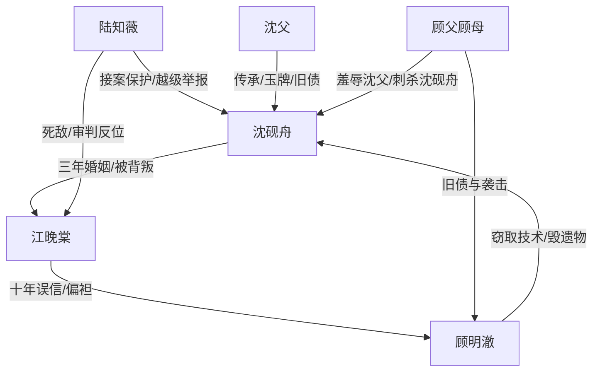

# 角色标签图谱

## 角色清单

### 沈砚舟 — 隐忍型技术传承大男主
- 叙事功能: 受害者、设局者、清算者、最终补偿对象
- 核心标签: 非遗传承人、被枉法丈夫、证据型复仇者
- 弧光: 被妻子判败的“囚犯” → 掌控证据链的原告 → 行业盛典主角
- 台词风格: 前半少言忍痛，后半短句冷判
- 关键行为: 撕毁上诉书、签陆知薇、提前计划、亮控告书、拒绝复合
- 读者情绪关系: 前半心疼，后半爽，结尾获得补偿

### 江晚棠 — 枉法冷面妻/迟到悔恨者
- 叙事功能: 婚姻背叛者、司法压迫者、温度反转承载者
- 核心标签: 主审法官、白月光信徒、傲慢失权者
- 弧光: 高台审判男主 → 停职失权 → 证人席仰望 → 挡刀也无效
- 台词风格: 冷漠命令式，后期破碎乞求式
- 关键行为: 驳回诉求、冻结资格、夺遗物、毁公证书、自爆录音、挡刀
- 读者情绪关系: 先恨，后看她悔恨崩塌，最终不允许她被原谅

### 顾明澈 — 白月光窃贼/假弱者反派
- 叙事功能: 直接施害者、傲慢积累器、最终反咬触发器
- 核心标签: 青梅竹马、专利窃贼、绿茶式男反派
- 弧光: 被偏袒的胜利者 → 技术事故源头 → 看守所反咬者 → 十二年刑罚
- 台词风格: 阴阳怪气、装无辜、危急时尖叫攀咬
- 关键行为: 偷技术、摔玉牌、装伤、庆功羞辱、威胁江晚棠
- 读者情绪关系: 高恨点来源，承担报应爽点

### 陆知薇 — 铁娘子死敌/新秩序代理人
- 叙事功能: 外部强援、司法修正者、男主新归属暗线
- 核心标签: 死对头律师、冷静执行者、保护者
- 弧光: 旁听席静坐 → 接案越级举报 → 法庭陪伴 → 三年后同车回家
- 台词风格: 礼貌但锋利，短句压迫
- 关键行为: 接技术授权、递实名举报、保管原件、护送男主、交传票
- 读者情绪关系: 安全感、替读者执行打脸

### 顾母 — 余孽式极端反扑者
- 叙事功能: 结尾生死危机触发器，促成江晚棠以命求偿失败
- 核心标签: 护短母亲、失控报复者
- 弧光: 背景人物 → 持刀袭击者
- 台词风格: 疯狂、单句爆发
- 关键行为: 持刀刺杀男主
- 读者情绪关系: 强化顾家恶债未清

### 沈父 — 被埋葬的传承源头
- 叙事功能: 男主复仇正当性的根，玉牌与技术传承的情绪锚
- 核心标签: 被羞辱父亲、非遗传承者、遗产象征
- 弧光: 旧录像里的失败者 → 技术在儿子身上复活
- 台词风格: 无直接台词
- 关键行为: 留下玉牌与技术精神
- 读者情绪关系: 心疼、要求顾家偿债

## 关系网络

## 角色功能对照表（供改编参考）

| 原角色 | 极致标签 | 叙事功能 | 读者情绪功能 | 改编时必须保留的 |
|--------|---------|---------|-------------|---------------|
| 沈砚舟 | 隐忍技术传承人 | 受害+设局+清算 | 心疼转爽 | 前期被误判，后期靠证据链赢 |
| 江晚棠 | 枉法冷面妻 | 权力压迫+悔恨 | 恨与不原谅 | 既是爱人也是制度权力者 |
| 顾明澈 | 白月光窃贼 | 直接施害 | 高恨点 | 装弱、偷窃、反咬三件套 |
| 陆知薇 | 铁娘子死敌 | 外援与新秩序 | 安全感 | 必须比江晚棠更稳、更冷、更有效 |
| 沈父 | 被毁传承源 | 情绪债源头 | 心疼与正当性 | 遗物/传承/旧债不可删除 |
