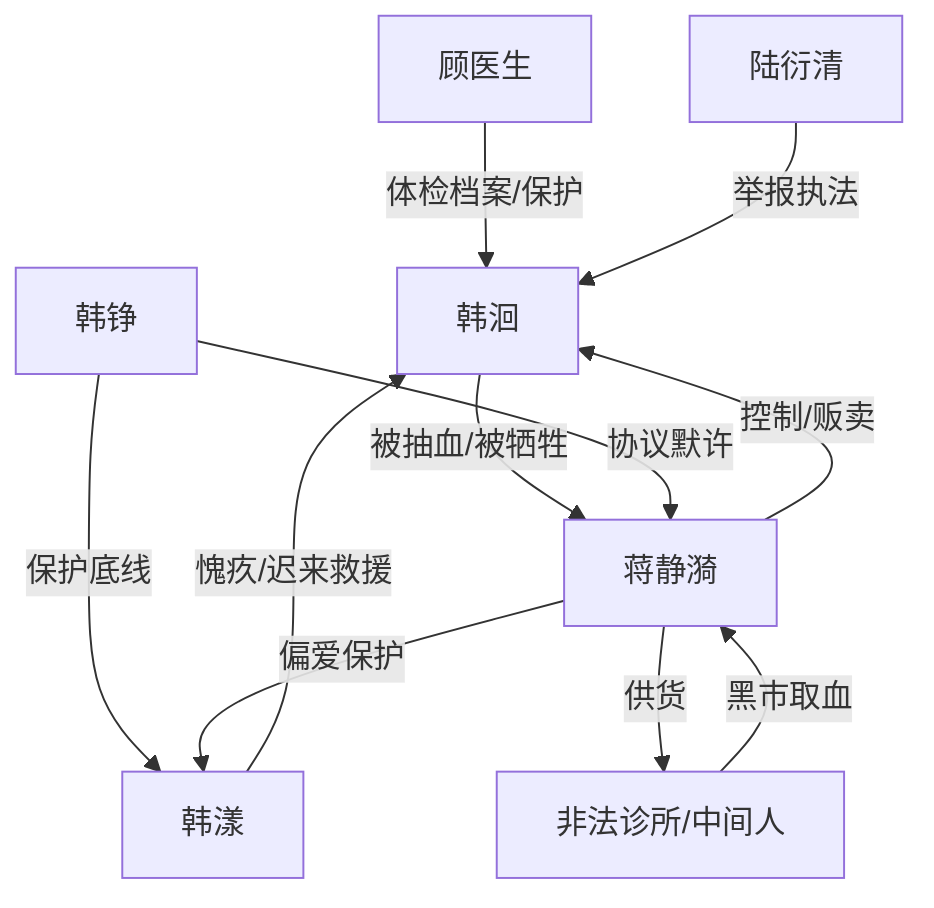

# 角色标签图谱

## 角色清单

### 韩洄 — 清醒重生复仇女主
- 叙事功能: 受害者、调查者、诱饵、清算执行者
- 核心标签: 冷静、长期主义、证据意识
- 弧光: 被抽干至死的血库 → 掌握证据链的反杀者 → 拥有人生的幸存者
- 台词风格: 平静提问，短句逼问，少控诉
- 关键行为: 让妹妹验血、记录日记、建立体检档案、拍协议和诊所、短信求援
- 读者情绪关系: 心疼、敬佩、强烈代偿爽

### 蒋静漪 — 温柔皮相的吸血母亲
- 叙事功能: 核心施害者，亲情剥削逻辑来源
- 核心标签: 伪慈母、控制狂、利益化
- 弧光: 温柔哄骗 → 道德绑架 → 贩卖女儿血液 → 被执法带走
- 台词风格: 甜腻温柔包裹威胁
- 关键行为: 长期抽血、隐瞒妹妹血型、卖血还债、非法诊所交易
- 读者情绪关系: 恨、恶心、等待报应

### 韩铮 — 懒惰懦弱的父亲共犯
- 叙事功能: 次级反派，揭示“沉默也是共犯”
- 核心标签: 逃避、伪心疼、签字共犯
- 弧光: 看似不知情 → 暴露协议 → 哭泣无效
- 台词风格: 犹豫、省略、解释未出口
- 关键行为: 签署协议，保护韩漾，默许韩洄被“自行处理”
- 读者情绪关系: 失望、愤怒、冷感清算

### 韩漾 — 愧疚的被保护者
- 叙事功能: 对照组、情绪债承载者、后期补偿行动者
- 核心标签: 被偏爱、胆怯、迟来的站队
- 弧光: 抢夺与沉默 → 知情恐惧 → 主动打电话 → 等待原谅
- 台词风格: 前期任性，后期颤抖、低声、认错
- 关键行为: 五岁验血、十四岁打电话、承认重生
- 读者情绪关系: 复杂，不完全恨，不允许轻易洗白

### 顾医生 — 外部保护者
- 叙事功能: 专业证据见证人，替女主建立可信档案
- 核心标签: 温柔、专业、可信
- 弧光: 校医问诊 → 秘密记录 → 救援链条
- 台词风格: 轻声但明确
- 关键行为: 建立体检档案，保密，联系陆医生
- 读者情绪关系: 安心、补偿、信任

### 陆衍清 — 专业清算接口
- 叙事功能: 将私人受害转成公共执法案件
- 核心标签: 冷静、专业、行动派
- 弧光: 电话判断证据 → 安排举报 → 引来执法
- 台词风格: 追问式、判断式
- 关键行为: 判断证据链、联系卫生监督和公安
- 读者情绪关系: 安全感、期待

### 周姨/灰夹克男人 — 犯罪链条具象化
- 叙事功能: 扩大伤害范围，把家庭剥削升级为黑市犯罪
- 核心标签: 买血者、中间人、物化儿童
- 弧光: 周姨死亡断财路；男人在诊所被抓
- 台词风格: 商品交易口吻
- 关键行为: 估价、取货、要求多抽
- 读者情绪关系: 恶心、恐惧、盼清算

## 关系网络

## 角色功能对照表（供改编参考）

| 原角色 | 极致标签 | 叙事功能 | 读者情绪功能 | 改编时必须保留的 |
|--------|---------|---------|-------------|---------------|
| 韩洄 | 清醒重生女主 | 受害转证人 | 心疼与爽感 | 冷静蓄证、以身为饵 |
| 蒋静漪 | 吸血母亲 | 核心压迫源 | 恨点 | 温柔话术+利益剥削 |
| 韩铮 | 懦弱共犯父亲 | 二层背叛 | 失望和愤怒 | 签字/默许证据 |
| 韩漾 | 愧疚妹妹 | 对照与补偿 | 复杂余味 | 不轻易原谅但给行动机会 |
| 顾医生 | 专业保护者 | 证据背书 | 安全感 | 长期档案 |
| 陆医生 | 公共力量接口 | 清算落地 | 爽点兑现 | 合法举报链 |
