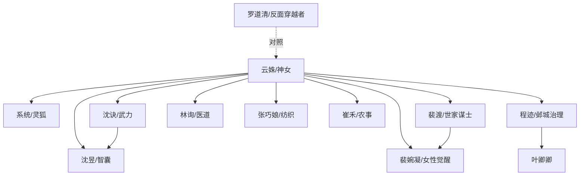

# 角色标签图谱

## 角色清单

### 云姝 — 清醒救世大女主/假神女真革命者
- 叙事功能: 主叙事发动机，负责制造神迹、收拢民心、重塑生产关系与价值秩序。
- 核心标签: 清醒、会演、强控制力。
- 弧光: 拒绝攻略男主 → 扮演神女 → 入世教化众生 → 准备推翻旧秩序。
- 台词风格: 人前神性短句，人后网感吐槽。
- 关键行为: 赐粥、救灾、审判、赐种、传技、斩龙脉、医疫。
- 读者情绪关系: 爽、敬佩、期待她继续升级。

### 系统/小狐狸 — 吐槽辅助/道具接口
- 叙事功能: 提供系统规则、技能解释、监控、传话、配合演神迹。
- 核心标签: 傻白甜、忠诚、嘴馋。
- 弧光: 鸡肋换装系统 → 神女工业外挂核心组件。
- 台词风格: 网感、搞笑、撒娇。
- 关键行为: 配合传送、幻境、皮肤变形、监控全局。
- 读者情绪关系: 轻松、好笑、暖。

### 沈昱 — 神女第一智囊/信仰布道者
- 叙事功能: 替云姝解释神意，把神迹转化为治理逻辑。
- 核心标签: 聪明、虔诚、内政型谋士。
- 弧光: 寻兄士族公子 → 神女庙倡议者 → 信都治理核心。
- 台词风格: 温润、逻辑强、善辩。
- 关键行为: 建神庙、安抚流民、组织治理、说服神女入世。
- 读者情绪关系: 欣赏、信任、偶尔心疼。

### 沈诀 — 武力担当/从怀疑到狂信
- 叙事功能: 军事线核心，代表旧武勋阶层向神女臣服。
- 核心标签: 骁勇、傲骨、护主。
- 弧光: 厌恶方士 → 质疑神女 → 亲眼见证 → 愿为神女死战。
- 台词风格: 冷硬、直接、武将式。
- 关键行为: 守城、迎战国师、请神女收复山河。
- 读者情绪关系: 爽、慕强、看他被女主降服的乐趣。

### 裴渡 — 世家谋士/理性怀疑者
- 叙事功能: 代表世家阶层与理性知识分子，被神女体系吸纳。
- 核心标签: 清贵、谋略、傲慢后觉醒。
- 弧光: 怀疑神女 → 见证神迹 → 参与治理 → 反思世家特权。
- 台词风格: 克制、锋利、士族腔。
- 关键行为: 提供政治视角，推动人手与治理结构。
- 读者情绪关系: 期待其转变、欣赏其能力。

### 裴婉凝 — 闺阁觉醒者/女性路线火种
- 叙事功能: 承接女性自我觉醒与婚姻反抗。
- 核心标签: 聪慧、勇敢、被压抑的才华。
- 弧光: 逃婚少女 → 觉醒女性 → 云锦坊组织者 → 说服神女关键人。
- 台词风格: 前期怯，后期清亮坚定。
- 关键行为: 拒绝盲婚、组织纺织、提出让神女看凡人成果。
- 读者情绪关系: 心疼、欣慰、爽。

### 罗道清 — 堕落穿越者/镜像反派
- 叙事功能: 作为云姝的反面镜像，展示现代知识若无道德约束会变成压迫工具。
- 核心标签: 高材生、懦弱、权力腐化。
- 弧光: 被迫穿越求生 → 变成加害者 → 公开受审 → 被迫赎罪。
- 台词风格: 现代口语、狡辩、崩溃。
- 关键行为: 造火炮、刺杀沈诀、带兵攻信都、被罚罪领域审判。
- 读者情绪关系: 恨、复杂、警醒。

### 程迹/叶卿卿 — 邺城仁政夫妻
- 叙事功能: 承接瘟疫线的人间至情与善政样本。
- 核心标签: 清官、贤妻、舍己救人。
- 弧光: 不信神 → 见神迹 → 以功德救人 → 纳入神女治理体系。
- 台词风格: 程迹克制沉重，叶卿卿温柔坚定。
- 关键行为: 封城抗疫、救助病患、触发神女救人逻辑。
- 读者情绪关系: 感动、心疼。

### 林询 — 医道承继者
- 叙事功能: 承接《济世医典》，代表凡人可学习神授知识。
- 核心标签: 温润、医者仁心、天赋高。
- 弧光: 普通医者 → 天书择主 → 抗疫核心。
- 台词风格: 谦和、专业、慎重。
- 关键行为: 识别疫病传播、研制药丸、组织救治。
- 读者情绪关系: 信任、期待成长。

### 张巧娘/苏阿衡/崔禾/冯春芽 — 平民女性群像
- 叙事功能: 展示“普通女性也能成为历史主体”。
- 核心标签: 坚韧、实干、勇敢。
- 弧光: 被忽视的底层女性 → 被神女看见 → 纺织/工匠/农业/战斗线担当。
- 台词风格: 朴素、直接。
- 关键行为: 承接纺织机、红薯种植、义士试炼。
- 读者情绪关系: 热血、心疼、振奋。

## 关系网络

## 角色功能对照表（供改编参考）

| 原角色 | 极致标签 | 叙事功能 | 读者情绪功能 | 改编时必须保留的 |
|--------|---------|---------|-------------|---------------|
| 云姝 | 清醒救世大女主 | 全局发动机 | 爽、敬畏 | 不攻略男主，转向救世 |
| 系统 | 嘴馋傻白甜外挂 | 规则解释与喜剧调剂 | 轻松、暖 | 人前配合神迹，人后吐槽 |
| 沈昱 | 第一智囊 | 解释神意，组织治理 | 信任、敬佩 | 聪明且虔诚 |
| 沈诀 | 武力信徒 | 军事线 | 慕强、爽 | 从怀疑到臣服 |
| 裴婉凝 | 闺阁觉醒者 | 女性议题 | 心疼、振奋 | 逃婚、拒绝被安排 |
| 罗道清 | 堕落穿越者 | 反面镜像 | 恨、警醒 | 现代知识+道德堕落 |
| 林询 | 医道承继者 | 医疗线 | 希望 | 天书择主 |
| 程迹/叶卿卿 | 仁政夫妻 | 瘟疫线情感核心 | 感动 | 舍己救人 |
