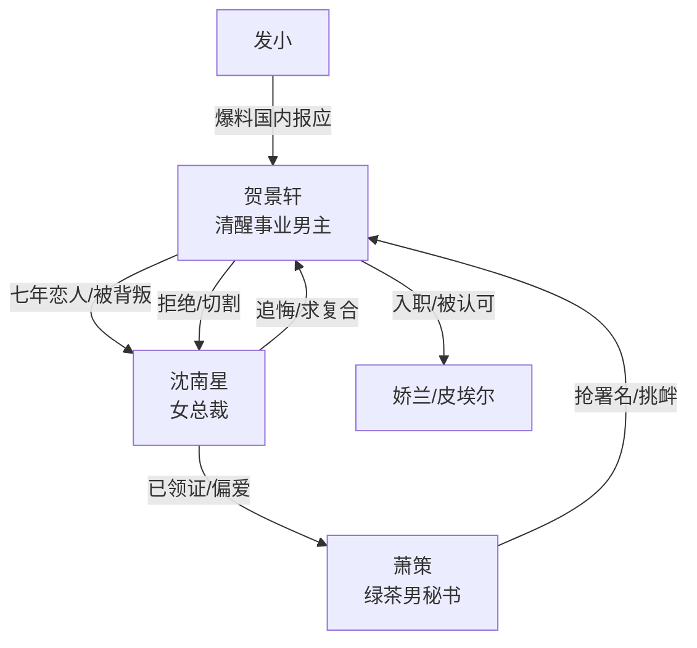

# 角色标签图谱

## 角色清单

### 贺景轩 — 清醒事业型弃夫男主

- 叙事功能: 受害者、撤资者、重生者，承担读者代入与最终补偿。
- 核心标签: 清醒、克制、天才调香师
- 弧光: 委曲求全的准新郎 → 切断关系的首席调香师 → 全球执行副总裁
- 台词风格: 冷静短句，少解释，多切割
- 关键行为: 接受娇兰邀约、拉黑沈南星、寄律师函、拒绝股权、完成新品重生
- 读者情绪关系: 前半心疼，后半爽和尊敬

### 沈南星 — 傲慢失控的女总裁/追妻火葬场对象

- 叙事功能: 主要背叛者，制造情绪债，后期承受悔恨。
- 核心标签: 自负、贪心、迟来的悔悟
- 弧光: 双线占有的掌控者 → 公司暴雷的失控者 → 栅栏外的失败者
- 台词风格: 前期理所当然，后期卑微求复合
- 关键行为: 藏结婚证、夺署名、护萧策、追到巴黎、签切割声明
- 读者情绪关系: 前期恨，后期看她火葬场获得清算爽感

### 萧策 — 绿茶男秘书/偷窃型小三

- 叙事功能: 直接挑衅者，推动沈南星暴露真实偏心。
- 核心标签: 绿茶、贪婪、无能
- 弧光: 被偏爱的“名正言顺老公” → 项目暴雷者 → 入狱者
- 台词风格: 对外装可怜，对男主露出恶意
- 关键行为: 戴腕表挑衅、抢署名、求配方、卖幻夜配方、做假账
- 读者情绪关系: 恨点集中，最终被捕带来直接爽点

### 皮埃尔 — 国际事业线见证者

- 叙事功能: 证明男主价值的外部权威。
- 核心标签: 专业、认可、贵人
- 弧光: 接机负责人 → 事业见证者 → 高位任命传递者
- 台词风格: 直接赞赏，带国际职场感
- 关键行为: 接机、带看实验室、确认男主作品价值、宣布副总裁任命
- 读者情绪关系: 提供补偿与爽感背书

### 发小 — 读者嘴替/信息中继

- 叙事功能: 传递国内报应进展，替读者骂人和欢呼。
- 核心标签: 仗义、直爽、嘴替
- 弧光: 愤怒爆料者 → 报应播报者 → 释然见证者
- 台词风格: 口语化、情绪外放
- 关键行为: 发视频、汇报萧策被捕、告知沈氏终局
- 读者情绪关系: 帮读者释放情绪，避免男主破功

## 关系网络

## 角色功能对照表（供改编参考）

| 原角色 | 极致标签 | 叙事功能 | 读者情绪功能 | 改编时必须保留的 |
|--------|---------|---------|-------------|---------------|
| 贺景轩 | 清醒事业型弃夫 | 被夺走后主动撤离 | 心疼转爽 | 专业能力、冷静切割、事业升维 |
| 沈南星 | 傲慢女总裁 | 情感与事业双重施害 | 恨与火葬场快感 | 前期自负、后期具体悔恨 |
| 萧策 | 绿茶无能小三 | 直接挑衅和暴雷源 | 恶心与报应爽 | 抢来的东西不会用 |
| 皮埃尔/娇兰 | 国际权威 | 价值背书 | 补偿爽 | 外部平台必须足够高 |
| 发小 | 嘴替 | 传递信息 | 替读者骂和笑 | 报应进度播报 |
