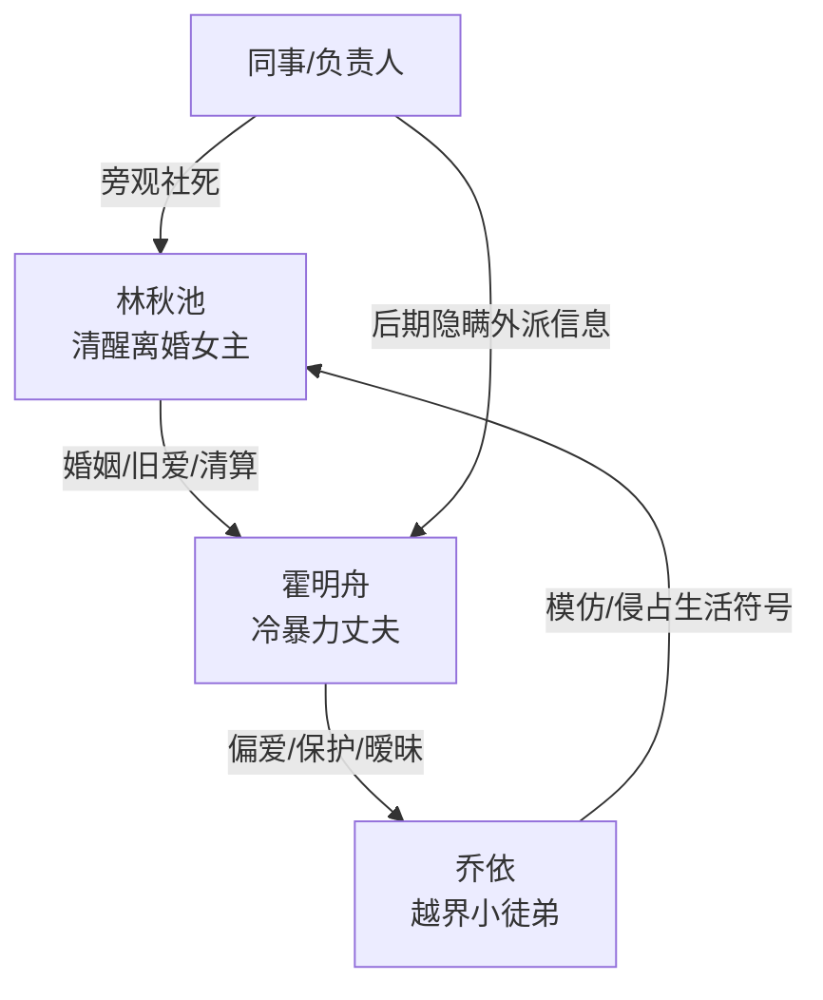

# 角色标签图谱

## 角色清单

### 林秋池 — 清醒离婚大女主
- 叙事功能: 受害者、见证者、清算者。
- 核心标签: 冷静、专业、被冷暴力后觉醒。
- 弧光: 等待回应的妻子 → 心死离开的人 → 事业重建的清醒者。
- 台词风格: 短、冷、直击本质。
- 关键行为: 打胎、外派、签离婚协议、拉黑、拒绝复合。
- 读者情绪关系: 前半心疼，后半爽和尊重。

### 霍明舟 — 迟来深情冷暴力丈夫
- 叙事功能: 施害者、情绪债制造者、后半偿债者。
- 核心标签: 敷衍、偏爱错位、迟来悔恨。
- 弧光: 对妻子自动回复 → 维护乔依 → 失去后全国寻找 → 崩溃签字。
- 台词风格: 前期稳定敷衍，后期破碎哀求。
- 关键行为: 设置自动回复、偏袒乔依、当乔依男伴、两年寻妻、求复合、转移财产。
- 读者情绪关系: 前半恨，后半看其受苦获得清算快感。

### 乔依 — 越界小徒弟/婚姻入侵者
- 叙事功能: 触发偏爱对照，放大霍明舟失职。
- 核心标签: 撒娇、模仿、越界。
- 弧光: 被霍明舟保护和纵容 → 被霍明舟断联驱赶。
- 台词风格: 装作亲近，带暧昧试探。
- 关键行为: 穿同款睡衣、要同款漆扇、要求霍明舟当男伴、台上暧昧提问。
- 读者情绪关系: 厌恶，但核心恨点仍在霍明舟。

### 公司负责人/同事 — 社会目光
- 叙事功能: 放大女主当众难堪，也在后半保护她的信息。
- 核心标签: 旁观、误会、默契。
- 弧光: 饯别宴推女主到尴尬场 → 后来默契不告诉霍明舟外派信息。
- 台词风格: 日常口语。
- 关键行为: 安排饯别宴、推女主入座、后期不告知行踪。
- 读者情绪关系: 增强社死压迫与后期补偿。

## 关系网络

## 角色功能对照表（供改编参考）

| 原角色 | 极致标签 | 叙事功能 | 读者情绪功能 | 改编时必须保留的 |
|--------|---------|---------|-------------|---------------|
| 林秋池 | 清醒离婚大女主 | 承受冷暴力并抽离 | 心疼到爽 | 不复合、不解释、不圣母 |
| 霍明舟 | 迟来深情渣夫 | 制造债务并偿债 | 恨点与火葬场爽点 | 前期敷衍必须具体，后期报应必须具体 |
| 乔依 | 越界小徒弟 | 偏爱触发器 | 厌恶、膈应 | 模仿女主生活物件，占用男主温柔 |
| 同事群体 | 社会目光 | 放大羞辱和补偿 | 尴尬、解气 | 前期围观社死，后期保护女主 |
