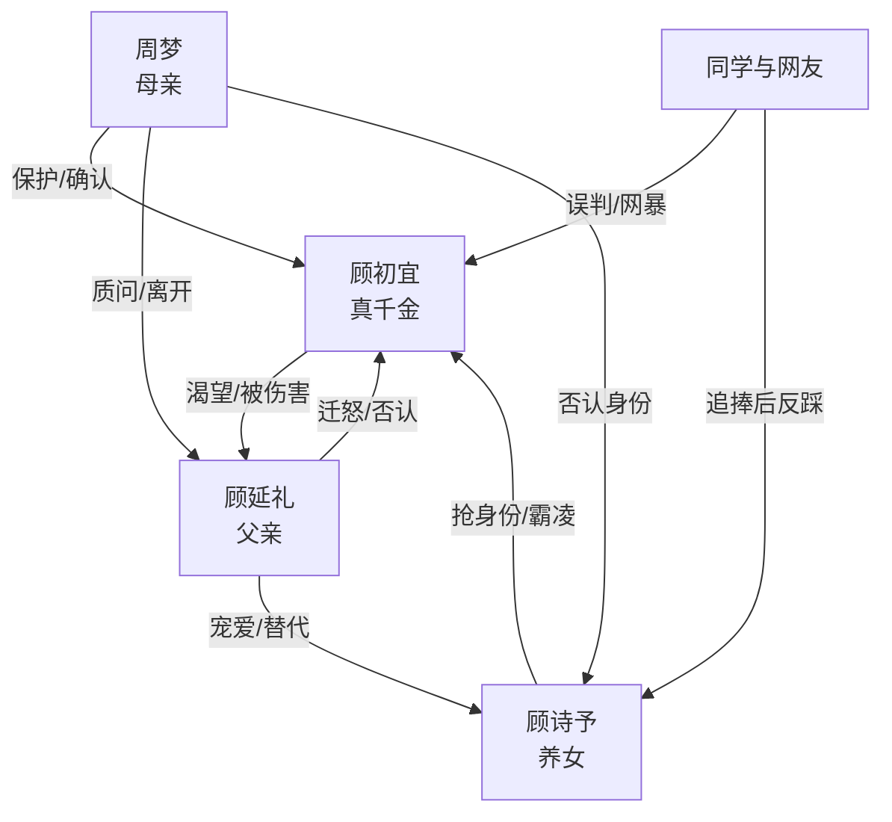

# 角色标签图谱

## 角色清单

### 顾初宜 — 被夺人生的真千金
- 叙事功能: 第一人称受害者与最终清算者。
- 核心标签: 缺爱、隐忍、拒绝回头
- 弧光: 自认“应得” → 被母亲确认价值 → 拿回身份与未来
- 台词风格: 前半少言、爆发短句；后半冷静反讽。
- 关键行为: 扔笔反抗、夺项链、跳湖、拒绝原谅、转学、高考、用遗产击碎顾诗予幻想。
- 读者情绪关系: 心疼、代入、后期爽。

### 周梦/妈妈 — 归来的护崽母亲
- 叙事功能: 正义坐标、身份校正者、情绪债偿还者。
- 核心标签: 护短、清醒、行动派
- 弧光: 失踪缺席 → 付代价归来 → 带女儿离开
- 台词风格: 直击要害，不给绿茶表演空间。
- 关键行为: 否认顾诗予、质问父亲、带女儿去学校、直播认女、坚持离婚。
- 读者情绪关系: 安全感、爽、补偿。

### 顾延礼/爸爸 — 迁怒亲女的疯魔父亲
- 叙事功能: 第一压迫源，也是温度反转的悔恨承载体。
- 核心标签: 偏执、迁怒、迟来悔恨
- 弧光: 曾经宠女 → 十年迁怒 → 讨好补偿 → 自杀谢罪
- 台词风格: 前半冷酷命令，后半苍白解释。
- 关键行为: 收养顾诗予、否认女儿身份、误会项链事件、直播澄清、解除收养、签离婚、自杀。
- 读者情绪关系: 恨、厌、后期复杂但不可原谅。

### 顾诗予 — 鸠占鹊巢的绿茶养女
- 叙事功能: 具体施害者、夺取女主人生的载体。
- 核心标签: 绿茶、冒牌千金、惯性抢夺
- 弧光: 顾家独女 → 身份曝光 → 被赶出顾家 → 落魄崩溃
- 台词风格: 假意道歉、以退为进、关键时刻甩锅。
- 关键行为: 抢生日、偷项链、直播装受害者、刺激女主跳湖、学校装委屈、最终质问女主。
- 读者情绪关系: 恨、等她报应、看她崩溃。

### 姜末与同学群体 — 逐利霸凌合唱团
- 叙事功能: 放大社会性羞辱，呈现身份势利。
- 核心标签: 跟风、势利、欺软怕硬
- 弧光: 帮顾诗予欺负女主 → 得知真相后道歉/转向欺负顾诗予
- 台词风格: 群体嘲讽、站队式发言。
- 关键行为: 推伤女主、网暴爆料、生日嘲讽、后期霸凌顾诗予。
- 读者情绪关系: 厌恶、讽刺、验证环境腐烂。

### 班主任/姜末父母/工作人员/网友 — 舆论压力装置
- 叙事功能: 让女主的私痛变成公共误判。
- 核心标签: 偏听、势利、反转后变脸
- 弧光: 误判女主 → 被真相打脸
- 台词风格: 评判式、标签化。
- 关键行为: 指责女主、要求退学、直播评论、道歉。
- 读者情绪关系: 加压、助推清算爽点。

## 关系网络

## 角色功能对照表（供改编参考）

| 原角色 | 极致标签 | 叙事功能 | 读者情绪功能 | 改编时必须保留的 |
|--------|---------|---------|-------------|---------------|
| 顾初宜 | 被夺人生的真千金 | 承受压迫并完成脱离 | 心疼、代入、爽 | “自认不配”到“不回头”的弧光 |
| 周梦 | 护崽母亲 | 兑现迟来的兜底 | 补偿、安全感 | 无条件站女儿，行动清算 |
| 顾延礼 | 迁怒亲女的父亲 | 温度反转和悔恨承担者 | 恨、复杂余痛 | 曾爱女儿、后伤女儿、最终悔毁 |
| 顾诗予 | 绿茶养女 | 抢夺与反噬载体 | 恨、看报应 | 偷遗物/夺身份/假装受害 |
| 同学群体 | 势利霸凌者 | 扩大压迫场 | 憋屈、讽刺 | 前后站队反转 |
