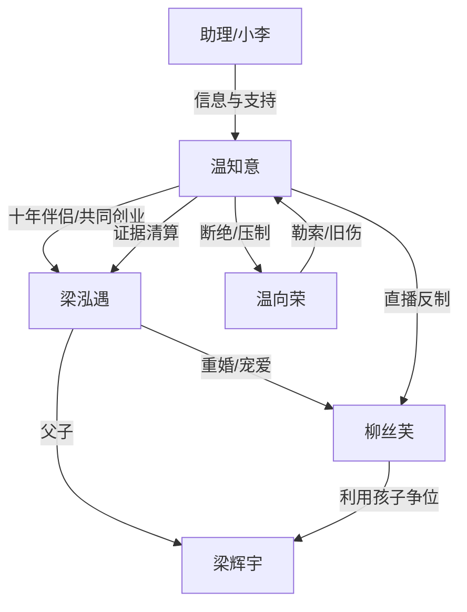

# 角色标签图谱

## 角色清单

### 温知意 — 清醒复仇原配/创业大女主
- 叙事功能: 承受背叛、积累情绪债、执行复仇与自我重建。
- 核心标签: 隐忍、能干、断爱清醒
- 弧光: 等婚礼的爱人 → 被夺走身份的受害者 → 温氏掌权者
- 台词风格: 前期克制追问，后期短句冷打脸
- 关键行为: 查柳丝芙、提交梁氏证据、庭审补证、直播反制、录音追加、掌控股权
- 读者情绪关系: 心疼、代入、爽

### 梁泓遇 — 负心掌权男/傲慢背叛者
- 叙事功能: 核心施害者，制造婚姻、家庭、公司、墓地多层剥夺。
- 核心标签: 傲慢、双标、控制欲
- 弧光: 少年救赎者 → 出轨重婚者 → 阶下囚
- 台词风格: 云淡风轻、命令式、施舍式
- 关键行为: 七次取消领证、与柳丝芙领证、赶走温知意、威胁墓地、反告诽谤
- 读者情绪关系: 恨、厌恶、期待报应

### 柳丝芙 — 白莲小三/夺位寄生者
- 叙事功能: 执行公开羞辱，抢夺合法妻子位置，推动女主触底反击。
- 核心标签: 挑衅、装弱、贪婪
- 弧光: 被宠小三 → 假正室 → 逃亡失败者
- 台词风格: 茶言茶语、公开卖惨、私下挑衅
- 关键行为: 展示结婚证、公司碰瓷、直播污名、卷款逃跑
- 读者情绪关系: 恨、想看打脸

### 梁辉宇 — 私生子/合法性工具
- 叙事功能: 作为梁泓遇与柳丝芙婚姻的活证据，刺痛温知意失子创伤。
- 核心标签: 孩子、筹码、替代
- 弧光: 被保护的儿子 → 惊恐旁观者
- 台词风格: 童声控诉
- 关键行为: 拿出结婚证、哭喊“妈妈不是小三”
- 读者情绪关系: 复杂，主要服务于恨点加深

### 温向荣 — 赌鬼父亲/原生家庭阴影
- 叙事功能: 旧伤复现，配合柳丝芙完成当街羞辱。
- 核心标签: 吸血、粗暴、无耻
- 弧光: 恐惧源头 → 被保镖压制的旧债
- 台词风格: 粗鄙、勒索式
- 关键行为: 当街抢手机、打温知意、要钱
- 读者情绪关系: 厌恶、痛恨

### 小李/助理 — 见证者与执行工具
- 叙事功能: 提供信息、协助盯梢、代表普通员工视角确认女主价值。
- 核心标签: 忠诚、机敏、辅助
- 弧光: 同情旁观 → 支持温总
- 台词风格: 急切、口语化
- 关键行为: 提供微信信息、监控柳丝芙、传递紧急通知
- 读者情绪关系: 缓冲、支持感

## 关系网络

## 角色功能对照表（供改编参考）

| 原角色 | 极致标签 | 叙事功能 | 读者情绪功能 | 改编时必须保留的 |
|--------|---------|---------|-------------|---------------|
| 温知意 | 清醒复仇原配 | 主角与执行者 | 心疼到爽 | 她有真实贡献和反击能力 |
| 梁泓遇 | 傲慢负心男 | 核心压迫者 | 恨点来源 | 曾经救赎与现在践踏并存 |
| 柳丝芙 | 白莲小三 | 羞辱执行者 | 打脸期待 | 公开装弱、私下挑衅 |
| 梁辉宇 | 合法性工具 | 刺痛失子伤 | 加深痛感 | 结婚证/孩子证明必须等价保留 |
| 温向荣 | 原生家庭吸血鬼 | 旧伤复现 | 极致厌恶 | 当街羞辱与勒索 |
| 助理/小李 | 支持者 | 信息推动 | 稳定爽感 | 见证女主真实身份 |
