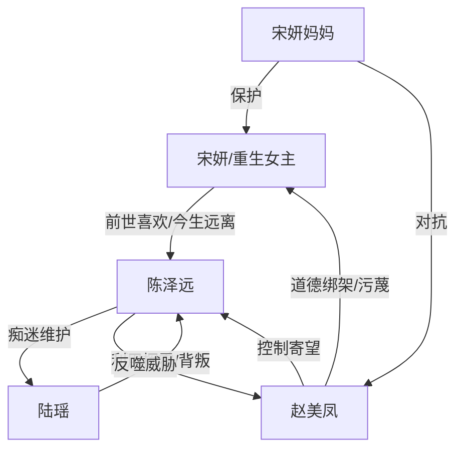

# 角色标签图谱

## 角色清单

### 宋妍 — 清醒重生大女主
- 叙事功能: 视角核心、撤回牺牲者、命运对照组
- 核心标签: 清醒、克制、上进
- 弧光: 前世恋爱脑牺牲 → 今生守住高考 → 名校毕业进入外企
- 台词风格: 冷静反问，短句回刺
- 关键行为: 不找助听器，揭出咖啡厅线索，拒绝作弊，拒绝复合和借钱
- 读者情绪关系: 心疼、代入、爽

### 陈泽远 — 恋爱脑白眼狼竹马
- 叙事功能: 主反派与自毁样本
- 核心标签: 自私、虚荣、恋爱脑
- 弧光: 学霸宠儿 → 故意考低 → 被背叛欠债 → 高中学历求职失败
- 台词风格: 推责、嘴硬、威胁式
- 关键行为: 故意丢助听器，前世推女主下楼，今生护陆瑶，贷款挥霍，殴打陆瑶
- 读者情绪关系: 恨、鄙夷、等报应

### 赵美凤 — 控制欲强势母亲
- 叙事功能: 压迫者、陈泽远选择的受害者、情绪放大器
- 核心标签: 自私、势利、控制
- 弧光: 逼女主牺牲 → 被儿子反噬 → 赔钱卖房
- 台词风格: 道德绑架、辱骂、哭求
- 关键行为: 求女主找助听器，扇女主，逼作弊，殴打陆瑶，借债甩锅
- 读者情绪关系: 前期恨，后期看她被反噬有爽感

### 陆瑶 — 拜金班花
- 叙事功能: 诱因、陈泽远自毁的放大器
- 核心标签: 拜金、虚荣、现实
- 弧光: 被陈泽远维护 → 挥霍陈家 → 傍大款抛弃陈泽远 → 死于小三身份
- 台词风格: 嘲讽、嫌弃、功利
- 关键行为: 要名牌，逼陈泽远同校，背叛陈泽远
- 读者情绪关系: 恨、看她反噬陈泽远时有爽感

### 宋妍妈妈 — 清醒保护型母亲
- 叙事功能: 道德坐标、亲情补偿、女主安全边界
- 核心标签: 清醒、护女、坚定
- 弧光: 前世被气病 → 今生护住女儿高考和名誉
- 台词风格: 朴素、直接、护短
- 关键行为: 阻止女主冒雨找助听器，挡住赵美凤，拒绝借钱
- 读者情绪关系: 心疼、安心、支持

## 关系网络

## 角色功能对照表（供改编参考）

| 原角色 | 极致标签 | 叙事功能 | 读者情绪功能 | 改编时必须保留的 |
|--------|---------|---------|-------------|---------------|
| 宋妍 | 清醒重生大女主 | 撤回牺牲，完成命运改写 | 代入、爽、补偿 | 不主动害人，只拒绝再牺牲 |
| 陈泽远 | 恋爱脑白眼狼 | 自毁型反派 | 恨、等报应 | 前世害女主，今生亲口选择自毁 |
| 赵美凤 | 控制欲势利母亲 | 逼迫与反噬承载者 | 憋屈、爽 | 前期压女主，后期被儿子拖垮 |
| 陆瑶 | 拜金班花 | 诱因与背叛者 | 厌恶、反噬爽 | 必须在后期亲口否定陈泽远的牺牲 |
| 宋妍妈妈 | 清醒护女母亲 | 道德锚点 | 安全感、心疼 | 必须保护女主名誉和前途 |
