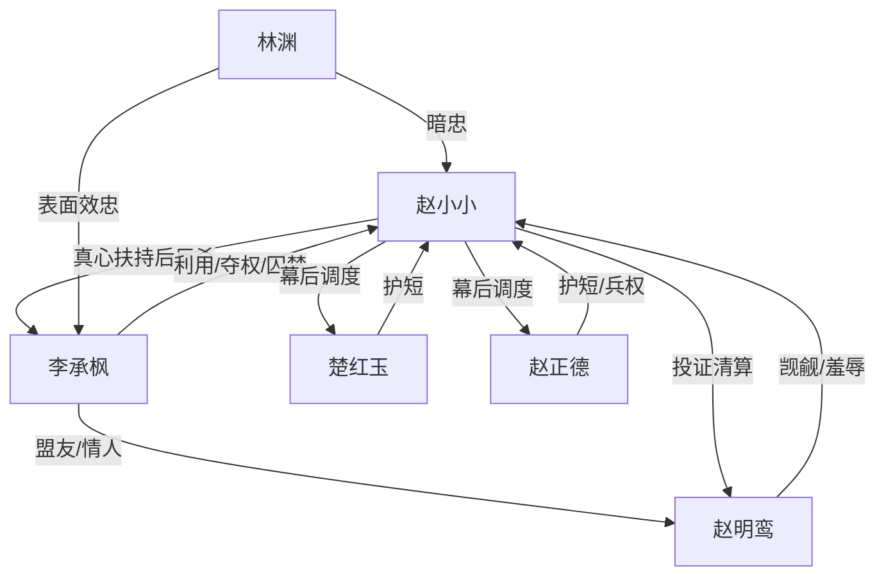

# 角色标签图谱

## 角色清单

### 赵小小 — 幕后棋手型魔丸郡主

- 叙事功能: 主角、布局者、复仇执行者、最终权力承受者
- 核心标签: 冷静、狠准、十年布局
- 弧光: 相夫教子的幕后郡主 → 被背叛的复仇者 → 孤寒女帝
- 台词风格: 短句、冷问、判决式
- 关键行为: 伪造遗诏、压服百官、越狱、调兵围城、废帝
- 读者情绪关系: 爽、心疼、敬畏

### 李承枫 — 伪柔弱白眼狼夫君

- 叙事功能: 反派核心、情感债来源、身份反转载体
- 核心标签: 装弱、复仇偏执、权欲
- 弧光: 柔弱侯爷 → 新帝夺权 → 废帝冷宫
- 台词风格: 前期怯懦断续，后期冷硬疯狂
- 关键行为: 试探食盒、投靠长公主、夺兵权、设局落魂谷、囚禁女主
- 读者情绪关系: 恨、恶心、期待报应

### 楚红玉 — 母夜叉魔丸娘

- 叙事功能: Hook 发动机、喜剧缓冲、亲情底线
- 核心标签: 暴力护短、毒术、莽中有底
- 弧光: 砍皇帝头的母亲 → 被追杀的家人 → 宫宴抱孙的外祖母
- 台词风格: 粗暴、直接、喜剧感
- 关键行为: 砍皇帝头、毒哑太监、藏暗卫、救场反击
- 读者情绪关系: 爽、好笑、安心

### 赵正德 — 莽夫战神爹

- 叙事功能: 兵权载体、亲情支点、结尾代价触发者
- 核心标签: 战神、宠女、粗中有细
- 弧光: 帮搬椅子的荒诞父亲 → 北疆调兵者 → 向女儿行臣礼的臣子
- 台词风格: 粗口化、护短、直白
- 关键行为: 统兵、落魂谷逃生、带三十万宁王军围城
- 读者情绪关系: 爽、温暖、结尾心酸

### 赵明鸾 — 风骚跋扈长公主

- 叙事功能: 前中段压迫者、李承枫盟友、狗咬狗清算对象
- 核心标签: 跋扈、恋爱脑权欲、恶毒
- 弧光: 闯府羞辱女主 → 摄政长公主 → 天牢拔舌
- 台词风格: 娇嗔、羞辱、命令式
- 关键行为: 闯府查食盒、带走李承枫、逼立后、通敌倒卖军械
- 读者情绪关系: 恨、厌、看她被反噬的爽

### 林渊 — 十年暗子禁军统领

- 叙事功能: 后期反转工具、女主布局能力证明
- 核心标签: 忠诚、暗线、关键倒戈
- 弧光: 李承枫认可的新统领 → 女主十年前埋下的棋
- 台词风格: 军令式、简短
- 关键行为: 城楼下令放下弓箭，率十万禁军归女主
- 读者情绪关系: 惊喜、爽

## 关系网络

## 角色功能对照表（供改编参考）

| 原角色 | 极致标签 | 叙事功能 | 读者情绪功能 | 改编时必须保留的 |
|--------|---------|---------|-------------|---------------|
| 赵小小 | 幕后棋手郡主 | 主角/清算者 | 爽与心疼 | 十年布局、冷静狠、最终代价 |
| 李承枫 | 伪弱白眼狼 | 反派/背叛者 | 恨与报应期待 | 装弱、夺权、杀女主父母计划 |
| 楚红玉 | 魔丸娘 | Hook/喜剧/武力 | 爽与安心 | 极端护短、荒诞暴力 |
| 赵正德 | 战神爹 | 兵权/亲情 | 温暖与心酸 | 调兵、落魂谷反转、结尾行礼 |
| 赵明鸾 | 跋扈长公主 | 外部压迫 | 厌恶 | 羞辱女主、与反派狗咬狗 |
| 林渊 | 暗子统领 | 后手揭示 | 惊喜 | 关键节点倒戈 |
