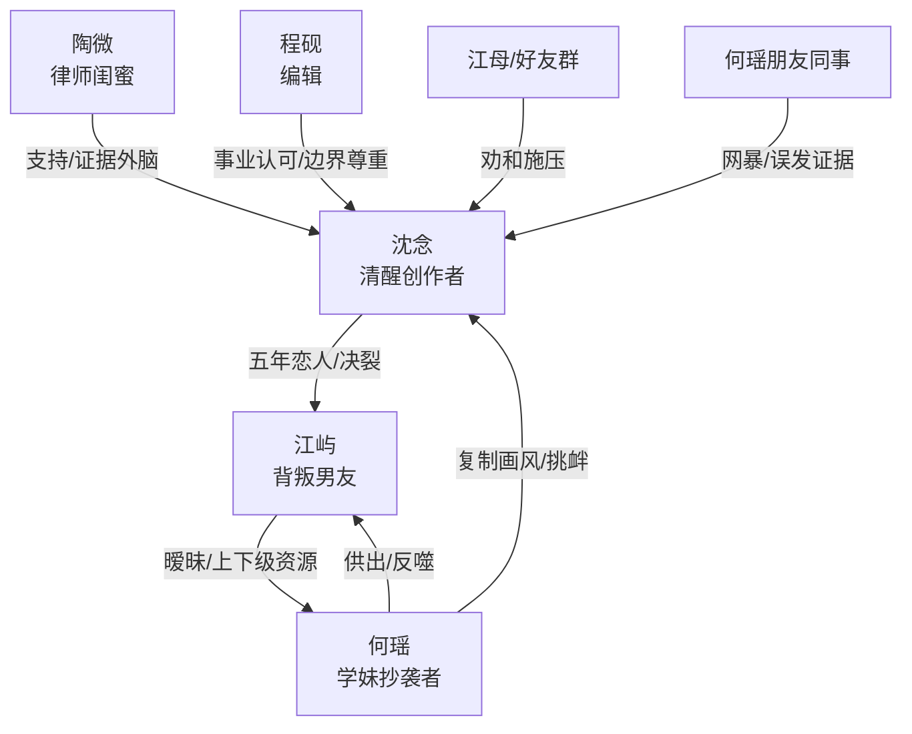

# 角色标签图谱

## 角色清单

### 沈念 — 清醒自救型创作者
- 叙事功能: 主视角承压者与反击者，把情感创伤转化为作品与证据。
- 核心标签: 克制、敏感但清醒、创作型大女主
- 弧光: 被背叛后自我怀疑 → 证据确认 → 创作爆发 → 自我归还
- 台词风格: 短句、反问、低音量清算
- 关键行为: 点赞朋友圈、改签、搬走、截图、画《不必要的行李》、公开说实话、捐掉防晒衣
- 读者情绪关系: 心疼、代入、替她憋屈，后期获得爽感与释然

### 江屿 — 煤气灯式背叛男友
- 叙事功能: 压迫源之一，负责制造长期情绪债与话术回旋。
- 核心标签: 自私、逃避、双标
- 弧光: 掌控女主 → 怕难堪 → 失去资源与情感供给 → 被解聘
- 台词风格: 反问、指责、降级问题
- 关键行为: 五一撒谎、陪何瑶、拿沈念生日请客、官宣、求和失败
- 读者情绪关系: 恨、厌烦、期待被反噬

### 何瑶 — 绿茶替代者/抄袭者
- 叙事功能: 外部挑衅者，放大背叛羞辱，并引出创作权益反击。
- 核心标签: 复制、示威、资源依附
- 弧光: 穿女主物件上位 → 官宣挑衅 → 舆论翻车 → 职场出局
- 台词风格: 装无辜、喊学姐、私信破防
- 关键行为: 穿情侣防晒衣、朋友圈官宣、抄袭画作、发朋友圈嘲讽、晚宴自爆
- 读者情绪关系: 恨、恶心、期待被扒皮

### 陶微 — 律师闺蜜/清醒外脑
- 叙事功能: 解释证据价值，替读者说出判断，推动女主从被告心态转为原告心态。
- 核心标签: 犀利、护短、专业
- 弧光: 陪伴见证 → 法律兜底 → 见证疗愈
- 台词风格: 直接、反讽、法律逻辑强
- 关键行为: 提醒整理证据、判断舆论回火、指出江屿话术训练
- 读者情绪关系: 爽、安心、替女主撑腰

### 程砚 — 尊重型事业助力者
- 叙事功能: 对照江屿，证明正常尊重不是稀缺奇迹，同时推动事业线。
- 核心标签: 稳定、边界感、专业
- 弧光: 编辑邀约 → 画集推动 → 画展策划
- 台词风格: 简短、具体、尊重选择
- 关键行为: 记住燕麦拿铁、收录画作、推动加印和选题会
- 读者情绪关系: 舒适、补偿，但不是救赎主体

### 孟晴/周远/江母/何瑶朋友 — 群体压力合唱团
- 叙事功能: 把私人背叛扩展为社会性羞辱，制造高压环境。
- 核心标签: 劝和、和稀泥、站队
- 弧光: 替江屿说话 → 逐渐转为消息传递者/背景噪音
- 台词风格: “五年不容易”“他不是故意的”
- 关键行为: 劝和、传话、群聊暗讽
- 读者情绪关系: 烦躁、窒息、现实感增强

## 关系网络

## 角色功能对照表（供改编参考）

| 原角色 | 极致标签 | 叙事功能 | 读者情绪功能 | 改编时必须保留的 |
|--------|---------|---------|-------------|---------------|
| 沈念 | 清醒自救型创作者 | 承压、留证、创作反击 | 心疼到爽 | 克制、不吵闹、最终自我归还 |
| 江屿 | 煤气灯背叛男 | 情绪债来源 | 恨与反噬期待 | 话术重复、双标、现实代价 |
| 何瑶 | 绿茶抄袭者 | 挑衅与版权冲突 | 恶心与扒皮爽 | 复制女主、公开示威、私信自爆 |
| 陶微 | 律师闺蜜 | 证据解释器 | 爽感放大 | 专业兜底、犀利判断 |
| 程砚 | 尊重型编辑 | 事业补偿线 | 舒适感 | 不抢女主主体性 |
| 群体压力合唱团 | 和稀泥围观者 | 增压 | 窒息感 | 劝和、误解、站队噪音 |
