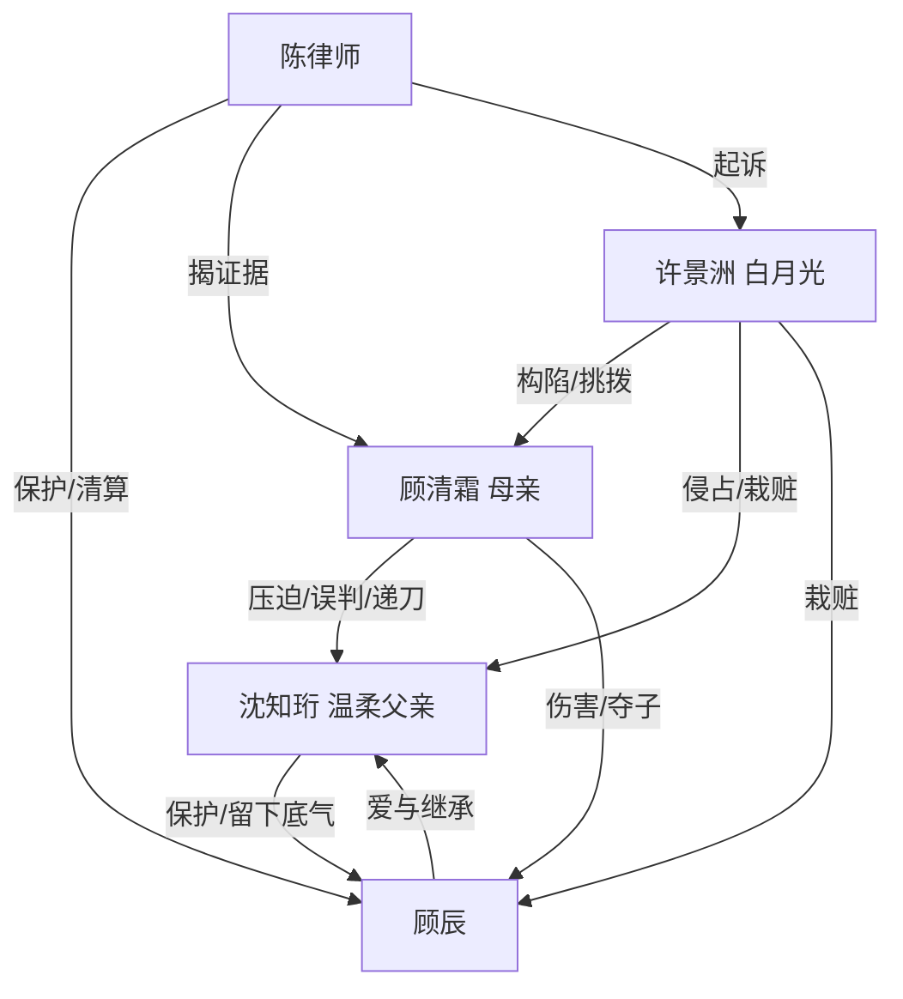

# 角色标签图谱

## 角色清单

### 顾辰 — 清醒受伤继承者
- 叙事功能: 第一人称见证者，承接父亲遗产与价值观，执行最终拒绝原谅。
- 核心标签: 被伤害的孩子、清醒旁观者、自由继承者。
- 弧光: 恐惧无力的八岁孩子 → 拒绝被母亲困住的成年人。
- 台词风格: 前期哭求、质问；后期平静、残忍、边界清晰。
- 关键行为: 护父、保存父亲文件、拒绝监护、拒绝探望、建立基金和图书馆。
- 读者情绪关系: 心疼、代入、最终获得补偿性释然。

### 沈知珩 — 被困住的攻略者父亲
- 叙事功能: 情绪债核心承载者，死亡触发清算，主题金句来源。
- 核心标签: 温柔父亲、异乡攻略者、清醒退场者。
- 弧光: 为爱留下 → 被亲手摧毁 → 放弃世界 → 以死亡脱离。
- 台词风格: 克制、短句、少控诉，越痛越平静。
- 关键行为: 给孩子整理证件、签协议、护子、留下信托与律师、死亡脱离。
- 读者情绪关系: 极强心疼；他的“不再要她”构成最大爽点。

### 顾清霜 — 偏执掌权母亲/迟来悔恨者
- 叙事功能: 主要情绪债制造者，真正火葬场主体。
- 核心标签: 京圈掌权人、偏信白月光、亲手递刀者。
- 弧光: 高位施压 → 亲手逼死丈夫 → 查明真相 → 失去丈夫、儿子、公司、余生。
- 台词风格: 命令式、审判式；后期哀求式、破碎式。
- 关键行为: 停药、逼歉、夺股、抽血、夺子、毁骨灰、迟来调查。
- 读者情绪关系: 前期恨，后期不被原谅的报应爽。

### 许景洲 — 绿茶白月光/构陷型反派
- 叙事功能: 外部恶意源，制造母亲误判，后期被法律清算。
- 核心标签: 白月光、绿茶骗子、恩将仇报。
- 弧光: 被偏袒的受害者伪装 → 露馅 → 入狱。
- 台词风格: 委屈、退让、暗中挑拨；败露后尖叫甩锅。
- 关键行为: 诬陷沈家、占主卧、伪造病情、栽赃顾辰、转移财产。
- 读者情绪关系: 恨、厌恶；他的崩溃提供直接打脸爽点。

### 陈律师 — 秩序清算者/父亲遗愿执行人
- 叙事功能: 法律与秩序入口，保护顾辰，执行财产和监护权清算。
- 核心标签: 冷静专业、可信长辈、证据持有人。
- 弧光: 生前被父亲托付 → 死后接管局面 → 帮顾辰获得自由。
- 台词风格: 平静、冷硬、证据导向。
- 关键行为: 入场保护顾辰，提交证据，争取监护权，交付成年文件。
- 读者情绪关系: 安全感、补偿感。

## 关系网络

## 角色功能对照表（供改编参考）

| 原角色 | 极致标签 | 叙事功能 | 读者情绪功能 | 改编时必须保留的 |
|--------|---------|---------|-------------|---------------|
| 顾辰 | 清醒受伤继承者 | 见证与最终拒绝 | 心疼、代入、释然 | 第一人称受害孩子视角与“不原谅” |
| 沈知珩 | 被困住的攻略者父亲 | 情绪债核心 | 心疼、痛感、主题 | 为爱留下又后悔留下 |
| 顾清霜 | 偏执掌权母亲 | 主债务人 | 恨、火葬场爽 | 主动伤害，不可洗白 |
| 许景洲 | 绿茶白月光 | 外部反派 | 厌恶、打脸爽 | 装弱挑拨与证据败露 |
| 陈律师 | 秩序清算者 | 法律执行 | 安全感 | 父亲生前托付的第三方秩序 |
