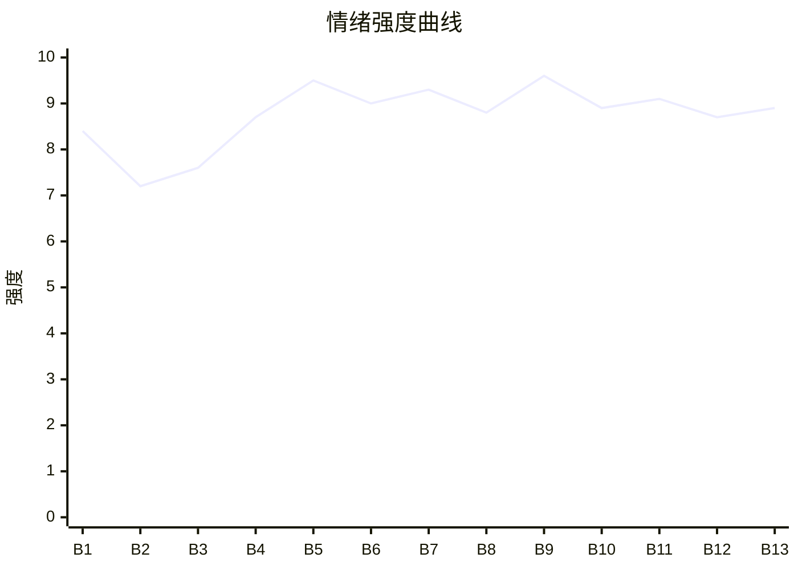

# Beat Sheet 节拍器

## 全文概况

- 总字数: 约 15100 字
- 节拍数: 13 幕
- 核心母题（Logline）: 已死少女花疏影，为了让旧日爱人知道被篡改情书的真相，以灵魂视角旁观江玦从恨她到悔疯，最终放下执念离开。
- 情绪模式: 死亡揭示 → 误会压迫 → 青春温度回闪 → 物证引爆 → 悔恨清算 → 放下离场

## 节拍详表

### Beat 1: 访谈揭尸 [简介-第1章前半]
- **字数**: 约 900 字（占比 6.0%）
- **核心事件**: 退休老师宋晓在访谈中公开“拆散早恋”的旧事，并说女学生已因白血病死去。
- **情绪标签**: 震惊、悬疑、反讽
- **情绪强度**: 8.4/10
- **情绪方向**: ⚡突变
- **冲突类型**: 大转折
- **悬念钩子**: 死去的女学生和金融大鳄江玦到底发生过什么？
- **叙事速度**: 快
- **对话占比**: 55%
- **reversal_mechanism**: [M4, M5]
- **hook_strength**: 8.8/10（极端度 2.7/3，信息密度 2.8/3，悬念 1.8/2，节奏 1.5/2）
- **关键句**: “她得了白血病没钱治，三年前就死了。”
- **原文摘录**: 退休老师宋晓上了档访谈节目。她桃李满天下，学生不是总裁就是科学家。被问到对哪个学生印象最深。她抿了抿唇，笑的苦涩。“是个最不成器的。”“她是年纪第一，却和班里的吊车尾黄毛谈恋爱，我为了她的未来，就把她的情书变成揭短信在家长会朗读，他们就被我拆散了。”“没想到她落榜了，那个黄毛却考上了顶级学府，成了金融大鳄，真是世事无常啊。”主持人问她有什么话想对那个学生说。宋晓说：“说了她也听不到了。”“她得了白血病没钱治，三年前就死了。”视频冲上热搜，男主角江玦对此一无所知，正赶着给未婚妻买粉钻项链。

### Beat 2: 未婚妻与灵魂旁观 [第1章中段]
- **字数**: 约 1100 字（占比 7.3%）
- **核心事件**: 江玦和未婚妻甜蜜通话，花疏影灵魂旁观，确认江玦仍恨她。
- **情绪标签**: 酸涩、嫉痛、克制
- **情绪强度**: 7.2/10
- **情绪方向**: ↓下降
- **冲突类型**: 微冲突
- **悬念钩子**: 江玦为什么如此厌恶“前女友”？
- **叙事速度**: 中
- **对话占比**: 45%
- **reversal_mechanism**: [M4, M5]
- **hook_strength**: null
- **关键句**: “江玦恨我，很恨我。”
- **原文摘录**: 于淼笑着催江玦早点去拍粉钻，江玦宠溺答应。于淼调侃：“我真要感谢你的前女友，把你教的这么好，前人栽树后人乘凉。”江玦脸僵住，说自己没谈过恋爱。“我静静地飘在半空，没有错过江玦眼神的变化。”他听到前女友时眼底有明晃晃的厌恶。叙述补出：那封信毁掉他的体面，也让他父亲心脏病发作成植物人。他凭恨意考上最高学府，创业成金融大佬，和于淼订婚。

### Beat 3: 同学会否认花疏影 [第1章后半-第2章开头]
- **字数**: 约 1000 字（占比 6.6%）
- **核心事件**: 江玦见宋晓并参加同学会，当众装作不认识花疏影。
- **情绪标签**: 憋屈、难堪、冷讽
- **情绪强度**: 7.6/10
- **情绪方向**: ↓下降
- **冲突类型**: 微冲突
- **悬念钩子**: 他越说不认识，越证明记得太深。
- **叙事速度**: 快
- **对话占比**: 50%
- **reversal_mechanism**: [M5]
- **hook_strength**: null
- **关键句**: “花疏影是哪位？”
- **原文摘录**: 江玦去电视台给宋晓送花，宋晓邀请他参加同学聚会，并说“放心吧，她不会来。”同学会因江玦热闹起来，有人喝醉提起“江玦和花疏影早恋的事”。场子死寂，众人看江玦反应。江玦笑了下，抿酒问：“花疏影是哪位？”众人尴尬地笑，说不重要。叙述人总结：“我和江玦轰轰烈烈的三年，就被这么轻轻带过。”

### Beat 4: 借钱与抛钱旧伤 [第2章中后段]
- **字数**: 约 1300 字（占比 8.6%）
- **核心事件**: 宋晓劝江玦去祭日，回忆花疏影三年前求他借钱治病，被他羞辱。
- **情绪标签**: 心疼、愤怒、绝望
- **情绪强度**: 8.7/10
- **情绪方向**: ↓下降
- **冲突类型**: 大转折
- **悬念钩子**: 江玦会不会去墓园？他是否会信她已死？
- **叙事速度**: 中
- **对话占比**: 42%
- **reversal_mechanism**: [M4, M5]
- **hook_strength**: null
- **关键句**: “这点钱够给自己买个好点的骨灰盒了。”
- **原文摘录**: 宋晓说花疏影走时连收尸的人都没有，劝江玦过去。江玦冷笑：“都说祸害遗千年，她那样的人不会死的。”回忆中，花疏影查出白血病，回家发现母亲早搬走，打电话向江玦借一百万，说“我快死了”。江玦早掐断电话。第二天她发传单晕倒撞进江玦怀里，他看清是她后抽回手，让她摔在烤化的沥青上，又扔下两万块：“不是说快死了吗，这点钱够给自己买个好点的骨灰盒了。”她后来真的用两万块买了骨灰盒。

### Beat 5: 青春温度正峰与误会爆炸 [第3章]
- **字数**: 约 2200 字（占比 14.6%）
- **核心事件**: 回忆两人少年相护、情书被改、父亲死亡、求救电话被挂断、女主彻底坠落。
- **情绪标签**: 温柔、撕裂、绝望
- **情绪强度**: 9.5/10
- **情绪方向**: ⚡突变
- **冲突类型**: 大转折
- **悬念钩子**: 情书原文到底是什么？江玦何时知道真相？
- **叙事速度**: 中
- **对话占比**: 35%
- **reversal_mechanism**: [M5, M6]
- **hook_strength**: null
- **关键句**: “那天我能记住的，只有被挂断的电话和空气中的花香。”
- **原文摘录**: 花疏影回忆第一次见江玦，他被人打得头破血流，却递外套给她。他给她送早饭、占自习位置、替她挡母亲发病时的打。高三她想正式告白，却被宋晓翻书包，把情书变成“看不起江玦”的揭短。江父被气到病危后去世，江玦把百合花扔在她脚边，说：“我喜欢上你，是我贱。”她被混混拖进巷子，拨通江玦求救。江玦说：“那要恭喜你了。”电话挂断。她被发现时断了右手，全身都是伤。后来她没复读，进黑工厂，生病化疗，看江玦在电视上宣布要结婚。临死前，她和来医院做慈善的江玦隔着帘子擦肩而过。

### Beat 6: 墓前拒信与真相第一爆 [第4章]
- **字数**: 约 1500 字（占比 9.9%）
- **核心事件**: 江玦到墓前仍羞辱花疏影，宋晓揭开情书被改的真相，递出 U 盘。
- **情绪标签**: 愤怒、心碎、期待
- **情绪强度**: 9.0/10
- **情绪方向**: ↑上升
- **冲突类型**: 大转折
- **悬念钩子**: U 盘里有什么能让江玦信？
- **叙事速度**: 快
- **对话占比**: 60%
- **reversal_mechanism**: [M4, M6]
- **hook_strength**: null
- **关键句**: “什么脏东西，也配拿到我面前。”
- **原文摘录**: 江玦取消会议去墓园，说要看花疏影演到什么时候。墓碑写着“花疏影之墓”“感谢上帝，我终于自由了”。江玦说她知道用道具，想给他做小三。宋晓说：“那天疏影跪下来求你的时候，你没开门。她向你求救的时候，你也没理。”她递出粉红色信纸，江玦却把信甩进污水坑：“什么脏东西，也配拿到我面前。”宋晓甩银行卡，说花疏影用两万买骨灰盒，这是剩下的钱，并承认当年是她改了情书。江玦仍不信。宋晓拿出带 Hello Kitty 挂饰的 U 盘。

### Beat 7: U盘音频实锤 [第5章]
- **字数**: 约 1500 字（占比 9.9%）
- **核心事件**: 江玦看到旧照片和暗恋记录，听见宋晓篡改情书的原始音频，鉴定报告证实真实。
- **情绪标签**: 动摇、窒息、崩塌
- **情绪强度**: 9.3/10
- **情绪方向**: ↑上升
- **冲突类型**: 大转折
- **悬念钩子**: 他会如何面对已被自己毁掉的人？
- **叙事速度**: 中
- **对话占比**: 35%
- **reversal_mechanism**: [M5, M6]
- **hook_strength**: null
- **关键句**: “无加工痕迹，系原始音频。”
- **原文摘录**: 江玦认出 U 盘是自己送给花疏影的第一份礼物。文件夹里有偷拍照片和背后日期文字：“江玦大半夜给我送布洛芬……我有点喜欢他了。”“我决定勇敢一次，喜欢江玦。”音频里，花疏影哭着质问宋晓为什么乱说话，宋晓坚持“以后一定会感谢我的”。随后花母冲进来，骂她喜欢“那个贱人的儿子”，用头发把她拖走。江玦听了两遍，直到烟头烧到手背才回神。他让助理鉴定音频。报告写明：无加工痕迹，系原始音频。江玦挺直的脊背弯下去，像座倾颓的山。

### Beat 8: 烂掉的情书与迟到道歉 [第6章前半]
- **字数**: 约 1300 字（占比 8.6%）
- **核心事件**: 江玦回墓地捡被自己丢进污水的情书，终于向墓碑道歉。
- **情绪标签**: 悔恨、悲凉、释然
- **情绪强度**: 8.8/10
- **情绪方向**: →平稳高位
- **冲突类型**: 微冲突
- **悬念钩子**: 他以为她没有遭遇巷中侵害，这个侥幸会不会被打碎？
- **叙事速度**: 慢
- **对话占比**: 45%
- **reversal_mechanism**: [M5]
- **hook_strength**: null
- **关键句**: “那封短短的信，早已经软烂如泥。”
- **原文摘录**: 江玦夜里回到墓地，名贵皮鞋踩进污水也不皱眉。他伸手去捡粉红色纸张，纸已泡涨起皱，字迹晕开，越拿越碎。花疏影劝他回自己的世界，说不怪他了。江玦摸着墓碑照片，轻笑说“真是丑”，又把落叶放进口袋，在墓旁坐下，肩膀发抖。大滴眼泪砸在地上。他说：“花疏影，对不起。当年的事我没信过你，现在估计你也不会信我。”女主灵魂平静接受，觉得心结解开，身体越来越轻。

### Beat 9: 出警记录击碎侥幸 [第6章后半-第7章前半]
- **字数**: 约 1500 字（占比 9.9%）
- **核心事件**: 江玦以为她骗了巷中遭遇，出警记录证明一切都是真的。
- **情绪标签**: 震骇、愤怒、报应期待
- **情绪强度**: 9.6/10
- **情绪方向**: ⚡突变
- **冲突类型**: 大转折
- **悬念钩子**: 江玦会怎样清算加害者与母亲？
- **叙事速度**: 快
- **对话占比**: 38%
- **reversal_mechanism**: [M6, M5]
- **hook_strength**: null
- **关键句**: “只是你来的太晚了江玦，太晚了。”
- **原文摘录**: 江玦说那天挂掉电话后去找过她，没找到，以为她又骗他。“还好你是骗我的，还好你没有经历那些事……”花疏影愣住：“原来我没有被放弃啊。只是你来的太晚了江玦，太晚了。”助理送来出警记录：“花小姐遭遇侵犯，断了只手。”第7章江玦反复说“不可能”，但记录写着撕裂、青紫、轻伤二级。侥幸彻底被碾灭。他指甲掐进掌心，冷声说：“去查这群畜生的下落。还有，我要见花疏影的妈妈。”

### Beat 10: 母亲互相指罪 [第7章后半]
- **字数**: 约 1300 字（占比 8.6%）
- **核心事件**: 江玦见到花母，质问她撤诉，花母反指他也是毁掉女儿的人。
- **情绪标签**: 伦理撕裂、压抑、心疼
- **情绪强度**: 8.9/10
- **情绪方向**: →平稳高位
- **冲突类型**: 大转折
- **悬念钩子**: 直接加害者会被如何处置？
- **叙事速度**: 中
- **对话占比**: 58%
- **reversal_mechanism**: [M5, M6]
- **hook_strength**: null
- **关键句**: “你现在以什么身份来指责我？”
- **原文摘录**: 江玦找到住在筒子楼里的花母。她形容枯槁，听见江玦名字后说：“你这是嫌毁了我女儿不够，又来报复我了？”江玦质问她为何撤诉。花母拍桌骂：“我就是保护她，才把她关在家里……她为了你学会了翻窗，不顾尊严跪着求你，甚至被糟蹋了还要报案！”她又反问江玦：“我女儿被你害成这样，她的未来全被你毁了，你觉得你又比我高尚在哪里？”江玦被花瓶砸中，血流在地上。花母跪地哭：“疏影，我的疏影……”

### Beat 11: 清算施暴者 [第8章前半]
- **字数**: 约 1200 字（占比 7.9%）
- **核心事件**: 江玦找到当年施暴者，逼其承认并将他们送入牢狱。
- **情绪标签**: 爽、愤怒、迟来补偿
- **情绪强度**: 9.1/10
- **情绪方向**: ↑上升
- **冲突类型**: 大转折
- **悬念钩子**: 清算之后，江玦如何面对宋晓和自己？
- **叙事速度**: 快
- **对话占比**: 45%
- **reversal_mechanism**: [M6]
- **hook_strength**: null
- **关键句**: “你们这种人，就该去死。”
- **原文摘录**: 江玦在废弃楼找到那群人。他们挨过毒打，还辩称自己是好人。江玦问：“你们说这公平吗？”有人想起那个女孩，却说“不是我们的错，是她勾引我们”。江玦沉默两秒，抄起钢管砸过去。出来后，他在水管边洗手，从慢条斯理到粗暴，搓到手血肉模糊。他把那群人全部送进去。女主以为这就是最好的结局，却看见江玦又去找宋晓。

### Beat 12: 生前最后一程与灵魂疑见 [第8章后半-第9章]
- **字数**: 约 1700 字（占比 11.3%）
- **核心事件**: 宋晓讲述花疏影临终前的坚强和放下，江玦崩溃到疑似看见她。
- **情绪标签**: 悲悯、钝痛、悬疑
- **情绪强度**: 8.7/10
- **情绪方向**: →平稳高位
- **冲突类型**: 大转折
- **悬念钩子**: 江玦是否会彻底精神崩溃？女主能否离开？
- **叙事速度**: 慢
- **对话占比**: 40%
- **reversal_mechanism**: [M4, M5]
- **hook_strength**: null
- **关键句**: “花疏影，是你吗？”
- **原文摘录**: 宋晓告诉江玦，花疏影没哭过，说眼泪在那天流完了。化疗时，她拉宋晓出去散步，谈高中旧事，看见江玦和于淼订婚的无人机，仍说“这才对嘛，郎才女貌，多好啊。”她说上一辈的债还是会落在他们身上。后来她吃不下睡不好，却在某天吃满一碗饭，认真给自己选骨灰盒和墓志铭：“感谢上帝，我终于自由了。”江玦听得崩溃，朝空处伸手，喊：“花疏影，是你吗？”

### Beat 13: 男主坠落与女主转身 [第10章]
- **字数**: 约 1600 字（占比 10.6%）
- **核心事件**: 江玦精神失常、婚约解除、事业崩塌、散尽资产赎罪，女主进入新世界。
- **情绪标签**: 悔恨、清算、释然、留白
- **情绪强度**: 8.9/10
- **情绪方向**: ↓下降后释然
- **冲突类型**: 大转折
- **悬念钩子**: 无，完成收束。
- **叙事速度**: 中
- **对话占比**: 30%
- **reversal_mechanism**: [M5, M8]
- **hook_strength**: null
- **关键句**: “我没有回头，转身进入另一个世界开始我的人生。”
- **原文摘录**: 江玦被送进医院，精神有问题的消息传开。于淼发来解除婚约，他回“好”。两家生意受震动。江玦扑在工作上，跨国并购失败，返程飞机遇气流，他平静地像等一场奖励：“花疏影，我终于能见到你了。”他活了下来，却发现江氏股价跌停，高中旧事被爆，小三儿子的新闻霸占热搜。他把自己关在家抽烟喝酒，几次把脚放在 42 楼阳台外。最后他卸任总裁，捐出名下资产用于治疗白血病等重疾。离开江氏时身无分文。他说：“花疏影，如果有来生，我会用我的一辈子向你赎罪。”女主没有回头，进入另一个世界开始人生。

## 情绪曲线可视化

## 节拍密度检测

- 平均每 1160 字一个节拍
- 微冲突密度: 每约 3000 字一次
- 大转折密度: 每约 1500 字一次
- 判定: 符合高频节拍器标准；该文不是纯爽文短爆，而是虐恋 BE 的“真相递进式高压节拍”。

## 反转机制清单(Reversal Mechanisms)

从 prompts/patterns/reversal-mechanisms.md 的 8 大机制中命中以下机制:

| 机制 ID | 机制名 | 承载 Beat | 关键段落/金句 | 等价改编提示 |
|--------|--------|-----------|--------------|-------------|
| M4 | 灵魂线视角 | Beat 1-13 | “我静静地飘在半空”“说了她也听不到了”“我没有回头” | 死亡必须前置，主角后续以观看距离贴近施害者，保留只有死者知道的信息差炸弹。 |
| M5 | 温度反转曲线 | Beat 2-13 | “江玦恨我，很恨我” → “花疏影，对不起” → “用我的一辈子向你赎罪” | 必须显式写出温度正峰、归零伤害、负值悔恨，结尾悔恨要有具体行为代价。 |
| M6 | 多层递进反转 | Beat 5-12 | 情书被改、音频实锤、出警记录、宋晓临终回忆依次引爆 | 层数不能少，每层反转要升维：情节真相 → 伤害真相 → 伦理归罪 → 价值清算。 |
| M8 | 道德模糊结尾 | Beat 13 | “我没有回头，转身进入另一个世界开始我的人生。” | 胜利后保留代价与留白，不写团圆，不让忏悔直接换来幸福或原谅。 |
