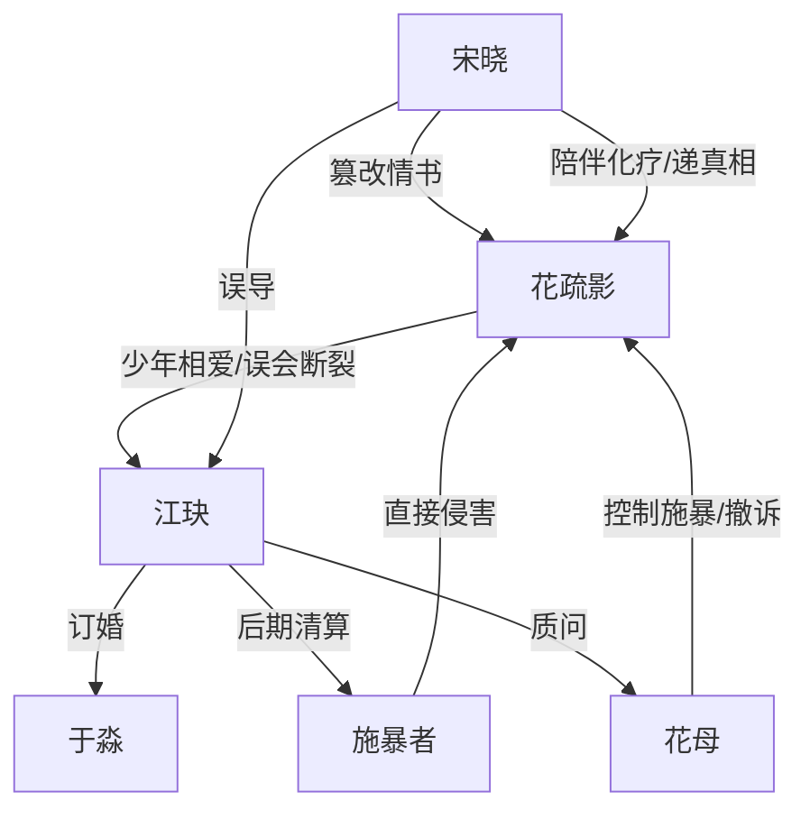

# 角色标签图谱

## 角色清单

### 花疏影 — 已死白月光/灵魂旁观者
- 叙事功能: 第一人称视角核心，承载全部情绪债与真相信息。
- 核心标签: 年级第一、被误解、已死但放下
- 弧光: 想解释 → 被毁掉 → 病死成灵魂 → 放下执念进入新世界
- 台词风格: 克制、平静、少量自嘲
- 关键行为: 写情书、求救、求生、保存旧物、最终不回头
- 读者情绪关系: 心疼、替她不平、希望她解脱

### 江玦 — 误伤爱人的悔恨大佬
- 叙事功能: 温度反转主轴，读者恨点和后半悔恨爽点的承载者。
- 核心标签: 金融大鳄、旧恨深重、迟到赎罪
- 弧光: 否认花疏影 → 发现真相 → 清算他人 → 自毁赎罪
- 台词风格: 前期冷讽刻薄，后期破碎低声
- 关键行为: 否认、扔信、听音频、查出警记录、捐资产
- 读者情绪关系: 前半恨，后半复杂心疼但不完全原谅

### 宋晓 — 自以为是的赎罪老师
- 叙事功能: 误会源头和真相递送者。
- 核心标签: 教育家、篡改情书、迟来赎罪
- 弧光: 自认纠偏 → 毁掉学生 → 陪她化疗 → 公开真相
- 台词风格: 前期笃定，后期愧疚诚恳
- 关键行为: 家长会朗读假信、访谈爆料、保存 U 盘、陪花疏影临终
- 读者情绪关系: 恨她的傲慢，也承认她后期补偿

### 花母 — 疯癫控制型母亲
- 叙事功能: 原生家庭压迫与伦理撕裂的代表。
- 核心标签: 精神失常、控制、悔恨
- 弧光: 施暴控制 → 撤诉遮丑 → 孤独衰败 → 跪地哭女儿
- 台词风格: 尖锐、撕裂、带羞辱性
- 关键行为: 拖走女儿、用皮带打她、撤诉、反问江玦身份
- 读者情绪关系: 愤怒与悲悯混合

### 于淼 — 现任未婚妻/对照组
- 叙事功能: 展示江玦“万事顺意”的现状，反衬花疏影之死。
- 核心标签: 未婚妻、老钱家庭、体面生活
- 弧光: 甜蜜期待 → 察觉不对 → 解除婚约
- 台词风格: 轻松撒娇，带无心刺痛
- 关键行为: 提及前女友、解除婚约
- 读者情绪关系: 非反派，承担温度反差功能

### 施暴者群体 — 现实恶意具象
- 叙事功能: 承载最直接、最不可饶恕的伤害。
- 核心标签: 犯罪者、推责、遗忘受害者
- 弧光: 逍遥法外 → 被逼认出 → 入狱清算
- 台词风格: 狡辩、受害者有罪论
- 关键行为: 侵害花疏影，后续否认与推责
- 读者情绪关系: 纯恨点，必须被清算

## 关系网络

## 角色功能对照表（供改编参考）

| 原角色 | 极致标签 | 叙事功能 | 读者情绪功能 | 改编时必须保留的 |
|--------|---------|---------|-------------|---------------|
| 花疏影 | 已死白月光 | 视角与情绪债核心 | 心疼、惋惜、释然 | 已死前置、克制旁观、不回头 |
| 江玦 | 悔恨大佬 | 温度反转与清算执行 | 前恨后复杂爽 | 前期误伤够狠，后期代价够重 |
| 宋晓 | 赎罪老师 | 误会源头与物证递送 | 愤怒、迟来补偿 | 自以为为你好导致毁灭 |
| 花母 | 疯癫母亲 | 家庭伦理压迫 | 恨与悲悯 | 控制与悔恨并存 |
| 于淼 | 体面现任 | 现实幸福对照 | 酸涩、不迁怒 | 不能写成低级小三反派 |
| 施暴者 | 纯恶加害者 | 直接伤害和清算对象 | 强烈恨点 | 必须被等价清算 |
