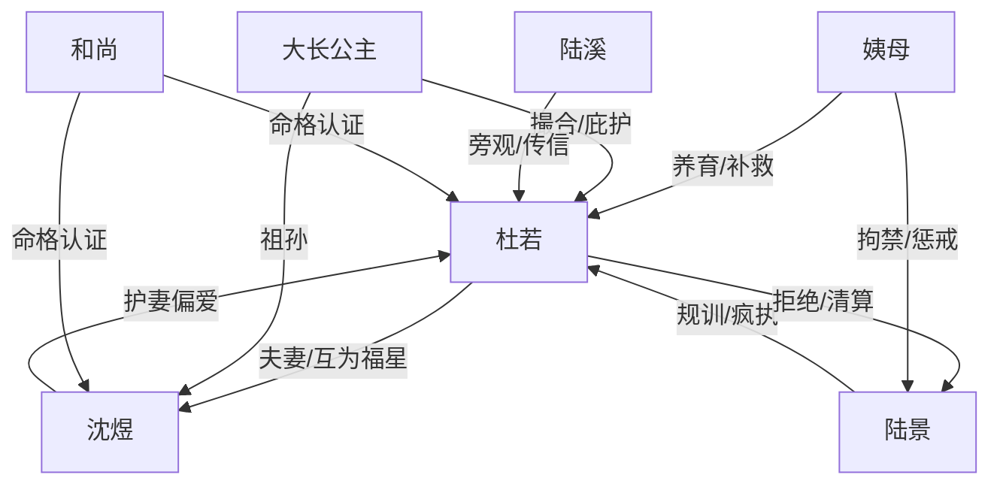

# 角色标签图谱

## 角色清单

### 杜若 — 清醒自救型甜宠女主
- 叙事功能: 承受打压、识别错误关系、接受真正偏爱，并用选择改写命运。
- 核心标签: 艳丽孤女、清醒、被爱后复苏
- 弧光: 被规训到自疑 → 接受偏爱 → 坚定守护沈煜和孩子 → 圆满释然
- 台词风格: 温和但关键处锋利，常用反问完成反击。
- 关键行为: 答应另嫁、拒绝陆景、准备软甲救沈煜、保住孩子。
- 读者情绪关系: 心疼、代入、爽、祝福

### 沈煜 — 少年气护妻小郡王
- 叙事功能: 正确爱的化身，补偿女主被压抑的自我，并与女主互相改命。
- 核心标签: 真香、护短、赤诚
- 弧光: 不想成亲 → 一见倾心 → 极致偏爱 → 被女主救命 → 圆满父亲
- 台词风格: 直白、笨拙、带少年式撒赖。
- 关键行为: 送满怀珠宝、查闲话者外室、交账本、护妻、穿软甲活下来。
- 读者情绪关系: 甜、安心、姨母笑式喜欢

### 陆景 — 规训型自恋反派
- 叙事功能: 制造前半压迫和后半悔恨清算，是错误爱的反面教材。
- 核心标签: PUA 表哥、自恋、疯执
- 弧光: 高位贬低 → 错失婚事 → 发现失去 → 前世执念暴露 → 被关押边缘化
- 台词风格: 训诫式、贬低式、自我合理化。
- 关键行为: 当众羞辱杜若、拒绝回京、强认前世、等沈煜死讯。
- 读者情绪关系: 恨、恶心、等报应

### 姨母 / 陆夫人 — 愧疚护女长辈
- 叙事功能: 推动杜若另嫁，前世梦信息持有者，执行对陆景的最终约束。
- 核心标签: 护短、愧疚、补救
- 弧光: 想亲上加亲 → 发现儿子伤人 → 主动改婚 → 因前世梦坚定关押陆景
- 台词风格: 温柔、内疚、关键时刻强硬。
- 关键行为: 为杜若另寻婚事、安排嫁妆、扇陆景、拘禁陆景。
- 读者情绪关系: 感动、安心

### 大长公主 — 高位助攻祖母
- 叙事功能: 提供高位婚配资源和无条件接纳，是甜宠平台的权力保障。
- 核心标签: 眼光毒、会助攻、护孙媳
- 弧光: 相中杜若 → 戳破沈煜真香 → 接纳杜若 → 宠重曾孙女
- 台词风格: 打趣、利落、权威。
- 关键行为: 春日宴提亲、公主府撮合、开库房、命格确认后加倍宠爱。
- 读者情绪关系: 爽、可靠

### 陆溪 — 旁观成长型妹妹
- 叙事功能: 前期误读“喜欢”，后期见证陆景疯执并完成价值观成长。
- 核心标签: 天真、善良、成长
- 弧光: 以为哥哥喜欢杜若 → 听懂真正喜欢 → 见证哥哥疯了 → 嫁得安稳
- 台词风格: 少女式直接。
- 关键行为: 问杜若是否等陆景、传递陆景疯话、后期总结哥哥疯了。
- 读者情绪关系: 轻微心疼、欣慰

### 和尚 — 命运认证者
- 叙事功能: 将前世梦和今生命运连接，确认杜若与沈煜互为福星。
- 核心标签: 高人、命格揭示、转折锚点
- 弧光: 出场即揭示命数变化，随后退场。
- 台词风格: 偈语式、对仗式。
- 关键行为: 点出“明珠暗投”“美玉易折”“珠联璧合”。
- 读者情绪关系: 悬念释疑、宿命甜

## 关系网络

## 角色功能对照表（供改编参考）

| 原角色 | 极致标签 | 叙事功能 | 读者情绪功能 | 改编时必须保留的 |
|--------|---------|---------|-------------|---------------|
| 杜若 | 清醒自救孤女 | 主视角与情绪承载 | 心疼到祝福 | 从自疑到自在的弧光 |
| 沈煜 | 真香护妻郡王 | 正确爱的补偿者 | 甜、安心 | 笨拙真诚，不油腻 |
| 陆景 | 规训型表哥 | 压迫源与清算对象 | 恨、爽 | “为你好”式打压 |
| 姨母 | 愧疚护女长辈 | 婚事转向与前世真相 | 感动 | 补救行动必须实际 |
| 大长公主 | 高位助攻 | 婚配资源和权力背书 | 爽 | 一眼认可女主 |
| 陆溪 | 成长旁观者 | 价值观辅助说明 | 释然 | 从误判到明白 |
| 和尚 | 命格认证者 | 升格主题 | 宿命感 | 只点到为止，不解释过满 |
