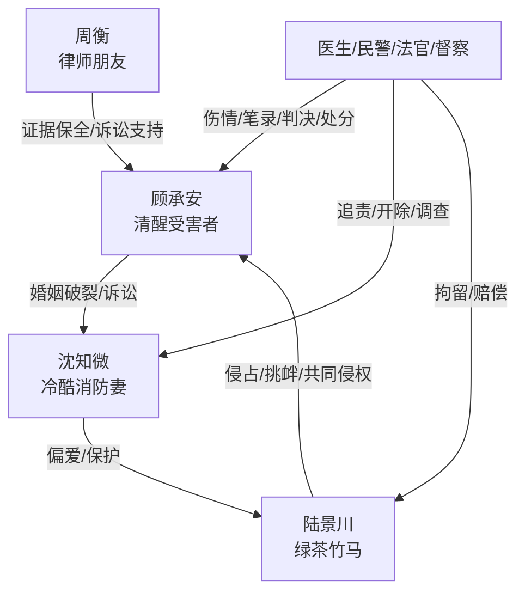

# 角色标签图谱

## 角色清单

### 顾承安 — 清醒受害者/证据型复仇者
- 叙事功能: 第一人称承压者、证据链收集者、道德坐标中心。
- 核心标签: 死里逃生、冷静决裂、制度反杀
- 弧光: 求救无门的丈夫 → 提离婚的受害者 → 用证据清算的原告 → 重建生活的人
- 台词风格: 短句、低温、判词感强
- 关键行为: 火场跳窗自救；准备离婚；固定伤情和证据；庭审追责；卖房离场。
- 读者情绪关系: 心疼、愤怒代入、爽感投射。

### 沈知微 — 冷酷消防妻/滥权背叛者
- 叙事功能: 核心施害者，负责制造生死压迫和职业伦理崩塌。
- 核心标签: 职业傲慢、情感冷漠、误导救援
- 弧光: 掌握制服权威的妻子 → 否认丈夫伤害 → 法庭承认 → 被开除并调查
- 台词风格: 冷淡、不耐烦、定性式
- 关键行为: 反锁丈夫；提前在值班群污名化；误导120；撕毁离婚协议；护陆景川。
- 读者情绪关系: 恨、憋屈、期待她失去制服和婚姻。

### 陆景川 — 绿茶竹马/侵占型帮凶
- 叙事功能: 第三者、拱火者、共同侵权人，让婚姻背叛具象化。
- 核心标签: 装无辜、鸠占鹊巢、临事甩锅
- 弧光: 被偏爱的竹马 → 住进婚房挑衅 → 侵占遗物暴露 → 办案区崩塌
- 台词风格: 表面温和，私下挑衅，出事后推责。
- 关键行为: 占用主卧、穿主角睡衣、摔小木马、戴亡父银表、替沈知微作证/拱火。
- 读者情绪关系: 厌恶、想看打脸、想看赔偿/拘留。

### 周衡 — 律师朋友/清算执行器
- 叙事功能: 专业助攻，推动证据保全、诉讼、行政追责。
- 核心标签: 清醒、专业、护短
- 弧光: 接到离婚请求 → 固定证据 → 法庭提交 → 陪伴主角离场
- 台词风格: 直截了当，法律化。
- 关键行为: 准备离婚材料；保全伤情和财产；录像；提交证据；解释追责路径。
- 读者情绪关系: 安全感、理性爽点。

### 民警/医生/法官/督察系统 — 制度清算者
- 叙事功能: 将主角个人痛苦转化为可验证的事实和处罚。
- 核心标签: 证据、权威、秩序
- 弧光: 从核实事实 → 固定证据 → 判决处分
- 台词风格: 客观、条目式。
- 关键行为: 诊断生育损伤；现场勘验；庭审询问；通报开除。
- 读者情绪关系: 迟来的正义、权威背书。

## 关系网络

## 角色功能对照表（供改编参考）

| 原角色 | 极致标签 | 叙事功能 | 读者情绪功能 | 改编时必须保留的 |
|--------|---------|---------|-------------|---------------|
| 顾承安 | 清醒受害者 | 承压、取证、反杀 | 心疼与代偿爽 | 不失控、不求复合、用证据清算 |
| 沈知微 | 滥权伴侣 | 堵死求救通道 | 恨点核心 | 亲密关系 + 职业权力双背叛 |
| 陆景川 | 侵占型竹马 | 拱火与二次羞辱 | 恶心、想看打脸 | 鸠占鹊巢、动遗物、甩锅 |
| 周衡 | 专业助攻 | 执行法律清算 | 安全感 | 证据保全和法律路径 |
| 制度系统 | 权威背书 | 完成死环 | 公正爽 | 录音、记录、判决、处分必须落地 |
