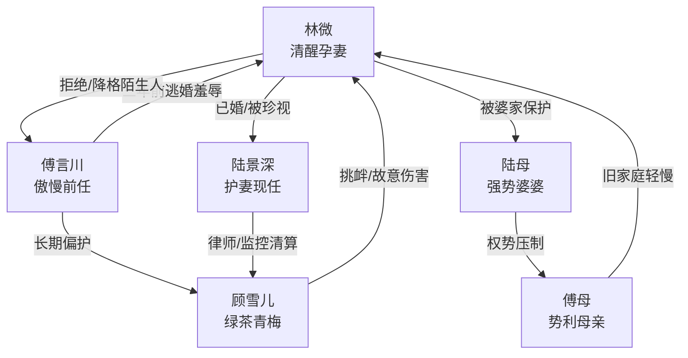

# 角色标签图谱

## 角色清单

### 林微 — 清醒孕妻/前任火葬场女主
- 叙事功能: 承受旧伤、拒绝前任、触发打脸与清算。
- 核心标签: 清醒、克制、已重生。
- 弧光: 卑微爱人 → 心死离场 → 被新家庭珍视的妻子与母亲。
- 台词风格: 冷静短句，善用反问和结论句。
- 关键行为: 拒绝求婚、否认傅言川家属身份、展示婚姻证据、拒绝和解。
- 读者情绪关系: 心疼、代入、爽。

### 傅言川 — 傲慢前任/迟到三年的追妻火葬场男
- 叙事功能: 主要压迫者与悔恨承载体。
- 核心标签: 自恋、迟钝、控制欲。
- 弧光: 高高在上求婚 → 否认现实 → 崩溃求原谅 → 陌生叔叔。
- 台词风格: 命令式、施舍式、质问式。
- 关键行为: 订婚宴逃婚、三年后堵门、否认孕肚、护青梅、试图签字。
- 读者情绪关系: 恨、厌、期待被打脸。

### 顾雪儿 — 绿茶青梅/恶意伤害者
- 叙事功能: 引爆旧债、推动孕妇危机、提供法律清算对象。
- 核心标签: 装弱、嫉妒、恶毒。
- 弧光: 被偏护的青梅 → 监控实锤的施害者 → 名声尽毁。
- 台词风格: 娇滴滴、装可怜、倒打一耙。
- 关键行为: 订婚宴挑赌约、摘头纱、医院送花、故意撞孕妇。
- 读者情绪关系: 恨，期待被法律惩罚。

### 陆景深 — 护妻现任/克制霸总
- 叙事功能: 身份反差爆发、情感补偿、法律清算执行者。
- 核心标签: 稳、护短、长期陪伴。
- 弧光: 隐形丈夫 → 关键时刻现身 → 真正家人。
- 台词风格: 冷淡精准，少废话。
- 关键行为: 按住签字板、出示证件、调律师监控、挡住傅言川。
- 读者情绪关系: 安全感、爽、嗑糖。

### 陆母 — 强势护短婆婆/新家庭补偿
- 叙事功能: 把女主从“被傅家挑剔”抬升到“被陆家珍视”。
- 核心标签: 雍容、护短、公道。
- 弧光: 登场即撑腰。
- 台词风格: 温和威严，句句压制。
- 关键行为: 关心林微身体、拒绝五百万和解、承诺陆家顶着。
- 读者情绪关系: 暖、补偿、爽。

### 傅母 — 势利豪门母亲/旧家庭压迫延伸
- 叙事功能: 复现傅家对女主的轻慢，并被更高权势压制。
- 核心标签: 势利、尖酸、利己。
- 弧光: 嚣张指责 → 认出陆家后低头 → 灰溜溜离开。
- 台词风格: 指责、交易、甩锅。
- 关键行为: 倒打一耙、递五百万支票求和解。
- 读者情绪关系: 厌恶，期待被降维压制。

## 关系网络

## 角色功能对照表（供改编参考）

| 原角色 | 极致标签 | 叙事功能 | 读者情绪功能 | 改编时必须保留的 |
|--------|---------|---------|-------------|---------------|
| 林微 | 清醒孕妻 | 被羞辱后的重建者 | 心疼与代入 | 冷静、不回头、已有新生活 |
| 傅言川 | 傲慢前任 | 主要火葬场对象 | 恨与爽 | 坚信女主还爱他，直到证据击碎 |
| 顾雪儿 | 绿茶青梅 | 恶意升级器 | 恨 | 装弱到实锤故意伤害 |
| 陆景深 | 护妻现任 | 身份反差与保护 | 安全感 | 合法丈夫、长期陪伴、行动力 |
| 陆母 | 护短婆婆 | 家庭补偿 | 暖爽 | 当众撑腰，不用钱和稀泥 |
| 傅母 | 势利旧婆婆 | 旧压迫延伸 | 厌恶 | 先嚣张后低头 |
