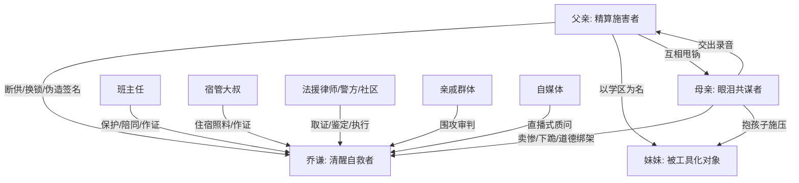

# 角色标签图谱

## 角色清单

### 乔谦 — 清醒自救型高三受害者

- 叙事功能: 第一人称主角，承受家庭牺牲并完成证据反杀。
- 核心标签: 未成年、清醒、证据型反击
- 弧光: 被断供的高三生 → 依法自救的706分优秀毕业生 → 拒绝被亲情绑架的成年人
- 台词风格: 短、准、冷，不争吵，常用反问和事实回击。
- 关键行为: 进资助办、报警、录音截图、拒签谅解、公开长文。
- 读者情绪关系: 心疼、代入、爽。

### 乔建国（父亲） — 精算型偏心施害者

- 叙事功能: 主要压迫者，策划断供、换锁、扣证件、伪造声明。
- 核心标签: 自私、算计、父权话术
- 弧光: 掌控家庭资源者 → 伪证败露者 → 撤职失信者
- 台词风格: 强硬、甩锅、把伤害说成教育。
- 关键行为: 假离婚转移存款、换锁、伪造签名、公开污蔑。
- 读者情绪关系: 恨、厌恶、期待其崩塌。

### 李娟（母亲） — 眼泪型共谋者

- 叙事功能: 以母亲身份和妹妹无辜制造道德绑架，同时提供关键反杀录音。
- 核心标签: 偏心、卖惨、共谋后甩锅
- 弧光: 抱妹妹施压者 → 被丈夫推出去者 → 迟来后悔者
- 台词风格: 哭诉、求情、把牺牲包装成“你大了能扛”。
- 关键行为: 停生活费、校门下跪、发来父亲录音。
- 读者情绪关系: 恨中带冷感，不值得原谅。

### 妹妹 — 被父母当作道德盾牌的婴儿

- 叙事功能: 父母偏心和资源转移的理由，不承担主动恶。
- 核心标签: 无辜、工具化、学区名额
- 弧光: 被用来抢资源 → 入学排序取消 → 回归普通排队
- 台词风格: 无。
- 关键行为: 无主动行为，被母亲抱着下跪。
- 读者情绪关系: 不恨孩子，恨利用孩子的大人。

### 班主任 — 制度善意与保护者

- 叙事功能: 识别困境、陪同报警补证、保护学生。
- 核心标签: 负责、冷静、可信成年人与见证人
- 弧光: 误以为学生胃口不好 → 知情后全程保护 → 鼓励向前走
- 台词风格: 简洁、实际、保护边界清晰。
- 关键行为: 陪派出所、联系招办、挡自媒体、联系律师。
- 读者情绪关系: 安心、感激。

### 宿管大叔 — 低调补偿型外部亲情

- 叙事功能: 用具体照料衬托亲生父母冷漠。
- 核心标签: 朴素、可靠、饭和被子
- 弧光: 给被子 → 考点送水 → 大学前叮嘱好好吃饭
- 台词风格: 土、短、暖。
- 关键行为: 提供被褥、作证、留饭、托人带话。
- 读者情绪关系: 暖、心酸。

### 亲戚群体 — 舆论压迫合唱队

- 叙事功能: 放大家庭伦理压力，让主角陷入“忘本”“自私”的审判。
- 核心标签: 道德绑架、利益相关、墙头草
- 弧光: 围攻乔谦 → 伪证败露后闭嘴 → 父母互咬后旁观
- 台词风格: 泛道德化、利益化。
- 关键行为: 校门围堵、群里转发、附和父母。
- 读者情绪关系: 厌烦、压抑。

## 关系网络

## 角色功能对照表（供改编参考）

| 原角色 | 极致标签 | 叙事功能 | 读者情绪功能 | 改编时必须保留的 |
|--------|---------|---------|-------------|---------------|
| 乔谦 | 清醒自救型受害者 | 主角与证据收集者 | 心疼、爽、代入 | 未成年/关键考试/冷静取证 |
| 父亲 | 精算型偏心父权 | 主谋与话术压迫源 | 恨点核心 | 断供、伪造证据、把伤害说成教育 |
| 母亲 | 眼泪型共谋者 | 道德绑架与后期证据突破口 | 厌恶、心冷 | 用弱者姿态逼主角牺牲 |
| 妹妹 | 被工具化婴儿 | 资源倾斜理由 | 区分无辜与工具化 | 孩子不作恶，大人利用孩子 |
| 班主任/学校 | 制度善意 | 合法保护链 | 安全感 | 现实兜底，不能神化 |
| 宿管大叔 | 日常补偿 | 温情对照 | 心酸暖点 | 被子、饭、水等具体照料 |
