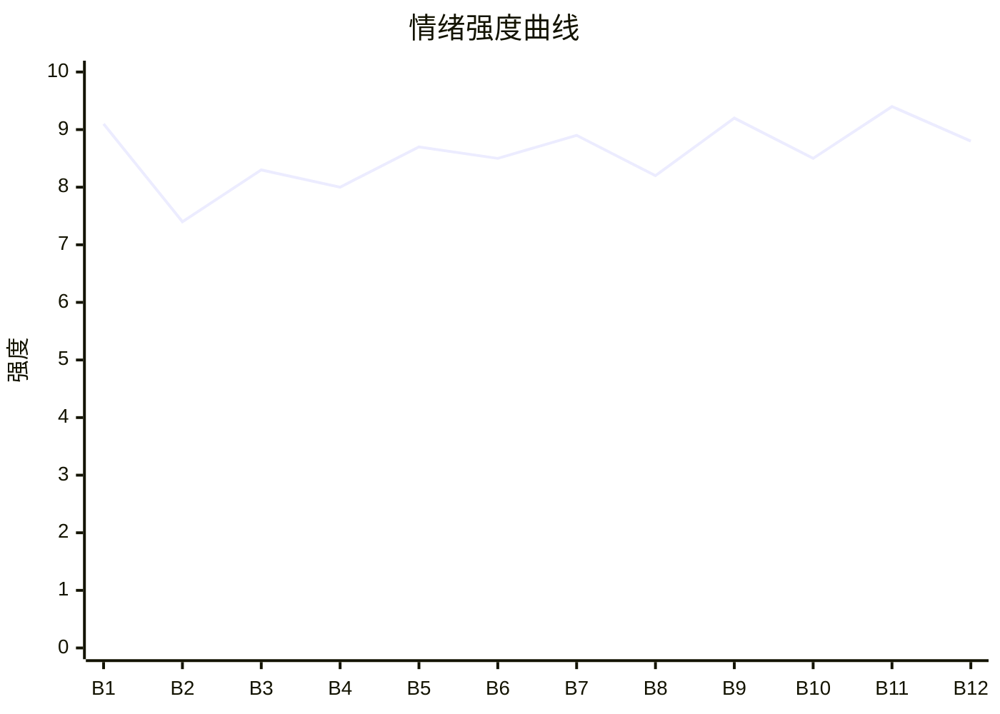

# Beat Sheet 节拍器

## 全文概况

- 总字数: 约 9300 字
- 节拍数: 12 幕
- 核心母题（Logline）: 一个被恋爱脑逆子用绝嗣逼迫的高龄主母，为保家族体面与香火，重新生子、断亲清算，最终得到孝顺幼子的补偿，逆子自毁而亡。
- 情绪模式: 极致打压 → 高龄重启 → 断亲反击 → 身份/继承反转 → 时间清算 → 温暖补偿

## 节拍详表

### Beat 1: 绝嗣逼宫与母亲重启 [开篇-01 前]
- **字数**: 约 520 字（占比 5.6%）
- **核心事件**: 唯一儿子端绝嗣药逼父母承认青楼女，母亲醒后决定自己再生。
- **情绪标签**: 震惊、愤怒、反击期待
- **情绪强度**: 9.1/10
- **情绪方向**: ⚡突变
- **冲突类型**: 大转折
- **悬念钩子**: 四十岁的母亲真能再生嫡子吗？
- **叙事速度**: 快
- **对话占比**: 55%
- **reversal_mechanism**: [M3, M6]
- **hook_strength**: 8.8/10
- **关键句**: “他不生，我生。”
- **原文摘录**: 花了我整整二十年心血养大的、唯一的儿子，跪在我面前，手里端着绝嗣药。“娘，这是我最后一次叫你娘。”我一巴掌打翻药碗，黑漆漆的药汁泼了一地。“你疯了？这是绝嗣药！”他笑了。“你们不是看重嫡子吗？”“不是嫌如烟出身青楼，说她生的孩子不配入族谱吗？”“那我就绝嗣。”“这辈子，我只爱如烟，只要她生的孩子。”“要嫡子？做梦！”说着，他从袖子里又掏出一碗，仰头一饮而尽。“爹，娘，你们这么想要嫡子，自己生啊！”我眼前一黑，直接栽倒在地。老爷冲进来的时候，我已经不省人事了。醒来后，我躺在榻上，盯着帐子顶看了一个时辰。然后坐起来，对老爷说：“他不生，我生。”

### Beat 2: 高龄怀胎与秘密防守 [01]
- **字数**: 约 760 字（占比 8.2%）
- **核心事件**: 沈夫人怀上身孕，老爷守护，砚秋携苏如烟上门索要别院与月银。
- **情绪标签**: 惊喜、紧张、憋屈
- **情绪强度**: 7.4/10
- **情绪方向**: ↑上升
- **冲突类型**: 微冲突
- **悬念钩子**: 求子符被苏如烟看见，怀孕秘密将被利用。
- **叙事速度**: 中
- **对话占比**: 42%
- **reversal_mechanism**: [M2, M6]
- **hook_strength**: null
- **关键句**: “我们沈家的三代家业，不是拿来养蛀虫的！”
- **原文摘录**: 我和老爷成亲二十年，生砚秋的时候伤了身子，大夫说我再难有孕。从那天起，府里的药就没断过。京城的妇科圣手请了七八个。来年开春，我吐得昏天黑地。郎中搭脉后说：“夫人，您这是喜脉。快三个月了。”老爷把衙门的事都推了，天天守在我房里。那天我正在喝安胎药，管家福叔跑进来：“夫人，少爷回来了！带着苏如烟，已经进了大门了！”我把安胎药碗藏到柜子里。砚秋进门就问西街别院和每月二百两银子为何收回。苏如烟帮腔说他是亲生独苗。砚秋威胁将来继承家业后是否给父母体面。我提醒他喝绝嗣药时没想着自己是沈家嫡长子，又拒绝还钱还宅，说三代家业不是养蛀虫的。苏如烟猛然瞥见压在桌上的求子符。

### Beat 3: 如烟煽风与逆子二次羞辱 [02]
- **字数**: 约 850 字（占比 9.1%）
- **核心事件**: 苏如烟借求子符挑事，砚秋再次用绝嗣辱骂父母，如烟以养老威胁。
- **情绪标签**: 屈辱、愤怒、心寒
- **情绪强度**: 8.3/10
- **情绪方向**: ↑上升
- **冲突类型**: 大转折
- **悬念钩子**: 父母确认儿子被拉不回，下一步会怎么处理？
- **叙事速度**: 快
- **对话占比**: 60%
- **reversal_mechanism**: [M3, M5]
- **hook_strength**: null
- **关键句**: “你们想要嫡子，下辈子吧！”
- **原文摘录**: 苏如烟委屈地问公婆是否还念着沈郎能生嫡子。砚秋腾地站起来，骂父母原来是打这个算盘，声称自己的孩子只会从如烟肚子里出来。他说自己已被逼得喝下绝嗣药，如今让她跟谁生，甚至混账地说“跟我爹吗”。他又说正妻只有如烟一个，父母想要嫡子下辈子吧，沈家的家业早晚是他的。苏如烟临走前红着眼威胁，说砚秋身边只剩她，父母再把他往外推，将来老了病了连端茶倒水的人都没有。老爷气得摔茶盏。我回想这些年给如烟弟弟安排差事、塞银子，意识到砚秋越来越混账与她脱不了干系。我和老爷对视，确认这个儿子怕是拉不回来了。

### Beat 4: 母亲最后心软与科考破灭 [03]
- **字数**: 约 920 字（占比 9.9%）
- **核心事件**: 母亲回忆养育二十年的心血，得知砚秋弃考，仍请神医补救，却被如烟打脸勒索。
- **情绪标签**: 心痛、失望、最后一丝母爱
- **情绪强度**: 8.0/10
- **情绪方向**: →平稳高压
- **冲突类型**: 微冲突
- **悬念钩子**: 只要肯回来，别院铺面可以商量，是否会被再次背刺？
- **叙事速度**: 中
- **对话占比**: 25%
- **reversal_mechanism**: [M5]
- **hook_strength**: null
- **关键句**: “十二年的寒窗，四位翰林的心血，就这么不考了？”
- **原文摘录**: 我回想苏如烟当初跪在府门口叫老夫人，如今攀上砚秋便翻脸。我的赤金步摇、老爷的汝窑茶盏，都被砚秋换成她给的廉价物件。三天里我托人去劝，苏如烟挡在门口，说砚秋身子不好不能见客，又让人传话要公婆自己来。我坐在椅子上摸着肚子，想到他三岁背《千字文》、五岁属对、七岁做破题，想到我们请翰林教他，盼他光耀门楣。老爷回来告诉我，学政大人说砚秋连乡试都没报名。我手里的佛珠断线。第二天我请神医圣手去给砚秋看，郎中却带着五个红指印回来，说苏姑娘让人把他轰出，还说真心疼儿子就把别院铺面还回来。我仍让福叔传话，只要砚秋肯回来，别院铺面可以商量。

### Beat 5: 最后谈判失败，族谱划名 [04 前半]
- **字数**: 约 960 字（占比 10.3%）
- **核心事件**: 砚秋以科考逼父母扶正如烟，母亲彻底断亲，命福叔划掉族谱。
- **情绪标签**: 决裂、清醒、痛快
- **情绪强度**: 8.7/10
- **情绪方向**: ⚡突变
- **冲突类型**: 大转折
- **悬念钩子**: 苏如烟笃定父母会心软，腹中孩子能否平安出生？
- **叙事速度**: 快
- **对话占比**: 58%
- **reversal_mechanism**: [M3, M6]
- **hook_strength**: null
- **关键句**: “从今天起，沈砚秋跟我沈家，再无瓜葛。”
- **原文摘录**: 砚秋总算回来了，但苏如烟也来了。他进门不行礼，一屁股坐下。我掩着显怀的肚子，请赵太医给他看诊。他讽刺说调理好了给父母生嫡子吗，又说心疼他就该接受如烟。老爷骂他为了青楼女子连科考都不参加。砚秋要求把如烟扶正、让她进族谱，他立马去考。苏如烟红眼要走，砚秋拉住她，说该走的是不认她的人。他撂话：如烟不做正妻，这辈子别想他去科考，并再次叫父母有本事再生一个去考。我闭眼吐气，命福叔去祠堂把他的名字从族谱上划掉。苏如烟回头笑，说我们就砚秋一个儿子，将来连摔盆的人都没有，我们会心软。两人上马车离去，我肚子剧痛，产婆被叫来。

### Beat 6: 小公子出生，旧筹码失效 [04 后半-05]
- **字数**: 约 810 字（占比 8.7%）
- **核心事件**: 三月后小儿子出生，砚秋上门等心软，被正式逐出沈家。
- **情绪标签**: 新生、释然、反转期待
- **情绪强度**: 8.5/10
- **情绪方向**: ↑上升
- **冲突类型**: 大转折
- **悬念钩子**: 砚秋不知道弟弟存在，下一次撞见会如何崩塌？
- **叙事速度**: 中
- **对话占比**: 24%
- **reversal_mechanism**: [M2, M6]
- **hook_strength**: null
- **关键句**: “沈家……有后了。”
- **原文摘录**: 三月后，一声啼哭划破沈府清晨。稳婆笑着说是个小公子。老爷接过孩子，手在抖，眼眶红了一圈，说沈家有后了。我虚弱地躺在产床上，看着皱巴巴的小脸，伸出一根手指，他立刻攥住。福叔进来，说少爷和苏姑娘又来了，说要谈谈，还说夫人肯定会心软。我低头看怀里找奶吃的儿子，再抬头时脸上没有表情，叫福叔告诉他们，从今往后沈家没有这个少爷。门外传来砚秋吼声，说这不可能，是气话。我没有再听，因为怀里的小家伙饿了。老爷坐在床沿上看着这一幕，眼泪掉下来。

### Beat 7: 逆子探病勒索，母亲彻底无泪 [05]
- **字数**: 约 880 字（占比 9.5%）
- **核心事件**: 砚秋闯入月子房，见母亲虚弱却以养老送终继续勒索。
- **情绪标签**: 厌恶、寒心、断爱
- **情绪强度**: 8.9/10
- **情绪方向**: ↓下降至谷底
- **冲突类型**: 微冲突
- **悬念钩子**: 母亲已没有眼泪，下一次反击会更硬。
- **叙事速度**: 快
- **对话占比**: 48%
- **reversal_mechanism**: [M5]
- **hook_strength**: null
- **关键句**: “我的手在抖。可我没掉一滴眼泪。因为不值得。”
- **原文摘录**: 坐月子的日子难熬，我年纪大，恢复得慢。砚秋每隔三五天传话，有时要别院，有时要铺面，有时直接要银子，每次都是“你们就我一个儿子，不给我给谁”。孩子快满两个月，砚秋带着酒气闯进来。他看见我瘦了，先问我怎么瘦成这样，我以为他担心，可他转而说我一把年纪折腾，把自己折腾成这样，又问我是不是快不行了。他说现在妥协还来得及，把别院、铺面还回来，让如烟进族谱，他还能给我养老送终；若继续犟，我病死了连摔盆的人都没有。老爷摔了药碗，骂他畜生。砚秋仍劝父亲过继一个，称两全其美。我看着这个十月怀胎、米糊喂大的长子，手在抖，却没掉一滴眼泪。我叫人把他请出去。

### Beat 8: 老鸨上门，供养链斩断 [06 前半]
- **字数**: 约 760 字（占比 8.2%）
- **核心事件**: 苏如烟带老鸨索五千两赎身银，母亲把人拖出府，并切断苏家利益链。
- **情绪标签**: 荒唐、痛快、掌控
- **情绪强度**: 8.2/10
- **情绪方向**: ↑上升
- **冲突类型**: 大转折
- **悬念钩子**: 供养链被断，砚秋会首次看见替代继承人。
- **叙事速度**: 快
- **对话占比**: 50%
- **reversal_mechanism**: [M3, M6]
- **hook_strength**: null
- **关键句**: “可她们不知道的是——我已经不需要砚秋了。”
- **原文摘录**: 又过一个月，苏如烟带着金妈妈上门。金妈妈大摇大摆坐在正厅，说如烟要嫁进沈家，赎身银得好好算，开价五千两。我问谁说要让她进沈家门。苏如烟红眼叫娘，我直接问谁是你娘。金妈妈说满京城都知道大少爷和如烟的事，我们不认账就是欺负人，又说我们就这一个儿子迟早低头。五千两让我差点气笑。当初赎她才一千两，如今坐地起价。她们算盘是沈家只有砚秋一个儿子，迟早要服软，可她们不知道我已经不需要砚秋了。我叫护院把两人拖出去。随后我把苏如烟弟弟从府衙除名，停了每月送去的银子。

### Beat 9: 弟弟曝光，身份坐标崩塌 [06 后半-07]
- **字数**: 约 900 字（占比 9.7%）
- **核心事件**: 砚秋闯门质问，看见母亲怀里的弟弟，继承人身份彻底崩塌。
- **情绪标签**: 爽、震惊、反差爆发
- **情绪强度**: 9.2/10
- **情绪方向**: ⚡突变
- **冲突类型**: 大转折
- **悬念钩子**: 砚秋不甘心，转向衙门、族里和舆论告状。
- **叙事速度**: 快
- **对话占比**: 36%
- **reversal_mechanism**: [M2, M3, M6]
- **hook_strength**: null
- **关键句**: “你弟弟。”
- **原文摘录**: 砚秋闯进来，质问为何断了苏家铺面，又问为何把他从族谱上划掉。话没说完，他看见我怀里的小孩儿，愣住了，问这是哪来的小孩。我没站起来，继续给小家伙擦脸，说：“你弟弟。”砚秋脸瞬间煞白，说不可能，问我都多大岁数了怎么可能生得出来。老爷端着鸡蛋羹进来，挡在我前面，说这是他亲弟弟，是我拼了命生下来的。砚秋说从哪儿抱来的野种，老爷一巴掌扇过去，警告他再说野种就打断腿。老爷细数我吃苦药扎针、躺大半年床、从鬼门关走一遭生下这个孩子。砚秋眼泪落下，问所以我们是真的不要他了。没人回答，只有小家伙咿呀。他转身离去，临走说我们会后悔。

### Beat 10: 告状失败与旧少爷坠落 [07 后半-08 前半]
- **字数**: 约 960 字（占比 10.3%）
- **核心事件**: 砚秋和如烟四处闹事、告状、卖惨，族老确认弟弟正统，砚秋被社会秩序排除。
- **情绪标签**: 解气、鄙夷、因果清算
- **情绪强度**: 8.5/10
- **情绪方向**: ↑上升
- **冲突类型**: 微冲突
- **悬念钩子**: 被剥夺资源后的砚秋与如烟会如何互相撕咬？
- **叙事速度**: 中
- **对话占比**: 20%
- **reversal_mechanism**: [M3, M6]
- **hook_strength**: null
- **关键句**: “可他不是嫡长子了。”
- **原文摘录**: 砚秋走后，苏如烟在沈府门口哭、骂、打滚，说我为老不尊。京城闲人议论我多大岁数还生，是跟大儿子抢家产，也有人说大少爷为青楼女子连科考都不去。砚秋到处告状，去衙门告我霸占家产，去族里告我偏心，去娘家哭诉，说我被妖人迷了心窍，要把家产给来历不明的野种。可衙门不是他开的，族老也不是瞎子。族长亲自看孩子、接生凭证和太医脉案，骂砚秋糊涂，那是亲弟弟，他娘为了生他差点没命，他还要告她。砚秋又告我们虐待嫡长子，可他不是嫡长子了，他的名字已从族谱划掉，老爷亲手划的。

### Beat 11: 砚庭成长，补偿线兑现 [08 后半-09 前半]
- **字数**: 约 1100 字（占比 11.8%）
- **核心事件**: 小儿子砚庭聪慧孝顺，秀才、举人、探花一路兑现沈家的香火与体面。
- **情绪标签**: 欣慰、补偿、扬眉吐气
- **情绪强度**: 9.4/10
- **情绪方向**: ↑上升至峰值
- **冲突类型**: 大转折
- **悬念钩子**: 砚庭荣耀加身后，砚秋将以何种姿态回头求母？
- **叙事速度**: 中快
- **对话占比**: 22%
- **reversal_mechanism**: [M2, M5, M6]
- **hook_strength**: null
- **关键句**: “娘，儿子没有辜负你的期望。”
- **原文摘录**: 苏如烟没了沈家的银子，弟弟差事没了，铺面收了，亲戚回老家，别院月钱都断了，砚秋又没挣过一文钱。他们搬到城南漏雨小院，天天吵钱。砚秋去码头扛包、铺子当伙计，最后说书抹黑沈家，被老掌柜当众揭穿，轰出茶馆。我的小儿子叫沈砚庭，三岁开蒙，五岁属对，七岁做破题，和哥哥小时候一样聪明，但他听话，知道谁对他好。老爷教到深夜，他会端茶说爹歇歇。十二岁中秀才，十六岁中举人，十九岁中贡士，殿试被钦点探花。跨马游街那天，他在茶楼下勒马下马，当着整条街、文武百官和观礼太监，单膝跪下朝我磕三个头，说儿子没有辜负我的期望。整条街喝彩，说沈探花孝顺，这才是真正的沈家少爷。

### Beat 12: 逆子冻死，暖屋收束 [09 后半-全文完]
- **字数**: 约 880 字（占比 9.5%）
- **核心事件**: 苏如烟卷款跑了，砚秋跪门求见未果，最终冻死无碑；砚庭奉汤陪母，屋内温暖收束。
- **情绪标签**: 冷清算、释然、温暖
- **情绪强度**: 8.8/10
- **情绪方向**: ↓回落留余味
- **冲突类型**: 大转折
- **悬念钩子**: 无，结局闭环。
- **叙事速度**: 慢
- **对话占比**: 14%
- **reversal_mechanism**: [M3, M5]
- **hook_strength**: null
- **关键句**: “不是因为狠心。是因为——我们早就没有这个儿子了。”
- **原文摘录**: 砚庭中探花的消息传遍京城时，砚秋已不再是沈家大少爷。苏如烟跑了，卷走他最后一点值钱家当，跟布商跑了。他开始往沈府门口跑，跪在石狮子旁，从早跪到晚，求娘见一面，说知道错了，想弟弟了。我没见，不值得。后来他回棺材铺守夜，冬天因喝酒误事被辞，去过破庙和土地庙，最后不知去了哪儿。有人看见他在城门口躺着，冻得缩成一团，身边破碗空空。我叹口气关窗。砚庭端热汤进来，说放了党参补气。他眼睛清亮，没有贪婪算计，靠在我肩上说会一直孝顺我。窗外雪下着，屋子暖烘烘。后来听说砚秋冻死，薄棺埋在乱葬岗，坟头无碑。我和老爷都没去送葬。不是狠心，是因为我们早就没有这个儿子了。

## 情绪曲线可视化

## 节拍密度检测

- 平均每 775 字一个节拍
- 微冲突密度: 每 1550 字一次
- 大转折密度: 每 930 字一次
- 判定: 符合高频节拍器标准

## 反转机制清单(Reversal Mechanisms)

从 prompts/patterns/reversal-mechanisms.md 的 8 大机制中命中以下机制:

| 机制 ID | 机制名 | 承载 Beat | 关键段落/金句 | 等价改编提示 |
|--------|--------|-----------|--------------|-------------|
| M2 | 身份反差爆发 | Beat 6, Beat 9, Beat 11 | “你弟弟。” / “这才是真正的沈家少爷！” | 隐藏或未被承认的继承人/身份牌必须在中后段一次砸出，且前期傲慢要足。 |
| M3 | 因果回旋反讽 | Beat 1, Beat 5, Beat 8, Beat 12 | “你们这么想要嫡子，自己生啊！” → “他不生，我生。” | 施害者的规则必须被主角原样反身应用，结尾要保留回旋判词。 |
| M5 | 温度反转曲线 | Beat 4, Beat 7, Beat 11, Beat 12 | “他是我的长子。” → “因为不值得。” → “屋子里，暖烘烘的。” | 必须有曾经疼爱、最后无泪、另一个人补偿三段温度变化。 |
| M6 | 多层递进反转 | Beat 1, Beat 5, Beat 9, Beat 11 | 再生决定 → 划族谱 → 弟弟曝光 → 探花叩母 | 层数不能少：动作反击、身份反转、宗族确认、价值补偿依次升维。 |
