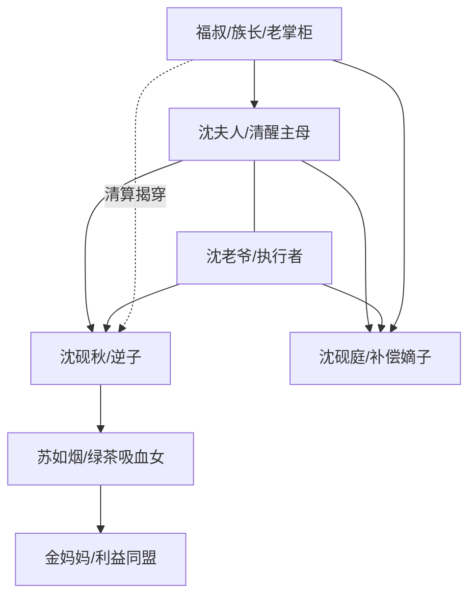

# 角色标签图谱

## 角色清单

### 沈夫人/“我” — 清醒主母
- 叙事功能: 第一视角主角，承受逆子压迫并完成家族秩序重建。
- 核心标签: 清醒、能忍、断得下手
- 弧光: 疼爱长子 → 最后挽救 → 划族谱断亲 → 得幼子补偿
- 台词风格: 短、稳、裁决感强
- 关键行为: 打翻绝嗣药、决定再生、划掉族谱、切断苏家供养、拒见砚秋
- 读者情绪关系: 让读者心疼并期待她反击成功

### 沈砚秋 — 恋爱脑逆子
- 叙事功能: 核心施害者和自毁样本。
- 核心标签: 忤逆、愚蠢、被拿捏
- 弧光: 唯一嫡长子 → 绝嗣逼宫 → 被划族谱 → 落魄冻死
- 台词风格: 质问、威胁、反复强调“你们就我一个儿子”
- 关键行为: 喝绝嗣药、弃考、勒索家产、诬告父母、跪门求见
- 读者情绪关系: 前期招恨，后期自作自受带来清算爽感

### 苏如烟 — 青楼绿茶/吸血女
- 叙事功能: 持续煽动砚秋，放大逆子的愚蠢。
- 核心标签: 有恃无恐、贪婪、会装可怜
- 弧光: 被砚秋捧着 → 逼沈家低头 → 失去供养 → 卷款逃跑
- 台词风格: 软中带刺，句句以养老与独苗威胁
- 关键行为: 挡郎中、索要别院铺面、带老鸨上门、卷走家当
- 读者情绪关系: 强恨点，负责让读者期待她被赶出利益链

### 沈老爷 — 家族秩序执行者
- 叙事功能: 代表父权与宗族执行力，为沈夫人的裁决落地。
- 核心标签: 护妻、重家业、有底线
- 弧光: 气到发抖 → 共同断亲 → 教养幼子 → 分享荣耀
- 台词风格: 怒斥式，少量温情
- 关键行为: 守孕妻、划族谱、扇砚秋、教砚庭
- 读者情绪关系: 提供安全感与执行爽感

### 沈砚庭 — 补偿型嫡子/孝顺神童
- 叙事功能: 偿还前文“香火、科考、孝道、体面”所有情绪债。
- 核心标签: 聪慧、孝顺、正统
- 弧光: 高龄得子 → 聪慧开蒙 → 探花及第 → 奉养母亲
- 台词风格: 温顺、真诚、少而有力
- 关键行为: 端茶、捶腿、挂匾、游街叩母、奉汤
- 读者情绪关系: 让读者获得补偿、暖意和扬眉吐气

### 福叔/族长/老掌柜 — 公共秩序见证者
- 叙事功能: 证明主角反击不是私怨，而被家族和社会秩序认可。
- 核心标签: 忠仆、公正、旁证
- 弧光: 传话执行 → 见证断亲 → 帮助清算谣言
- 台词风格: 简洁、实用
- 关键行为: 传话、划名执行、族长验明弟弟身份、老掌柜揭穿砚秋
- 读者情绪关系: 增强清算正当性

## 关系网络

## 角色功能对照表（供改编参考）

| 原角色 | 极致标签 | 叙事功能 | 读者情绪功能 | 改编时必须保留的 |
|--------|---------|---------|-------------|---------------|
| 沈夫人 | 清醒主母 | 承压与裁决 | 心疼、爽 | 前期仍救儿，后期才断亲 |
| 沈砚秋 | 恋爱脑逆子 | 种因自毁 | 恨、解气 | 绝嗣/断继承威胁必须极端 |
| 苏如烟 | 青楼绿茶 | 煽动与吸血 | 恨 | 装可怜和利益勒索并存 |
| 沈老爷 | 家族执行者 | 落地断亲 | 安全感 | 划族谱、护妻护幼子 |
| 沈砚庭 | 孝顺神童 | 偿债补偿 | 暖、扬眉吐气 | 具体孝顺行为与科考荣耀 |
