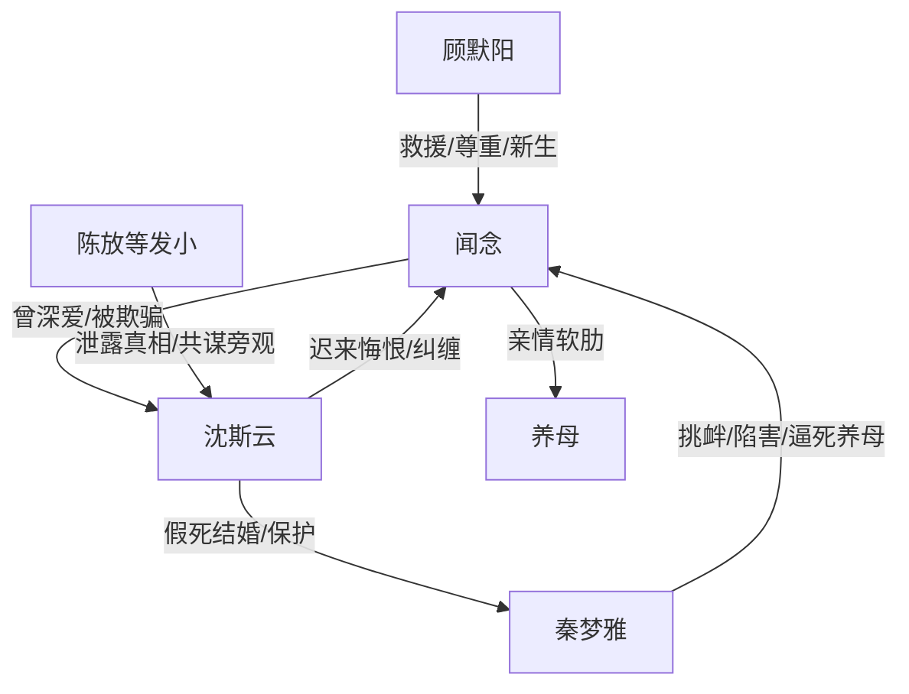

# 角色标签图谱

## 角色清单

### 闻念 — 清醒复生型受害大女主
- 叙事功能: 情绪债承受者、真相引爆者、新生完成者。
- 核心标签: 守墓六年、被污名化、彻底不回头。
- 弧光: 愧疚守旧爱 → 被真相击碎 → 以命澄清 → 平静新生。
- 台词风格: 前期质问，中期被迫克制，后期冷淡拒绝。
- 关键行为: 找上门、录道歉视频、跳江前定时发布证据、拒绝沈斯云。
- 读者情绪关系: 心疼、替她憋屈、期待她被补偿。

### 沈斯云 — 假死渣男/迟来悔疯者
- 叙事功能: 核心施害者、温度反转对象、追妻火葬场承载者。
- 核心标签: 假死、护小三、用软肋威胁。
- 弧光: 自私享乐 → 冷酷压迫 → 真相后悔疯 → 坠江死亡。
- 台词风格: 前期责备与威胁，后期乞求和自欺。
- 关键行为: 假死结婚、逼闻念道歉、威胁养母、清算秦梦雅、疯狂找闻念。
- 读者情绪关系: 恨、期待悔恨、拒绝原谅。

### 秦梦雅 — 恶毒小三/自作自受者
- 叙事功能: 直接挑衅者、二级反派、推动养母死亡的执行者。
- 核心标签: 小三上位、装柔弱、恶毒挑衅。
- 弧光: 被保护的妻子 → 恶行暴露 → 被离婚入狱 → 坠江死亡。
- 台词风格: 前期白莲道歉，后期癫狂承认。
- 关键行为: 发纪念帖、假装怀孕受刺激、买媒体、刺激养母、收买心源。
- 读者情绪关系: 强恨点、期待报应。

### 顾默阳 — 尊重型救赎男二/新人生承接者
- 叙事功能: 救回女主，提供安全关系，证明女主值得被爱。
- 核心标签: 尊重、稳定、托举。
- 弧光: 相亲对象 → 救命人 → 伴侣。
- 台词风格: 温和克制，不施压。
- 关键行为: 救下闻念、照顾她、带她离开旧城、求婚。
- 读者情绪关系: 安慰、补偿、踏实。

### 养母 — 无条件爱与软肋
- 叙事功能: 女主唯一亲情锚点，情绪债最大来源。
- 核心标签: 捡废品养女、病危、被害。
- 弧光: 回忆中的温暖 → 被威胁的软肋 → 死亡触底。
- 台词风格: 原文少台词，以回忆和物件承载。
- 关键行为: 收养闻念，被秦梦雅刺激后发病。
- 读者情绪关系: 心疼、愤怒、要求重罚反派。

### 陈放/发小群 — 真相泄露工具人
- 叙事功能: 暴露假死真相，证明沈斯云朋友圈共谋。
- 核心标签: 知情、冷漠、帮凶。
- 弧光: 八卦嘲讽 → 被撞破沉默。
- 台词风格: 口无遮拦。
- 关键行为: 说出六年前事故真相。
- 读者情绪关系: 厌恶、辅助恨沈斯云。

## 关系网络

## 角色功能对照表（供改编参考）

| 原角色 | 极致标签 | 叙事功能 | 读者情绪功能 | 改编时必须保留的 |
|--------|---------|---------|-------------|---------------|
| 闻念 | 清醒复生型受害大女主 | 承债与新生 | 心疼、爽、释然 | 最后彻底不回头 |
| 沈斯云 | 假死渣男 | 主施害者 | 恨、看他悔疯 | 曾经温柔 + 后期冷酷 + 迟来悔恨 |
| 秦梦雅 | 恶毒小三 | 直接作恶者 | 强恨点 | 白莲伪装与恶毒实锤 |
| 顾默阳 | 救赎男二 | 补偿关系 | 安全感 | 尊重边界，不逼迫 |
| 养母 | 亲情软肋 | 触底事件 | 心疼、愤怒 | 死亡必须推动反杀 |
