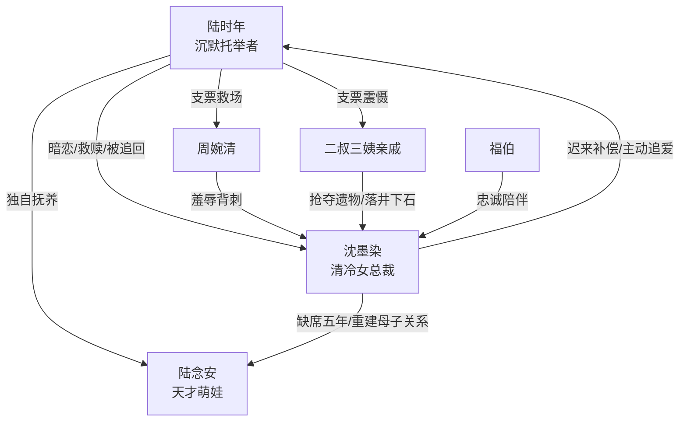

# 角色标签图谱

## 角色清单

### 陆时年 — 沉默托举型老实男主
- 叙事功能: 救赎发起者、情绪债偿还者、家庭归宿承载者。
- 核心标签: 暗恋十年、中彩票隐富、守约克制。
- 弧光: 自卑旁观者 → 有能力托举者 → 主动放手的父亲 → 被女主追回的家人。
- 台词风格: 短、笨、怂中带真诚。
- 关键行为: 两千万救场、夜里送牛奶、学做酸辣汤、带娃离开、卖蛋炒饭。
- 读者情绪关系: 心疼、认可、代入“真诚终有回响”的补偿爽。

### 沈墨染 — 破产千金到千亿女总裁的清冷回追女主
- 叙事功能: 女神对象、被救赎者、后半主动追爱者。
- 核心标签: 骄傲、强能力、迟来的深情。
- 弧光: 锦城名媛 → 破产孤女 → 创业女王 → 放下骄傲追夫。
- 台词风格: 清冷、直接、压迫感强；破防后变温柔。
- 关键行为: 签合约、重建公司、找男主五年、夜市空降、双倍还钱、留下卖炒饭。
- 读者情绪关系: 前期心疼，后期爽与甜，最终认可她配得上男主。

### 陆念安 — 天才萌娃/家庭破冰器
- 叙事功能: 五年缺席的情绪债显影器，母子破冰催化剂。
- 核心标签: 护爸、天才、缺母。
- 弧光: 不认识妈妈的小孩 → 误把妈妈当坏女人 → 原谅妈妈 → 家庭纽带。
- 台词风格: 稚嫩直接，有喜剧感。
- 关键行为: 挡在爸爸面前、质问妈妈为什么现在才来、要求保镖退开。
- 读者情绪关系: 心疼与萌感并行，放大父母错过的痛。

### 周婉清 — 落井下石的塑料闺蜜
- 叙事功能: 前期羞辱反派，制造女主落魄低谷。
- 核心标签: 嫉妒、虚伪、势利。
- 弧光: 假闺蜜 → 当众撕破脸 → 被男主支票震慑。
- 台词风格: 刻薄、炫耀、羞辱性强。
- 关键行为: 带赵总上门讥讽，索要八十万，扇沈墨染巴掌。
- 读者情绪关系: 激发恨意，服务救场爽点。

### 二叔/三姨等亲戚 — 家族吸血鬼
- 叙事功能: 群体压迫，放大“全世界抛弃她”的处境。
- 核心标签: 贪婪、短视、无情。
- 弧光: 抢遗物 → 羞辱沈墨染 → 被支票震住。
- 台词风格: 市侩、粗暴、强词夺理。
- 关键行为: 抢花瓶、抢镯子、骂丧门星。
- 读者情绪关系: 制造憋屈，等待男主打脸。

### 福伯 — 旧秩序忠诚见证人
- 叙事功能: 接住支票用途，证明女主不是贪钱而是救父与善后。
- 核心标签: 忠诚、老派、沉默。
- 弧光: 陪伴沈家低谷 → 见证资金救急。
- 台词风格: 几乎无台词。
- 关键行为: 去交医药费和遣散费。
- 读者情绪关系: 增加沈墨染落魄的可信度。

## 关系网络

## 角色功能对照表（供改编参考）

| 原角色 | 极致标签 | 叙事功能 | 读者情绪功能 | 改编时必须保留的 |
|--------|---------|---------|-------------|---------------|
| 陆时年 | 沉默托举型男主 | 金钱救场+长期照顾+主动放手 | 心疼、认同、补偿爽 | 有钱但克制，爱靠动作不靠嘴 |
| 沈墨染 | 清冷回追女总裁 | 从被救到反向追夫 | 心疼、惊艳、甜爽 | 骄傲、强能力、后期主动低头 |
| 陆念安 | 护爸天才萌娃 | 母子破冰和家庭钩子 | 萌、心酸、催泪 | 质问妈妈缺席，维护爸爸 |
| 周婉清 | 塑料闺蜜 | 落井下石 | 恨点 | 当众羞辱必须够具体 |
| 亲戚群 | 吸血亲族 | 群体压迫 | 憋屈 | 抢遗物/抢钱/道德辱骂 |
