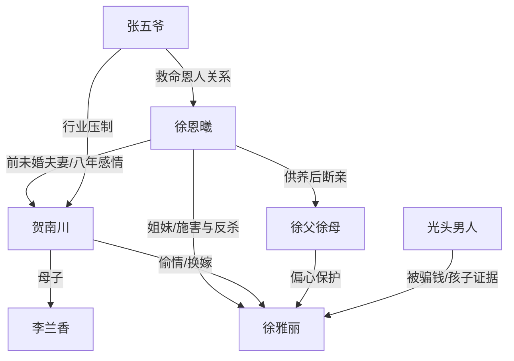

# 角色标签图谱

## 角色清单

### 徐恩曦 — 清醒赚钱大女主
- 叙事功能: 第一人称复仇核心，承受污名并完成公开反杀。
- 核心标签: 能赚钱、冷静、边界清晰
- 弧光: 前世被污名致死 → 重生后切断亲情爱情并掌控清算
- 台词风格: 短句反问，冷淡砸脸
- 关键行为: 抢话筒、撕结婚证、叫张五爷、放监控、赶父母、反追花销
- 读者情绪关系: 心疼转爽，读者期待她不要原谅任何人

### 徐雅丽 — 装嫩绿茶巨婴
- 叙事功能: 主要施害者，用“好奇宝宝”伪装制造污名。
- 核心标签: 装纯、贪婪、谎话精
- 弧光: 众人眼里的纯真妹妹 → 会所小姐/诈骗犯/三个孩子的妈
- 台词风格: “宝宝”语、夹子音、装无辜
- 关键行为: 婚礼污蔑、偷拍视频、勾引贺南川、骗钱跑路
- 读者情绪关系: 强恨点，读者等待她人设崩塌

### 贺南川 — 妈宝出轨渣男
- 叙事功能: 爱情线背叛者，负责制造女主八年感情破产。
- 核心标签: 浅薄、虚伪、见色忘义
- 弧光: 新郎/继承人 → 跪地求饶/破产染病
- 台词风格: 先道德审判，后卑微求饶
- 关键行为: 相信妹妹、公开亲吻徐雅丽、偷情、追讨恋爱花销
- 读者情绪关系: 恨与鄙夷，后期跪地提供爽点

### 李兰香 — 势利恶婆婆
- 叙事功能: 婆家压迫与羞辱的代表。
- 核心标签: 势利、护短、刻薄
- 弧光: 掀桌退婚的强势婆婆 → 洗盘子救儿子的底层母亲
- 台词风格: 脏话羞辱、钱财索赔
- 关键行为: 打女主、索彩礼、同意换嫁、拔监控电源
- 读者情绪关系: 恨点，后期落魄偿还羞辱债

### 徐父徐母 — 偏心吸血父母
- 叙事功能: 原生家庭背叛核心，证明女主被集体牺牲。
- 核心标签: 偏心、吸血、道德绑架
- 弧光: 享受女主供养 → 被赶出别墅、为妹妹一家打工
- 台词风格: “让着妹妹”“我们欠她”
- 关键行为: 维护妹妹、推动换嫁、故意支开女主、索要五百万
- 读者情绪关系: 心寒与愤怒，读者希望女主断供

### 张魁/张五爷 — 外部权力锤
- 叙事功能: 身份反差与降维清算工具，证明女主资源强。
- 核心标签: 道上大佬、行业资源、恩义分明
- 弧光: 外部闯入者 → 女主救命恩人的见证者
- 台词风格: 粗口、直接、压迫感强
- 关键行为: 带人入场、打贺南川、封杀贺家
- 读者情绪关系: 爽点放大器

### 光头男人 — 妹妹黑历史证人
- 叙事功能: 揭开徐雅丽过去与诈骗事实。
- 核心标签: 被骗者、粗暴证人、证据持有人
- 弧光: 门口闯入者 → 证据链关键节点
- 台词风格: 粗俗直白
- 关键行为: 出示手术同意书、带孩子、拿亲子鉴定、报警
- 读者情绪关系: 工具型爽点

## 关系网络

## 角色功能对照表（供改编参考）

| 原角色 | 极致标签 | 叙事功能 | 读者情绪功能 | 改编时必须保留的 |
|--------|---------|---------|-------------|---------------|
| 徐恩曦 | 清醒大女主 | 反杀执行者 | 心疼、爽 | 冷静、不原谅、证据控场 |
| 徐雅丽 | 装嫩绿茶巨婴 | 污名源头 | 恨、恶心 | 人设伪装与真实身份极端反差 |
| 贺南川 | 出轨渣男 | 爱情背叛 | 恨、鄙夷 | 先羞辱女主，后跪求 |
| 李兰香 | 恶婆婆 | 公众羞辱 | 憋屈、爽 | 打脸与落魄回收 |
| 徐父徐母 | 偏心父母 | 亲情背叛 | 心寒 | “欠她但不欠我”的伦理冲突 |
| 张五爷 | 权力外援 | 资源反差 | 爽 | 对女主尊敬，压垮渣男家 |
| 光头男人 | 黑史证人 | 证据引爆 | 爽、荒诞 | 手术/孩子/诈骗证据链 |
